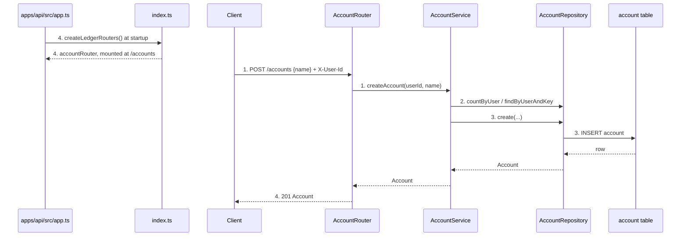
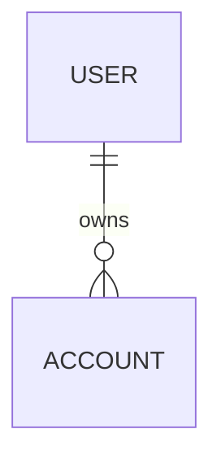

# Account Management

**Approved**: 2026-11-11 - user: "Plan is approved"

## Problem

Capital Care has no way to record the different ways the user pays (for example "Money", "Bank A account", "Credit Card from institution C"). Every Transaction must be linked to exactly one Account, so Transactions cannot be specified or built until Accounts exist; building them first would mean using a stand-in account and doing that work twice. Today the user keeps these accounts in another finance app. The source gives no usage numbers: nothing is measured, and the capability does not exist yet ([`.prd/account-management.md`](../../../.prd/account-management.md)).

When this ships, the user can create, rename, delete and list their accounts as a flat list, up to a system-defined limit (5 in development, 99 in production), and Transactions can be built on top of it.

## Shape

This reuses the `category` aggregate's layering (controller → service → repository), the `user`-scoped `X-User-Id` header, the shared error classes and the existing `config.ts`; it does not copy Category's validation rules (see Assumptions). The rules that change an outcome (name rules, case-insensitive uniqueness, the account limit, alphabetical order) run in `AccountService` and the Zod schemas in `account.dto.ts`, which the unit tests reach with an in-memory repository mock ([testing.md](../../../docs/tech/definitions/testing.md)).

1. `POST /accounts`, `GET /accounts`, `PATCH /accounts/:id`, `DELETE /accounts/:id` with `X-User-Id` -> `AccountRouter` (door 3) - reads the user id (401 if absent), validates the body with the Zod schema, calls the service
2. `AccountService` (new) - normalizes and validates the name, checks the name is free for this user (case-insensitive), on create counts the user's accounts against the limit from `getLedgerConfig()` (exists, gains `accountLimit`), throws `ValidationError` / `ConflictError` / `NotFoundError`
3. `AccountRepository` (new) - persists and reads `account` rows, maps row ↔ domain `Account`, lists ordered alphabetically ignoring case (door 1)
4. out: `Account` JSON (ISO 8601 UTC timestamps), `{ accounts: [...] }`, or `204`; `createLedgerRouters()` in `index.ts` (exists) builds and returns `accountRouter`, and `apps/api/src/app.ts` (exists) mounts it at `/accounts`

**Changes underneath**

| Front | What changes |
| --- | --- |
| domain | `Account` is a new entity in the Ledger bounded context; no existing term changes meaning |
| config | `LedgerConfig` gains the account limit, read from the environment at startup; `.env.example` and `docker-compose.dev.yml` set it to 5, production leaves it unset and gets 99 (door 2) |
| stored data | new `account` table via a generated migration; nothing to backfill, nothing existing is touched |
| readers | none yet; the future Transaction aggregate will read accounts through `AccountService` only, per the aggregate boundary rule |

New: `Account` entity and the `User` → `Account` ownership by `userId`. One-way constraints: `(userId, nameKey)` unique (door 1).

## Surface

| Route | In | Out | Status | Who |
| --- | --- | --- | --- | --- |
| `POST /accounts` | `{ name: string }` | `Account` | `201`; `400` ValidationError; `409` ConflictError (name taken, limit reached); `401` | current user only; no `X-User-Id` gets `401` |
| `GET /accounts` | none | `{ accounts: Account[] }` | `200`; `401` | current user only |
| `PATCH /accounts/:id` | `{ name: string }` | `Account` | `200`; `400`; `404`; `409` (name taken); `401` | current user only; another user's account gets `404` |
| `DELETE /accounts/:id` | none | empty | `204`; `404`; `401` | current user only; another user's account gets `404` |

`Account` is `{ id, userId, name, createdAt, updatedAt }`. Error bodies are `{ type, detail }`, the shape the Category routes return today. Unknown request fields are ignored ([api.md](../../../docs/tech/definitions/api.md#validation)).

## Landing

| One-way door | Literal shape | Alternative rejected |
| --- | --- | --- |
| Case-insensitive name uniqueness in the stored data | table `account` (`accountTable`) with `nameKey` = the name lowercased (Unicode-aware), and a unique index `account_userId_nameKey_unique` on `(userId, nameKey)`; `name` keeps the user's own casing | a `COLLATE NOCASE` index on `name` - SQLite folds only ASCII, so "Poupança" and "POUPANÇA" would both be accepted, breaking the Unicode-letters decision |
| The account limit as a system setting | environment variable `ACCOUNT_LIMIT`, a whole number ≥ 1, unset means 99; a set but invalid value (`0`, `-1`, `2.5`, `abc`) stops startup with an error naming the variable | a constant in code - testing the limit would need 99 accounts; a per-user stored limit - the PRD says the user never sets it; refusing to start when unset - a missing value could take the API down |
| Table and route naming | `account/account.entity.ts` exports `accountTable` → SQL `account`; router mounted at `/accounts` | a shared or generic table name - violates the one-table-one-owner rule in [database.md](../../../docs/tech/definitions/database.md#entity--table-naming-state-isolation) |

- Nothing else in this change is hard to reverse

## Criteria

### S1: Create, list and rename accounts (P1)

The user can build and see a flat list of accounts, in alphabetical order, and rename any of them.

**Acceptance Criteria**

1. WHEN a user POSTs `{ "name": "Bank A account" }` to `/accounts` THEN the system SHALL return `201` with `{ id (UUID), userId, name: "Bank A account", createdAt, updatedAt }`, timestamps as ISO 8601 UTC strings
   - `"Money"` → `201`; `"Credit Card from institution C"` → `201`
2. WHEN a user GETs `/accounts` and has no accounts THEN the system SHALL return `200` with `{ "accounts": [] }`
3. WHEN a user GETs `/accounts` THEN the system SHALL return all of that user's accounts, and only theirs, ordered alphabetically by name ignoring case
   - `"cash"`, `"Bank A"`, `"credit card"`, `"Bank B"` → `Bank A`, `Bank B`, `cash`, `credit card`
4. WHEN a user PATCHes `/accounts/:id` with a valid, free name THEN the system SHALL return `200` with the account carrying the new name and a new `updatedAt`, and `id`, `userId` and `createdAt` unchanged
5. WHEN a user PATCHes an account with its own current name THEN the system SHALL return `200`
   - `"Cash"` → `"Cash"` → `200`; `"cash"` → `"Cash"` on the same account → `200`, name now `"Cash"`
6. IF a PATCH body has no `name`, or an empty one, THEN the system SHALL return `400` ValidationError and leave the account unchanged
   - `{}` → `400`; `{ "name": "" }` → `400`

### S2: Account name rules

A name is 1 to 30 characters: letters of any language, digits and spaces.

**Acceptance Criteria**

1. IF a name is missing, empty, or only spaces THEN POST and PATCH SHALL return `400` ValidationError naming the rule, and nothing is saved
   - no `name` → `400`; `""` → `400`; `"   "` → `400`
2. IF a name is longer than 30 characters THEN POST and PATCH SHALL return `400` ValidationError naming the maximum
   - 30 characters → accepted; 31 characters → `400`
3. IF a name contains a character that is not a letter, digit or space THEN POST and PATCH SHALL return `400` ValidationError naming the allowed characters
   - `"Bank-A"` → `400`; `"Card #2"` → `400`; `"Money 💰"` → `400`; `"Conta Poupança"` → accepted; `"Cartão 2"` → accepted
4. WHEN a name has leading or trailing spaces THEN the system SHALL trim them before validating and saving
   - `"  Cash  "` → saved as `"Cash"`; the 30-character limit applies after trimming

### S3: Names are unique per user, ignoring case

**Acceptance Criteria**

1. IF a user creates an account whose name matches one of their own, ignoring case, THEN the system SHALL return `409` ConflictError saying the name is taken, and nothing is saved
   - `"Cash"` then `"cash"` → `409`; `"Poupança"` then `"POUPANÇA"` → `409`; `"Cash"` then `"Cash 2"` → `201`
2. IF a user renames an account to a name that another of their accounts has, ignoring case, THEN the system SHALL return `409` ConflictError and leave both accounts unchanged
3. WHEN two different users each create an account named `"Cash"` THEN both SHALL get `201`
4. WHEN an account is deleted THEN its name SHALL be free for the same user again
   - create `"Cash"`, delete it, create `"Cash"` → `201`

### S4: The account limit is a system setting

**Acceptance Criteria**

1. WHEN the limit is 5 and a user has fewer than 5 accounts THEN POST SHALL succeed; WHEN the user already has 5 THEN POST SHALL return `409` ConflictError with a `detail` that states the limit (`5`), and nothing is saved
   - 4 accounts, create → `201`; 5 accounts, create → `409` mentioning `5`
2. WHEN a user at the limit deletes an account THEN the next create SHALL succeed
3. WHEN two users each have 5 accounts THEN the limit SHALL apply to each user separately: a third user with 0 accounts can still create
4. IF the limit is lowered below the number of accounts a user already has THEN the system SHALL keep every existing account, list them all, and reject creating new ones until the count is below the limit
   - limit 5, user has 7 → list returns 7; create → `409`; after deleting down to 4, create → `201`
5. WHILE `ACCOUNT_LIMIT` is unset, the system SHALL use a limit of 99; WHEN it is set to a whole number ≥ 1 the system SHALL use that number
   - unset → 99; `"5"` → 5; `"1"` → 1; `"99"` → 99
6. IF `ACCOUNT_LIMIT` is set to anything other than a whole number ≥ 1 THEN the system SHALL fail at startup with an error that names `ACCOUNT_LIMIT`
   - `"0"` → fail; `"-3"` → fail; `"2.5"` → fail; `"abc"` → fail; `""` → fail
7. WHERE the development environment is used (`.env.example`, `docker-compose.dev.yml`) the limit SHALL be 5; the production compose file SHALL not set it
8. IF a request body contains a limit field THEN the system SHALL ignore it; no endpoint reads or changes the limit

### S5: Delete accounts and ownership

**Acceptance Criteria**

1. WHEN a user DELETEs `/accounts/:id` for an account they own THEN the system SHALL return `204`, remove it permanently, and it SHALL not appear in the list
2. IF a user PATCHes or DELETEs an account id that does not exist THEN the system SHALL return `404` NotFoundError and change nothing
3. IF a user PATCHes or DELETEs an account that belongs to another user THEN the system SHALL return `404` NotFoundError (not `403`) and change nothing
4. IF a request to any `/accounts` route has no `X-User-Id` header THEN the system SHALL return `401`

## Out of scope

| Excluded | Why |
| --- | --- |
| Transactions and any rule involving them (such as deleting an account a Transaction uses) | Transactions do not exist yet; each rule is specified in that phase |
| `GET /accounts/:id` | not in the PRD's In list; the service can still look up one account for its own use and for the future Transaction aggregate |
| Child accounts, account types, balance, currency | PRD Out: accounts are a flat list with a name only |
| Archiving or soft delete | PRD: delete is hard |
| User-facing control of the limit, and any API to read or change it | PRD: the limit belongs to the system, not the user |
| How the limit is delivered in other environments (config files, orchestrator variables) | not discussed yet; this feature reads one environment variable and nothing else |
| Web site and delete confirmation | PRD open question, discussed when the web phase starts |
| Sorting options and pagination on the list | PRD says alphabetical only; at most 99 accounts per user |
| Multiple users sharing accounts | PRD: personal single-user use; accounts are still stored per user, as Category is |

## Assumptions

| Assumption | Chosen default | Rationale | Confirmed? |
| --- | --- | --- | --- |
| "Letters" in names | any Unicode letter, digits and space | the user chose Unicode letters when asked | y |
| Limit when `ACCOUNT_LIMIT` is unset | 99; an invalid set value stops startup | the user chose "Use 99" when asked | y |
| Name rules and the 30-character bound | exactly the PRD's rules (1-30 characters, letters, digits, spaces, unique ignoring case) | the user confirmed "same as category", and the PRD journey spells the rules out | y |
| Lowered limit | existing accounts kept, new ones rejected until under the limit | the user agreed, and it is a Journey row in the PRD | y |
| Account does not reuse Category's current code for name rules | Account implements the PRD rules; Category's code today allows 255 characters, any characters and case-sensitive names | the PRD and the Category code disagree, and the Account PRD is the binding source | n |
| Accounts are stored and limited per user, like Category | `userId` on each account; the limit and uniqueness apply per user | follows the existing `X-User-Id` pattern; with one real user it behaves as one global list | n |
| Status for "limit reached" and "name taken" | `409` ConflictError for both; name rule violations are `400` | `409` is a conflict with current state, matching how Category reports duplicates; `400` matches Category's validation responses | n |
| PATCH needs a `name` | `{}` or an empty name is `400`, not a no-op | the only editable field is the name, so there is nothing else to update | n |
| Names are trimmed | leading and trailing spaces removed before validation and saving | a name that looks the same must not be a different one | n |
| Case-insensitive alphabetical order | `"bank"` sorts with `"Bank"`, not after `"Zed"` | the user sees names, not byte order | n |
| Alphabetical order for accented letters | letters sort by their base letter, ignoring case and accents: `"Ágata"` sorts between `"Abc"` and `"Bank"` | the user chose Unicode letters, so "alphabetical" must work for them | n |
| Limit check is not racy | the count and the insert run in one synchronous step in a single process, so two requests cannot both pass the check | the repository driver is synchronous and the service has no `await` between them | n |
| Error body shape | `{ type, detail }` as the Category routes return, not full RFC 7807 | consistency with the code that exists today | n |

**Open questions:** none - all resolved or logged above.

## Differences from the source

None - the product matches the source; the source is a PRD, not a capture.

## Sources

- [`.prd/account-management.md`](../../../.prd/account-management.md) - binding - confirmed 2026-11-11; scope, name rules, limit, lowered-limit behaviour and journey states
- [`docs/tech/definitions/`](../../../docs/tech/definitions/) - binding - architecture, database, API and testing conventions
- `modules/ledger/src/category/` - precedent - layering, routes and error shape to reuse
