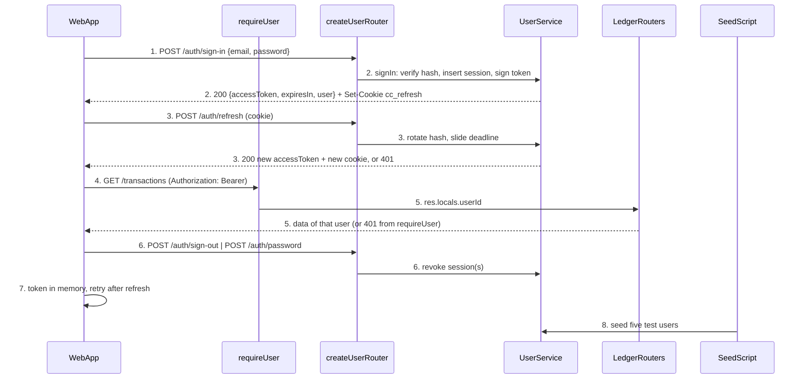
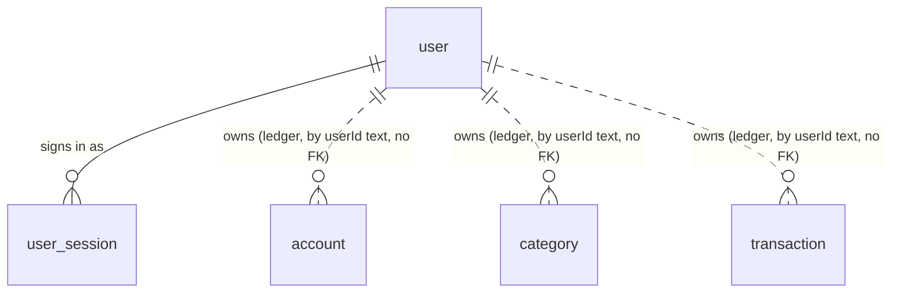
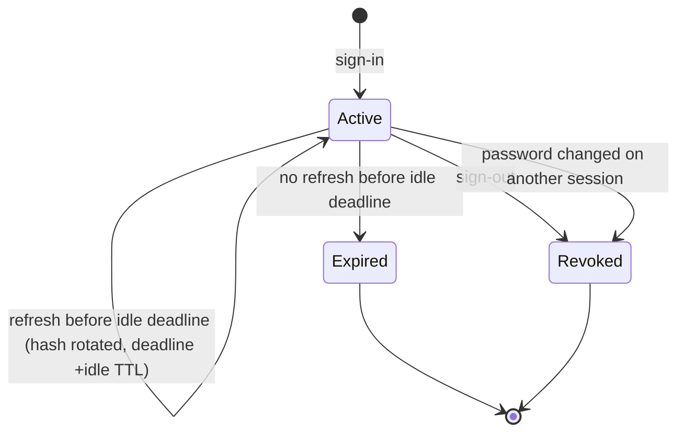

# Base authentication

**Approved**: 2026-11-25 - user: "Approved by tghcastro"

## Problem

Every data route (`/categories`, `/accounts`, `/transactions`) takes the acting user from an `X-User-Id` header that each controller reads itself, and the web app sends a hardcoded `alice`. Anyone who can reach the API can read or change any user's ledger by sending another id, so the app cannot leave the owner's machine, and the user management, password recovery and rate limiting PRDs cannot start. The `user` table holds only `id` and timestamps: there is no email, no password and no way to sign in. Evidence: `.prd/base-authentication.md` (confirmed 2026-11-23) and the code read in this session (`currentUserId()` in `account.controller.ts` and `transaction.controller.ts`, inline header reads in `category.controller.ts`, `CURRENT_USER = { id: 'alice' }` in `apps/web/src/lib/api.ts`).

When this ships, a user signs in with email and password, stays signed in while they use the app, sees only their own data, can change their password and sign out; a request without a valid session gets `401`, and the owner can create five test users with one command.

## Shape

Identity becomes its own module, `modules/identity` (door 8), holding the `user` aggregate that moves out of `modules/ledger`; the ledger keeps only the `userId` text column it already has and never imports the identity module. This reuses the RFC 7807 error body and `UnauthorizedError`, the shared API client in `packages/shared` (still the only place that sets the identity header) and the component-test harness in `apps/api/test/`. The rules that change an outcome - credential check, session renewal and expiry, rotation, revocation, password rules, audit events, test-user seeding - run in `UserService` in `modules/identity/src/user/`, which the unit tests reach with in-memory doubles; the middleware in `apps/api` only verifies the token and hands the user id on.

1. sign-in request -> `createUserRouter` (door 8) - validates the body, hands email, password and user agent to `UserService`
2. `UserService` (door 8) - checks the password hash (door 3), on success writes a session row (door 2) holding the hash of a new refresh token, signs an access token (door 4), records an audit event (door 5); the router answers the token, its lifetime and the user and sets the refresh cookie (door 6)
3. refresh request -> `UserService` - finds the session by the cookie's hash; while active, replaces the token hash and pushes the idle deadline forward (sliding), signs a new access token; otherwise `401` and the cookie is cleared
4. any data request -> `requireUser` (new) - verifies the bearer token through the token check `modules/identity` exports from its `index.ts`, puts the user id in `res.locals.userId`, or answers `401`
5. `LedgerRouters` (exists) - the category, account and transaction controllers read `res.locals.userId` instead of `X-User-Id`; services unchanged
6. sign-out and password-change requests -> `UserService` - revoke the current session / change the hash and revoke every other session of the user
7. `WebApp` (exists) - keeps the access token in memory, restores the session at load through refresh, retries once after a `401` through refresh and otherwise shows the sign-in page
8. `SeedScript` (new) -> `UserService` (door 8) - creates the five test users that do not exist yet

**Changes underneath**

| Front | What changes |
| --- | --- |
| domain | "acting user" meant the `X-User-Id` value; now means the `sub` of a verified access token. Branching on it today: the three controllers (`currentUserId()` / inline header read) - all move to `res.locals.userId` |
| modules | `modules/ledger/src/user/` moves to `modules/identity/src/user/`; `apps/api` mounts both modules' routers and runs both modules' migrations (`node dist/migrate.js`); `vitest.config.ts`, `tsconfig.json` references, the root `build` script (migrations copy) and the `Dockerfile` (`COPY modules/identity/package.json`) gain the new package; `docs/tech/definitions/architecture.md` describes the second module |
| stored data | the ledger drops its empty `user` table in its migration `0003_*`; the identity module creates `user` with the new columns and `user_session` in its own migration `0000_*`; `user` gains `email`, `password_hash`, `name`, `status`, `last_login_at`; new `user_session`. Nothing to backfill: the user table is empty and existing ledger rows are test data (confirmed by tghcastro); rows owned by free-text ids such as `alice` stay in place and become unreachable |
| readers | the web app (every screen now needs a session); the Bruno collection in `tools/bruno` (every request sends `X-User-Id` today); `docs/tech/definitions/security.md`, `web.md`, `logging.md`, `ci-cd.md`; `.env.example`; the CI smoke test, which starts the image and now must pass `AUTH_JWT_SECRET` |
| config | new: `AUTH_JWT_SECRET` (required), `AUTH_ACCESS_TOKEN_TTL_SECONDS` (default 900), `AUTH_SESSION_IDLE_TTL_SECONDS` (default 604800), `AUTH_COOKIE_SECURE` (default `true`), `TEST_USER_PASSWORD_PREFIX` (seed only) |
| dependencies | `jose`, `@node-rs/argon2`, `pino` in `modules/identity` |
| web serving | `/sign-in` and `/settings/password` are served `index.html` by the API (door 7); the Vite dev proxy gains `/auth` |

New: `user_session` and its relation to `user`; `email`, `password_hash`, `name`, `status`, `last_login_at` on `user`. One-way constraints: `user.email` unique (door 1); `user_session.token_hash` unique (door 2). Ledger tables keep their existing `userId` text column with no foreign key (unchanged).

## Surface

| Route | In | Out | Status | Who |
| --- | --- | --- | --- | --- |
| `POST /auth/sign-in` | `email`, `password`; `User-Agent` | `accessToken`, `expiresIn` (seconds), `user {id, email, name}`; `Set-Cookie: cc_refresh` | `200`, `400` (invalid body), `401` (`Invalid email or password`) | anyone |
| `POST /auth/refresh` | cookie `cc_refresh` | same body as sign-in; rotated `cc_refresh` | `200`, `401` (cookie cleared) | holder of an active session cookie |
| `POST /auth/sign-out` | cookie `cc_refresh` | nothing; cookie cleared | `204` (also with no or unknown cookie) | anyone |
| `POST /auth/password` | `Authorization: Bearer`, cookie `cc_refresh`; `currentPassword`, `newPassword` | nothing | `204`, `400` (rule broken or wrong current password), `401` (no valid token) | signed-in user |
| `/categories/*`, `/accounts/*`, `/transactions/*` (signature changes) | `Authorization: Bearer <accessToken>` replaces `X-User-Id` | unchanged | unchanged, plus `401` with no, malformed, badly signed or expired token | signed-in user; the rest get `401` |
| `GET /sign-in`, `GET /settings/password` | - | `index.html` | `200` | anyone (only while `WEB_DIST_PATH` is set) |

## Landing

| One-way door | Literal shape | Alternative rejected |
| --- | --- | --- |
| 1. `user` columns | identity migration `0000_*`: `email text NOT NULL` with `CREATE UNIQUE INDEX user_email_unique ON user (email)`, stored trimmed and lower-case; `password_hash text NOT NULL`; `name text NOT NULL`; `status text NOT NULL DEFAULT 'active'` (`'active' \| 'deleted'`); `last_login_at integer` (epoch ms, nullable) | case-sensitive email: `Alice@x.io` and `alice@x.io` would be two accounts |
| 2. `user_session` table | `user_session(id text PK uuid, user_id text NOT NULL REFERENCES user(id), token_hash text NOT NULL UNIQUE, expires_at integer NOT NULL, revoked_at integer, user_agent text, created_at integer NOT NULL, updated_at integer NOT NULL)`; `token_hash` = SHA-256 hex of a 32-byte random base64url token; one row per signed-in device, rotation overwrites `token_hash` and `expires_at` | one row per issued token: more rows and a cleanup job for no behaviour the PRD needs |
| 3. password hashing | `@node-rs/argon2` `hash`/`verify`, Argon2id with the library defaults; PHC string in `password_hash`. Unknown email still runs one `verify` against a fixed dummy hash | `argon2` (node-gyp): needs a build-script allowance in `.pnpmfile.cjs`; `@node-rs/argon2` ships prebuilt binaries with no install script |
| 4. access token | `jose` `SignJWT`, `HS256`, secret `AUTH_JWT_SECRET` (at least 32 characters, app refuses to start otherwise), claims `sub` = user id, `iss` = `capital-care`, `iat`, `exp` = now + `AUTH_ACCESS_TOKEN_TTL_SECONDS`; sent as `Authorization: Bearer <token>`; kept in browser memory only | `jsonwebtoken`: CommonJS with more dependencies; checking the session on every request: the user chose pure JWT, accepting other devices keep access until their token expires |
| 5. audit log | `pino` logger in `modules/identity`, one JSON line per event: `{ "event": "auth.sign_in" \| "auth.sign_out" \| "auth.password_change", "outcome": "success" \| "failure", "reason"?: "unknown_email" \| "wrong_password" \| "user_deleted" \| "no_session" \| "wrong_current_password" \| "invalid_new_password", "userId"?: "<uuid>", "email"?: "<masked>" }`; masking keeps the first and last character of the local part (`u***1@capital-care.test`; one or two characters: first character + `***`) and the whole domain; never a password or token | `console.log` strings: `logging.md` decides on Pino and structured lines |
| 6. refresh cookie | `cc_refresh=<token>; HttpOnly; SameSite=Strict; Path=/auth; Max-Age=<AUTH_SESSION_IDLE_TTL_SECONDS>`, plus `Secure` unless `AUTH_COOKIE_SECURE=false`; cleared with `Max-Age=0` | token in `localStorage`: readable by any script on the page |
| 8. identity module | `modules/identity` (package `@capital-care/identity`) with the same layout as the ledger (`src/user/`, `src/shared/persistence/`, `src/shared/errors.ts`, `src/config.ts`, `src/index.ts`); `index.ts` exports `createIdentityRouters`, `verifyAccessToken`, `migrateIdentity`, `closeIdentityDatabase`, `seedTestUsers` and public types only; same SQLite file (`DB_PATH`), own migrations folder `modules/identity/src/shared/persistence/migrations` and own Drizzle migrations table `__drizzle_migrations_identity`; the ledger never imports it; `apps/api` composes both | `user` stays in `modules/ledger`: identity has its own language (credentials, sessions, tokens) and the next three PRDs change it and not the ledger; extracting it later means moving a populated table between two migration sets. A separate database file: two connections and no shared transaction for no gain today |
| 7. SPA route fallback | after `express.static`, `GET /sign-in` and `GET /settings/password` answer `index.html` from `WEB_DIST_PATH` with `Cache-Control: no-cache`; client routes are listed explicitly, so no API path can be shadowed | catch-all fallback for every unknown `GET`: would answer `index.html` where a mistyped API path should `404` |

- Nothing else in this change is hard to reverse

## Criteria

### S1: Sign in and reach one's own data (P1)

A test user signs in with email and password and the data routes answer only with a valid access token, for that user's data.

**Acceptance Criteria**

1. WHEN `POST /auth/sign-in` receives the email and password of an active user THEN the system SHALL answer `200` with `accessToken`, `expiresIn` equal to `AUTH_ACCESS_TOKEN_TTL_SECONDS`, `user { id, email, name }` with no password field, and a `Set-Cookie` for `cc_refresh` with `HttpOnly`, `SameSite=Strict`, `Path=/auth` and `Max-Age` equal to `AUTH_SESSION_IDLE_TTL_SECONDS`
   - `  User1@Capital-Care.TEST ` signs in as `user1@capital-care.test` → 200
2. WHEN a sign-in succeeds THEN the system SHALL set the user's `last_login_at` to the time of the sign-in
3. IF the email is unknown, the password is wrong, or the user's status is `deleted` THEN `POST /auth/sign-in` SHALL answer `401` with `detail` `Invalid email or password`, set no cookie and create no session
   - all three causes give byte-identical bodies
4. IF the sign-in body has no email, a malformed email or an empty password THEN the system SHALL answer `400` with the RFC 7807 body and `type` `ValidationError`
5. WHERE `AUTH_COOKIE_SECURE` is unset or `true` the refresh cookie SHALL carry `Secure`; WHERE it is `false` it SHALL not
6. WHEN a request to `/categories`, `/accounts` or `/transactions` carries `Authorization: Bearer` with a valid access token THEN the system SHALL serve it as the token's `sub` user
   - user 1 creates an account; user 2 lists accounts → user 1's account is absent
7. IF a request to `/categories`, `/accounts` or `/transactions` carries no token, a malformed token, a token signed with another secret, or an expired token THEN the system SHALL answer `401` with `type` `UnauthorizedError` and `detail` `Authentication required`
   - a valid `X-User-Id: alice` and no token → 401; token expired one second ago → 401
8. The system SHALL not read `X-User-Id` anywhere in `apps/api`, `modules/ledger`, `modules/identity` or `packages/shared`
9. IF `AUTH_JWT_SECRET` is missing or shorter than 32 characters THEN `createApp()` SHALL throw an error naming `AUTH_JWT_SECRET`
   - 31 characters → throws; 32 → starts
10. IF `AUTH_ACCESS_TOKEN_TTL_SECONDS` or `AUTH_SESSION_IDLE_TTL_SECONDS` is set to anything but a whole number of at least 1 THEN `createApp()` SHALL throw an error naming the variable; WHEN unset THEN they SHALL be 900 and 604800
11. WHEN any request asks to create a user (`POST /users`) THEN the system SHALL answer `404`; no route creates a user
12. WHILE `WEB_DIST_PATH` is set, WHEN a client requests `GET /sign-in` or `GET /settings/password` THEN the system SHALL answer `200 text/html` with the built `index.html`; a `GET` of any other unknown path SHALL still answer `404`

### S2: Stay signed in, expire, sign out (P1)

The session renews while used, ends after the idle lifetime, and sign-out ends it on the server.

**Acceptance Criteria**

13. WHEN `POST /auth/refresh` carries the cookie of an active session THEN the system SHALL answer `200` with a new access token, set a new `cc_refresh` value, and move the session's deadline to now + `AUTH_SESSION_IDLE_TTL_SECONDS`
    - the previous cookie value used again after rotation → 401
14. IF `POST /auth/refresh` has no cookie, an unknown cookie, or the cookie of an expired or revoked session THEN the system SHALL answer `401` and clear `cc_refresh` with `Max-Age=0`
    - idle TTL 60 s: refresh at 59 s → 200; next refresh 61 s after that one → 401
15. WHEN `POST /auth/sign-out` carries the cookie of an active session THEN the system SHALL mark that session revoked, clear the cookie and answer `204`; a later refresh with that cookie SHALL answer `401`
16. IF `POST /auth/sign-out` has no cookie or an unknown one THEN the system SHALL still clear the cookie and answer `204`
17. WHEN the same user signs in twice (two devices) THEN both sessions SHALL refresh independently, and signing out of one SHALL leave the other active

### S3: Change one's own password (P1)

**Acceptance Criteria**

18. WHEN a signed-in user sends `POST /auth/password` with the correct `currentPassword` and a valid `newPassword` THEN the system SHALL answer `204`, accept only the new password at the next sign-in, revoke every other session of that user, and keep the session of the request's `cc_refresh` cookie active
    - user with sessions A (this request) and B: after the change, refresh with A → 200, with B → 401
19. IF `currentPassword` is wrong THEN the system SHALL answer `400` with `detail` `Current password is incorrect` and change nothing
20. IF `newPassword` is shorter than 12 or longer than 128 characters THEN the system SHALL answer `400` with `detail` `Password must be 12 to 128 characters`; IF it equals the current password THEN `400` with `detail` `New password must be different from the current one`
    - 11 characters → 400; 12 → 204; 128 → 204; 129 → 400
21. IF `POST /auth/password` has no valid access token THEN the system SHALL answer `401`
22. The system SHALL store passwords only as Argon2id hashes: `password_hash` starts with `$argon2id$` and never equals the password

### S4: Audit record (P1)

**Acceptance Criteria**

23. WHEN a sign-in succeeds THEN the system SHALL write one log line with `event` `auth.sign_in`, `outcome` `success`, the full `userId` and the masked email
    - `user1@capital-care.test` → `u***1@capital-care.test`; `ab@x.io` → `a***@x.io`; `a@x.io` → `a***@x.io`
24. WHEN a sign-in fails THEN the system SHALL write one log line with `event` `auth.sign_in`, `outcome` `failure`, `reason` `unknown_email`, `wrong_password` or `user_deleted`, the masked email, and `userId` only when the account exists
25. WHEN a sign-out or a password change succeeds or fails THEN the system SHALL write one log line with `event` `auth.sign_out` or `auth.password_change`, its `outcome`, its `reason` on failure, and `userId` and masked email when the user is known
26. The system SHALL never write a password, an access token or a refresh token to the log, in whole or in part
    - sign-in, refresh, sign-out and password change with known secret values → none of the values appears in the captured log output

### S5: Test users (P1)

**Acceptance Criteria**

27. WHEN the owner runs the seed with `TEST_USER_PASSWORD_PREFIX` set on an empty database THEN it SHALL create `user1@capital-care.test` to `user5@capital-care.test`, named `Test User 1` to `Test User 5`, status `active`, with password `<prefix><n>`, print `created <email>` for each and exit `0`
28. WHEN the seed runs again THEN it SHALL print `skipped <email> (already exists)` for each existing user, create no duplicate, leave existing passwords unchanged and exit `0`
29. IF `TEST_USER_PASSWORD_PREFIX` is unset, or `<prefix><n>` would be shorter than 12 characters THEN the seed SHALL print an error naming `TEST_USER_PASSWORD_PREFIX`, create nobody and exit `1`
    - prefix of 10 characters (`<prefix>1` = 11) → exit 1; 11 characters → exit 0

### S6: Web app (P1)

The screens have no binding capture; layout follows `docs/tech/definitions/design.md`.

**Acceptance Criteria**

30. WHILE the app loads, the system SHALL try to restore the session through `/auth/refresh` and show a loading state until it answers; no protected page SHALL render before it answers
31. WHEN a signed-out user opens a protected page (`/`, `/settings/password`) THEN the system SHALL show `/sign-in`, and after a successful sign-in SHALL show the page first requested
32. WHEN a user opens `/sign-in` directly and signs in THEN the system SHALL show `/`
33. WHEN a signed-in user opens `/sign-in` THEN the system SHALL show `/` without the form
34. WHEN the user submits the sign-in form with an empty email, a malformed email or an empty password THEN the form SHALL show `Enter your email`, `Enter a valid email` or `Enter your password` next to the field and send no request
35. WHEN the API answers `401` to the sign-in THEN the form SHALL show `Invalid email or password` and keep the email entered
36. WHEN a data request answers `401` THEN the API client SHALL call `/auth/refresh` once and repeat the request with the new token; IF refresh answers `401` THEN the system SHALL show `/sign-in` with `Session expired` and, after sign-in, return to the page the user was on
37. WHEN the signed-in user uses `Sign out` in the page header THEN the system SHALL call `/auth/sign-out`, forget the access token and show `/sign-in` with `Signed out`
38. WHEN the signed-in user uses `Change password` in the page header THEN the system SHALL show `/settings/password` with `Current password`, `New password` and `Confirm new password`
39. WHEN the user submits the change-password form with matching valid values THEN the system SHALL show `Password changed` and clear the form; IF the confirmation differs THEN it SHALL show `Passwords do not match` and send no request; IF the API answers `400` THEN it SHALL show the API's `detail`
40. The access token SHALL live only in memory: nothing is written to `localStorage`, `sessionStorage` or a script-readable cookie
41. The API client SHALL send `Authorization: Bearer <accessToken>` and no `X-User-Id`; IF the redirect target after sign-in is not a path on this site (does not start with `/`, or starts with `//`) THEN the system SHALL show `/`

### S7: Tooling and documents follow (P2)

**Acceptance Criteria**

42. The Bruno collection SHALL sign in as a test user in a first request, store the access token, send `Authorization: Bearer {{accessToken}}` instead of `X-User-Id` on every request, replace the `Missing X-User-Id` requests with missing-token requests, and add requests for wrong credentials (401) and refresh without a cookie (401)
43. The CI smoke test SHALL start the image with an `AUTH_JWT_SECRET` and still pass
44. The system SHALL update `docs/tech/definitions/security.md`, `web.md`, `logging.md`, `ci-cd.md`, `architecture.md` and `database.md`, `.env.example`, `tools/AGENTS.md` and `README.md` so they describe the bearer token, the refresh cookie, the new variables, the SPA routes, the audit log, the seed command and the `modules/identity` module with its own migrations; `X-User-Id` SHALL appear in none of them except as history
45. WHEN the database is migrated from the ledger's migration `0002` THEN `node dist/migrate.js` SHALL apply the ledger's `0003` (drop of the empty `user` table) and the identity module's migrations in one run, and running it again SHALL change nothing
46. The system SHALL keep `modules/ledger` free of imports from `@capital-care/identity` and `modules/identity` free of imports from `@capital-care/ledger`
47. WHEN `pnpm build`, `pnpm type-check` and `pnpm test` run THEN each SHALL exit 0

## Out of scope

| Excluded | Why |
| --- | --- |
| user management (registration, invitation, deactivation, roles) | PRD 3 |
| password recovery by email | PRD 4 |
| rate limiting and account lockout | PRD 2 |
| one active device per user | future requirement in the PRD |
| immediate revocation of access tokens on other devices | user chose pure JWT: other devices keep access until their access token expires (default 15 min) |
| MFA, captcha, HTTPS / hosting | PRD: not a requirement for now |
| listing or ending sessions per device | not planned |
| an `Origin` header check on `/auth/*` | `SameSite=Strict` on a same-origin app already keeps cross-site requests from sending the cookie |
| moving ledger rows owned by `alice` or other free-text ids | user: existing data is test data |
| a cleanup job for expired sessions | rows are small and one per device; revisit with user management |
| foreign keys from ledger tables to `user` | not needed for this feature; changing populated tables is its own decision |

## Assumptions

| Assumption | Chosen default | Rationale | Confirmed? |
| --- | --- | --- | --- |
| session lifetime | sliding idle lifetime, 7 days default, access token 15 min default, both configurable | user chose "Sliding, 7 days" | y |
| password rule | 12 to 128 characters, no composition rule, new differs from current | user chose "12 to 128 characters" | y |
| revocation on other devices | within the access token lifetime | user chose "Accept up to the access token lifetime" | y |
| confirm field on change password | yes | user chose "Yes" | y |
| Bruno collection | updated in this feature | user chose "Yes, update it" | y |
| existing data | nothing migrated | existing data is test data only - confirmed by tghcastro | y |
| identity module | `modules/identity`, separate from the ledger, same database file, own migrations | recommended in the conversation - Approved by tghcastro | y |
| solution | in-house, JWT kept for learning | user, in the PRD conversation | y |
| test-user emails and names | `user<n>@capital-care.test`, `Test User <n>` | `.test` is reserved and never routable; the PRD fixes the count, not the names | n |
| route names | `/auth/sign-in`, `/auth/refresh`, `/auth/sign-out`, `/auth/password` | a separate `/auth` prefix lets the cookie be scoped to `Path=/auth` | n |
| wrong current password status | `400`, not `401` | a `401` would make the web client treat it as an expired session and sign the user out | n |
| user agent | stored on the session from `User-Agent`, not shown anywhere yet | needed later by session management or one-device rule; costs one column | n |
| sign-in page copy | `Sign in`, labels `Email` and `Password`, button `Sign in` | no capture; PRD fixes only the messages | n |

**Open questions:** none - all resolved or logged above.

## Differences from the source

None - no binding source.

## Sources

- `.prd/base-authentication.md` - binding - confirmed 2026-11-23; Journey table is the product acceptance criteria
- `docs/tech/definitions/security.md` - binding - JWT as the long-term mechanism, swap isolated in one middleware, `401` with no acting user
- `docs/tech/definitions/logging.md` - binding - Pino, no credentials or tokens in logs
- Conversation of 2026-11-23 - binding - access JWT + rotating refresh cookie, Argon2id, configurable lifetimes, five scripted users with passwords from configuration
