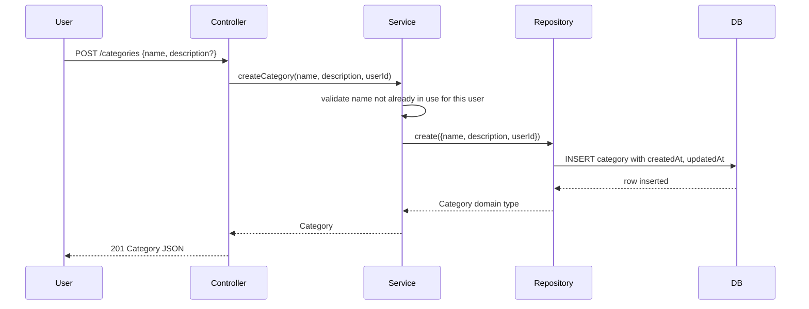
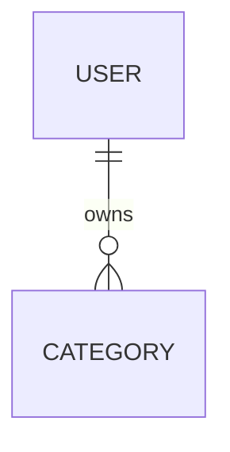

# Category Management

## Problem

Users today have no way to create, modify, or manage custom expense categories. Every transaction must be assigned to a pre-populated, static set of categories. Users cannot organize expenses according to their personal financial structure, forcing them to fit their real expenses into a rigid taxonomy.

When this ships, users will be able to create categories on demand, update them as their needs evolve, and organize transactions around categories that match their personal financial breakdown.

## Shape

This feature adds a new `category` aggregate and reuses the existing `user` aggregate. The business logic for uniqueness checks and ownership validation runs in the service layer, where tests can reach it directly (per [architecture.md](../../docs/tech/definitions/architecture.md)).

1. User action → request with `name` and `userId`
2. `Controller` (new) - validates request shape, delegates to service
3. `Service` (new) - checks name uniqueness per user, throws `ConflictError` if duplicate, calls repository to create
4. `Repository` (new) - persists to `category` table, maps Drizzle row ↔ domain `Category` type
5. DB writes `category` row, persists `createdAt`/`updatedAt` as epoch milliseconds
6. out: `Category` domain type (API serializes timestamps as ISO 8601 UTC)

**List, fetch, update, and delete follow the same pattern:** controller → service (business rules) → repository (DB) → response.

**Changes underneath**

| Front | What changes |
| --- | --- |
| domain | `Category` is a new entity in the Ledger bounded context |
| stored data | `category` table created, no backfill needed (new entity) |
| readers | Future: `Transaction` aggregate will reference `Category` by ID when recording expense classification (not in this feature) |

New: `Category` entity, `User` ↔ `Category` 1:N ownership relation. One-way constraints: `(userId, name)` unique index (door 1).

## Surface

| Route | In | Out | Status | Who |
| --- | --- | --- | --- | --- |
| `POST /categories` | `{ name: string; description?: string }` | `Category` | `201`, `400` ValidationError, `409` ConflictError; `401` Unauthorized | current user only |
| `GET /categories` | query: `sort` (default `name`, optional `-name`), no pagination | `{ categories: Category[] }` | `200`; `401` Unauthorized | current user only |
| `GET /categories/:id` | none | `Category` | `200`, `404` NotFoundError; `401` Unauthorized | current user only |
| `PATCH /categories/:id` | `{ name?: string; description?: string }` | `Category` | `200`, `400` ValidationError, `404` NotFoundError, `409` ConflictError; `401` Unauthorized | current user only |
| `DELETE /categories/:id` | none | empty | `204` No Content, `404` NotFoundError, `409` ConflictError; `401` Unauthorized | current user only |

All endpoints are scoped to the current user via `X-User-Id` header (interim; future JWT claim). Responses serialize `createdAt` and `updatedAt` as ISO 8601 UTC strings per [database.md](../../docs/tech/definitions/database.md#date--time). Unknown request fields are silently ignored per [api.md](../../docs/tech/definitions/api.md#validation).

## Landing

| One-way door | Literal shape | Alternative rejected |
| --- | --- | --- |
| Uniqueness constraint | `(userId, name)` unique index in `category` table | per-app name uniqueness (shared categories); no unique constraint (silent duplicates). Chosen to support per-user categorization and fail fast on conflicts. |
| Deletion semantics | Hard delete allowed only if no transactions reference the category; returns `409 ConflictError` if in use | Soft delete with `deletedAt` (storage overhead); CASCADE delete (data loss); no check (foreign-key violation at insert time, confusing). Chosen to preserve referential integrity and provide clear error feedback. |
| Table ownership | `category` table created in `category/category.entity.ts`, Drizzle table named `categoryTable` → SQL `category` | Shared `categories` table or flattened into `transaction` (violates [database.md](../../docs/tech/definitions/database.md#entity--table-naming-state-isolation) aggregate ownership rule). Chosen for consistency and future category-only queries. |

- Nothing else in this change is hard to reverse (controller/service/repository are additions; API contracts are new; no schema migrations; no existing data changed)

## Criteria

### S1: Create and retrieve a category

User creates a category and can fetch it by ID.

**Acceptance Criteria**

1. WHEN a user POSTs `{ name: "Groceries" }` to `/categories` THEN the system SHALL return `201` with a `Category` object containing `id` (UUID), `name`, `description` (null if omitted), `userId`, `createdAt`, `updatedAt` (all timestamps ISO 8601 UTC)
   - POST `{ name: "Groceries" }` → `201` with `name: "Groceries"`, `description: null`, `createdAt` is a valid ISO 8601 string
   - POST `{ name: "Utilities", description: "Electric, gas, water" }` → `201` with `description: "Electric, gas, water"`
2. WHEN a user GETs `/categories/:id` for a category they own THEN the system SHALL return `200` with the full `Category` object
3. IF a user GETs `/categories/:id` for a category they do not own THEN the system SHALL return `404 NotFoundError` (not `403`, per [api.md](../../docs/tech/definitions/api.md#error-handling))
4. IF a user POSTs without a `name` field THEN the system SHALL return `400 ValidationError` with `detail` explaining `name` is required
5. IF a user POSTs with `name` longer than 255 characters THEN the system SHALL return `400 ValidationError` with `detail` explaining the bound

### S2: Enforce per-user category name uniqueness

Same user cannot create two categories with the same name; different users can.

**Acceptance Criteria**

1. WHEN a user creates a category named "Groceries" THEN attempts to POST another "Groceries" to `/categories` SHALL return `409 ConflictError` with `detail` explaining the name is already in use
   - User Alice creates "Groceries"; Alice creates "Groceries" again → `409`; User Bob creates "Groceries" → `201`
2. WHEN a user PATCHes a category to rename it, and the new name collides with another category they own THEN the system SHALL return `409 ConflictError`
   - User has "Groceries" and "Food"; PATCH "Food" → `{ name: "Groceries" }` → `409`

### S3: List and sort categories

User can list all their categories with optional sorting.

**Acceptance Criteria**

1. WHEN a user GETs `/categories` THEN the system SHALL return `200` with `{ categories: [<Category>, <Category>, ...] }` containing all categories they own, sorted by name ascending (default)
2. WHEN a user GETs `/categories?sort=-name` THEN the system SHALL return categories sorted by name descending
3. IF the user has zero categories THEN `GET /categories` SHALL return `200` with `{ categories: [] }`

### S4: Update a category

User can update name and/or description of an existing category.

**Acceptance Criteria**

1. WHEN a user PATCHes `/categories/:id` with `{ name: "New Name" }` THEN the system SHALL return `200` with the updated `Category` object, `updatedAt` changed
   - Partial update: PATCH with only `name` → `description` unchanged; PATCH with only `description` → `name` unchanged
2. WHEN a user PATCHes `/categories/:id` with an empty object `{}` THEN the system SHALL return `200` with the category unchanged (no error)
3. IF a user PATCHes a category they do not own THEN the system SHALL return `404 NotFoundError`

### S5: Delete a category

User can delete a category they own. Deletion is blocked if transactions reference it.

**Acceptance Criteria**

1. WHEN a user DELETEs `/categories/:id` for a category with no transactions THEN the system SHALL return `204 No Content` and the category is removed
2. IF a user DELETEs `/categories/:id` for a category that has transactions referencing it THEN the system SHALL return `409 ConflictError` with `detail` explaining transactions must be reassigned or deleted first
   - Create category C, create transaction T with C, DELETE /categories/:id → `409`
3. IF a user DELETEs a category they do not own THEN the system SHALL return `404 NotFoundError`

## Out of scope

| Excluded | Why |
| --- | --- |
| Category icons / colors | Presentation only; can be added later without changing the API or DB schema |
| Shared categories (admin-managed) | Business rule not specified; current design is per-user only; can pivot if needed |
| Category archiving (soft delete) | Not a stated requirement; hard delete with in-use check provides clear semantics for this release |
| Pagination on `GET /categories` | Anticipated user habit is <100 categories per person; scale revisited if needed |
| Bulk create/update/delete | Not a stated requirement; single-resource operations are sufficient |
| Category hierarchies (parent/child) | Not a stated requirement; flat list adequate for initial release |

## Assumptions

| Assumption | Chosen default | Rationale | Confirmed? |
| --- | --- | --- | --- |
| Transaction → Category reference exists | Transactions will have a `categoryId` field and a FK to `category` | Categories are meaningless without transactions to classify; future feature assumes this; blocks the transaction integration | n |
| Current user comes from `X-User-Id` header | Header-based scoping (interim before JWT) | Testing and development convenience; production auth layer will replace with JWT claim (see [security.md](../../docs/tech/definitions/security.md)) | n |
| No category archiving | Hard delete only; no soft-delete or `deletedAt` field | Simpler data model and queries; soft-delete complexity not justified yet | n |
| `description` is optional text | `description` can be null or omitted; no structured metadata | Flexibility for users; complexity of key-value metadata not justified | n |

**Open questions:** none - all resolved or logged above.

## Differences from the source

None - the product is new, not derived from a binding capture or design.

## Sources

- User request: practice agentic development workflows by implementing category management feature.

**Approved**: 2026-11-06 - user: "plan is approved we can proceed from there"
