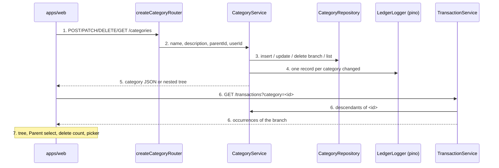
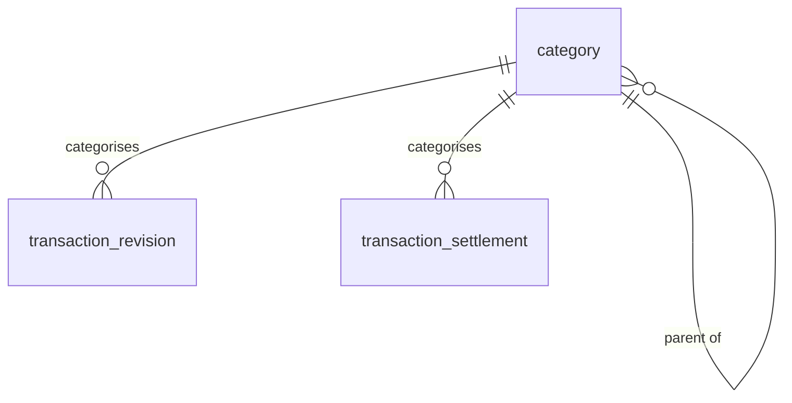

# Child Categories

**Approved**: 2026-11-25 - user: "Spec Approved. Implement this spec"

## Problem

Category Management promised a tree of up to 3 tiers, and the first version shipped a flat list.
The owner cannot organise categories or rebuild their category tree in Capital Care, so they still
maintain categories in another finance app. The name rules of the first PRD (short names, plain
characters, no duplicates in any letter case) are missing too, so the same category can exist
twice with different capitalisation. Evidence: the owner's own statement in the PRD; there is no
count of their categories in the other app and nobody tracks category usage.

When this ships, the owner builds their full 3-tier category tree in Capital Care - creating,
renaming, moving and deleting branches, and picking any tier for a transaction - and stops
maintaining categories in the other app.

## Shape

This reuses the existing `category` aggregate (controller, service, repository, table) and its
callers; it adds a parent link and a name key to the same table instead of a second tree table.
Every rule that changes an outcome - name rules, uniqueness, depth, cycles, the branch a delete
removes, alphabetical order at each level, the descendants a filter includes - runs in
`CategoryService` (and `TransactionService` for the filter), which the unit tests reach with the
in-memory repository; `apps/web` only displays the tree the API returns (AD-006).

1. `POST /categories` / `PATCH /categories/:id` / `DELETE /categories/:id` / `GET /categories` with `X-User-Id` -> `createCategoryRouter` (exists) - validates the body shape, hands `name`, `description`, `parentId` to the service
2. `CategoryService` (exists) - normalises and checks the name, checks the name key is free in the user's tree, checks the parent is the user's, the depth stays <= 3 and a move does not enter its own branch; on delete collects the branch; builds the sorted tree on list
3. `CategoryRepository` (exists) - persists `category.parentId` and `category.nameKey` (doors 1, 2); a delete of one row removes its branch through `ON DELETE CASCADE` and the existing `ON DELETE set null` uncategorizes transactions, revisions and settlements
4. `CategoryService` (exists) - writes one log record per created, renamed, moved, updated or deleted category through the injected `LedgerLogger` (door 3)
5. out: the category JSON with `parentId`, or the nested tree (door 4); `pino` (new, door 3) in `apps/api` prints the record
6. `TransactionService` (exists) - on `GET /transactions` and `GET /transactions/balance`, expands each selected `category` id to it and its descendants through `CategoryService` before filtering; `none` is unchanged
7. `apps/web` (exists) `TransactionsPage` + `FilterPanel` + `QuickAdd` (exist) - show the tree, the Parent select in the Add / Edit dialog, the delete confirmation with the count, and the indented picker

**Changes underneath**

| Front | What changes |
| --- | --- |
| domain | `Category` was a flat item; now it has a `parentId` (null = top level) and a depth of 1 to 3. `TransactionService.requireOwnReferences` branches on category existence only: unchanged, any tier may be assigned |
| domain | a `category` filter on transactions meant "exactly this category"; now it means "this category and its descendants" (AD-013). Read by `TransactionService.listMonth` and the monthly balance (`balance`) |
| domain | deleting a category with transactions was refused by a placeholder `hasTransactions` (always `false`); now it always goes ahead and the transactions become uncategorized |
| stored data | the migration deletes every existing category (AD-012): it first sets `categoryId` to `NULL` in `transaction_revision` and `transaction_settlement` explicitly (the drizzle table rebuild runs with `foreign_keys=OFF`, so `set null` would not fire), then deletes the rows, then adds `parentId` and `nameKey` |
| readers | `GET /categories` changes from a flat list to a nested tree - read by `apps/web` (`api.listCategories`, the panel, the picker, the category name in each transaction row) and the Bruno `Categories` folder; all updated in this change |
| readers | the existing `?sort=-name` keeps working, now applied at each level of the tree |

New: the `category` -> `category` "parent of" relation. One-way constraints: `parentId` references
`category.id` `ON DELETE CASCADE` (door 1); `(userId, nameKey)` unique, replacing
`(userId, name)` (door 2).

## Surface

| Route | In | Out | Status | Who |
| --- | --- | --- | --- | --- |
| `POST /categories` | `name`, `description?`, `parentId?` (null or absent = top level) | category with `parentId` | `201`, `400` name rule / 3-tier maximum, `404` parent not found, `409` `name is taken`, `401` no `X-User-Id` | the acting user, under their own categories only |
| `PATCH /categories/:id` | `name?`, `description?`, `parentId?` (absent = unchanged, null = move to top level) | category with `parentId` | `200`, `400` name rule / 3-tier maximum / into its own branch, `404` category or parent not found, `409` `name is taken`, `401` | the acting user; another user's category answers `404` |
| `DELETE /categories/:id` | - | - | `204`, `404`, `401` | the acting user; another user's category answers `404` |
| `GET /categories` | `sort?` (`name` default, `-name`) | `{ categories: [{ id, userId, name, description, parentId, createdAt, updatedAt, children: [...] }] }` | `200`, `401` | the acting user, their own categories only |
| `GET /categories/:id` | - | category with `parentId` | `200`, `404`, `401` | unchanged apart from `parentId` |

## Landing

| One-way door | Literal shape | Alternative rejected |
| --- | --- | --- |
| 1. parent link | `category.parentId text NULL REFERENCES category(id) ON DELETE CASCADE`; depth is not stored, it is computed from the parent chain | a closure table or a stored `depth`/`path` column: with at most 3 tiers per user the chain is at most 2 lookups, and a stored path must be rewritten for the whole branch on every move |
| 2. name uniqueness | `category.nameKey text NOT NULL`, the normalised name lower-cased in the service (`name.toLowerCase()` after NFC); unique index `category_userId_nameKey_unique` on `(userId, nameKey)`; the old `category_userId_name_unique` is dropped | a unique index on `(userId, lower(name))`: SQLite `lower()` folds ASCII only, so `Saúde` and `SAÚDE` would both be accepted |
| 3. logging dependency and seam | `pino` added to `apps/api`; the ledger defines `interface LedgerLogger { info(record: Record<string, unknown>, message: string): void }` and `createLedgerRouters({ logger })` receives it (AD-014). Record: `{ event: 'category.created' \| 'category.renamed' \| 'category.moved' \| 'category.updated' \| 'category.deleted', userId, categoryId, categoryName, previousName?, parentId?, previousParentId? }` | `pino` imported inside `modules/ledger`: the service tests would have to capture stdout, and the module would pick the log destination that `apps/api` owns |
| 4. list contract | `GET /categories` returns `{ categories: CategoryNode[] }`, each node the category JSON plus `parentId` and `children: CategoryNode[]` (empty array on a leaf), roots and every `children` sorted by name | a flat list with `parentId` the client nests itself: the order at each level and the nesting would be rebuilt in the web, against AD-006 |
| 5. migration deletes data | migration `0003` clears `categoryId` in `transaction_revision` and `transaction_settlement`, deletes all `category` rows, then adds the columns and indexes (AD-012) | keep the rows as roots: rejected by the user |

- Nothing else in this change is hard to reverse

## Criteria

### S1: Build a 3-tier tree (P1)

The owner creates categories at the top level, under a root, and under a child.

**Acceptance Criteria**

1. WHEN the user creates a category with no `parentId` (absent or `null`) THEN the system SHALL save it with `parentId: null` and answer `201` with the category JSON including `parentId: null`
2. WHEN the user creates a category with the `parentId` of their own root or child THEN the system SHALL save it under that parent and answer `201` with `parentId` set to that id
3. IF the user creates a category under a grandchild (a category at depth 3) THEN the system SHALL answer `400` `ValidationError` with detail `maximum depth is 3 tiers` and save nothing
   - parent at depth 2 → `201` (new depth 3); parent at depth 3 → `400`
4. IF the `parentId` given on create does not exist or belongs to another user THEN the system SHALL answer `404` `NotFoundError` with detail `Parent category not found` and save nothing
5. WHEN the user lists categories THEN the system SHALL answer `200` with `{ categories: [...] }` holding only top-level categories, each with a `children` array nesting its children, and their children nesting grandchildren, every node carrying `parentId`
6. The system SHALL order the roots and every `children` array alphabetically by name, ignoring letter case and accents, and in reverse when `sort=-name`
   - roots `banana`, `Apple`, `Cherry` → `Apple`, `banana`, `Cherry`; children of one root `Zoo`, `Éclair`, `Dog` → `Dog`, `Éclair`, `Zoo`
7. WHEN a user with no categories lists categories THEN the system SHALL answer `200` with `{ categories: [] }`
8. WHEN two users each have categories THEN the system SHALL list, nest and accept as parent only the acting user's categories

### S2: Name rules (P1)

Names are short, plain and unique in any letter case across the user's whole tree.

**Acceptance Criteria**

9. The system SHALL normalise a name before every rule by applying Unicode NFC, trimming leading and trailing spaces and collapsing each run of inner spaces into one, and SHALL store the normalised name
   - `"  Food   Out "` → stored `Food Out`
10. IF the name is missing, not a string, or empty after normalising THEN create SHALL answer `400` with detail `name is required`; on update, an absent `name` leaves the name unchanged and a present empty one answers the same `400`
11. IF the normalised name is longer than 30 characters THEN the system SHALL answer `400` with detail `name must be at most 30 characters`
    - 30 characters → accepted; 31 → `400`; 30 accented characters such as `é` × 30 → accepted (counted as characters, not bytes)
12. IF the normalised name contains anything other than Unicode letters, decimal digits and spaces THEN the system SHALL answer `400` with detail `name may contain only letters, digits and spaces`
    - `Saúde 2` → accepted; `Educação` → accepted; `Food & Drinks` → `400`; `Car-Fuel` → `400`; `Tab\tName` → `400`
13. IF the normalised name equals, ignoring letter case, the name of any other category in the user's tree, at any tier THEN the system SHALL answer `409` `ConflictError` with detail `name is taken` and save nothing
    - existing grandchild `Fuel` and new root `FUEL` → `409`; existing `Saúde` and new `SAÚDE` → `409`; another user's `Fuel` → accepted
14. WHEN the user renames a category to its own current name, or to the same name in another letter case THEN the system SHALL accept it with `200` and store the new spelling
15. The system SHALL apply the name rules to create and rename only; `description` keeps its current rule (optional, at most 500 characters)

### S3: Move a branch (P1)

The owner moves a category, with everything under it, to another parent or to the top level.

**Acceptance Criteria**

16. WHEN the user patches a category with the `parentId` of another of their categories THEN the system SHALL move it there with its whole branch, answer `200` with the new `parentId`, and the next list SHALL show the branch nested under the new parent with every descendant still under it
17. WHEN the user patches a category with `parentId: null` THEN the system SHALL make it a root, answer `200` with `parentId: null`, and keep its branch under it
18. IF the move would place any category of the branch deeper than tier 3 THEN the system SHALL answer `400` with detail `maximum depth is 3 tiers` and move nothing
    - a root with children and grandchildren moved under another root → `400`; a child with one child moved under another root → `200`; that same child moved under a child → `400`
19. IF the new `parentId` is the category itself or one of its descendants THEN the system SHALL answer `400` with detail `a category cannot be moved into itself or its descendants` and move nothing
20. IF the new `parentId` does not exist or belongs to another user THEN the system SHALL answer `404` with detail `Parent category not found` and move nothing
21. WHEN a patch carries both `name` and `parentId` THEN the system SHALL apply both or, if any rule fails, neither

### S4: Delete a branch (P1)

Deleting removes the category and everything under it; their transactions become uncategorized.

**Acceptance Criteria**

22. WHEN the user deletes a category THEN the system SHALL remove it and all its descendants permanently, with no confirmation, and answer `204`; the next list SHALL contain none of them
23. WHEN the deleted branch has transactions THEN the system SHALL delete it anyway, keep every transaction, and set their category to none, so `GET /transactions?month=<m>&category=none` returns them
24. WHEN a category is deleted THEN the system SHALL leave its parent, its siblings and every other branch unchanged

### S5: Not found and ownership (P1)

**Acceptance Criteria**

25. IF the category being updated, moved or deleted does not exist or belongs to another user THEN the system SHALL answer `404` `NotFoundError` with detail `Category not found` and change nothing

### S6: Log records (P1)

**Acceptance Criteria**

26. WHEN a category is created THEN the system SHALL write one info record `{ event: 'category.created', userId, categoryId, categoryName, parentId }`
27. WHEN a patch changes the name THEN the system SHALL write one record `{ event: 'category.renamed', userId, categoryId, categoryName: <new name>, previousName: <old name> }`
28. WHEN a patch changes the parent THEN the system SHALL write one record `{ event: 'category.moved', userId, categoryId, categoryName: <name after the patch>, parentId, previousParentId }`; a patch that renames and moves writes both records
29. WHEN a patch changes only the description THEN the system SHALL write one record `{ event: 'category.updated', userId, categoryId, categoryName }`
30. WHEN a delete removes a branch THEN the system SHALL write one record `{ event: 'category.deleted', userId, categoryId, categoryName }` per category removed, each with its own id and name
    - a root with 2 children and 1 grandchild → 4 records
31. IF a create, update, move or delete is refused THEN the system SHALL write no `category.*` record

### S7: Filter by a branch (P1)

**Acceptance Criteria**

32. WHEN `GET /transactions` or `GET /transactions/balance` is filtered by a `category` id THEN the system SHALL include the occurrences of that category and of all its descendants
    - filter `Food` with transactions on `Food`, `Groceries` (child) and `Fruit` (grandchild) → all three; filter `Groceries` → `Groceries` and `Fruit`, not `Food`
33. The `category=none` filter SHALL keep returning only occurrences with no category

### S8: The tree in the web site (P1)

**Acceptance Criteria**

34. WHEN the transactions page loads THEN the Categories panel SHALL show `Uncategorized` first, then the roots in the API's order, each child indented under its root and each grandchild indented under its child
35. WHEN the page loads THEN the system SHALL show every root expanded (its children visible) and every child collapsed (its grandchildren hidden); a category with children SHALL have a toggle button labelled `Expand <name>` / `Collapse <name>` with `aria-expanded`, and using it SHALL show or hide that category's children
36. WHEN the user clicks a category in the panel THEN the system SHALL toggle it in the filter as today, and the transactions list SHALL show that category's branch (criterion 32)
37. WHEN the user uses `Add category`, types a name, picks a category in the `Parent` select (default `None (top level)`) and saves THEN the system SHALL create it under that parent and show it nested there, with its parent expanded
38. WHEN the user uses `Edit <name>`, changes the `Parent` select (options: `None (top level)` and every category except itself, indented by tier) and saves THEN the system SHALL move it and show it with its branch in the new place
39. IF the API refuses a save THEN the dialog SHALL stay open and show the API's `detail` (e.g. `name is taken`, `maximum depth is 3 tiers`) in an alert
40. WHEN the user uses `Delete <name>` on a category with descendants THEN the system SHALL show a dialog `Delete <name>?` with the text `This permanently removes <n> categories: <name> and its <n-1> subcategories. Their transactions become uncategorized.`, and only `Delete` in that dialog sends the request; `Cancel` closes it and removes nothing
    - a root with 2 children and 1 grandchild → `This permanently removes 4 categories: Food and its 3 subcategories. ...`
41. WHEN the user uses `Delete <name>` on a category with no descendants THEN the system SHALL show `Delete <name>?` with the text `This permanently removes this category. Its transactions become uncategorized.` and delete on `Delete`
42. WHEN a delete succeeds THEN the panel SHALL no longer show the branch, and the deleted ids SHALL be removed from the active filter
43. WHEN the user opens the `Category` select in the Add transaction form THEN it SHALL list every category in tree order (depth-first, alphabetical at each level as the API returns), each child and grandchild indented under its parent, and any tier SHALL be selectable
44. The transaction rows SHALL keep showing the category name for a category at any tier

### S9: Migration (P1)

**Acceptance Criteria**

45. WHEN migration `0003` runs on a database with categories and transactions that reference them THEN it SHALL delete every category, keep every transaction, revision and settlement with `categoryId` `NULL`, and leave the `category` table with `parentId` and `nameKey` and the unique index on `(userId, nameKey)`

## Out of scope

| Excluded | Why |
| --- | --- |
| Importing the tree from the other app | not requested (PRD) |
| Archiving or soft delete | delete is permanent by decision (PRD) |
| Sharing categories between users | each user keeps only their own (PRD) |
| Moving or merging the transactions of a deleted category | they become uncategorized (PRD) |
| More than 3 tiers | fixed by decision (PRD) |
| Drag and drop to move | the Parent select covers the move; not requested |
| Confirmation of a delete in the API | PRD open question 3, default taken |
| Searching categories in the panel or picker | not requested |
| Replacing `X-User-Id` with the JWT (AD-009) | CAP authentication work, not this issue; the category routes keep reading the acting user the way the other ledger routes do today |

## Assumptions

| Assumption | Chosen default | Rationale | Confirmed? |
| --- | --- | --- | --- |
| What counts as a letter | any Unicode letter (`\p{L}`), so accents are allowed; digits are decimal digits (`\p{Nd}`) | user chose "Any letter, accents ok" | y |
| A parent filter | includes the category and all its descendants (AD-013) | user chose "It and its descendants" | y |
| Existing categories | the migration deletes them all; their transactions become uncategorized (AD-012) | user chose "Delete all categories" | y |
| Log record on a branch delete | one record per category removed | PRD open question 1, default taken by the owner | y |
| Name in the log after a rename or move | the name after the change; a rename also carries `previousName` | PRD open question 2, default taken by the owner | y |
| Spaces in a name | trimmed at the ends and inner runs collapsed to one before every rule, so `Food  Out` and `Food Out` are the same name | the rule allows spaces; without collapsing, two names that read the same could coexist, which the uniqueness rule exists to stop | n |
| Status for a broken name rule, the depth limit and a cycle | `400` `ValidationError`, as every ledger validation answers today | the ledger controllers map `ValidationError` to `400`; changing it is a separate contract change | n |
| "First level of children expanded by default" | roots are expanded (children visible), children are collapsed (grandchildren hidden); expansion is not remembered across reloads | literal reading of the PRD | n |
| Parent select in Add / Edit | lists every category (minus itself on Edit); a choice the API refuses shows the API's message | the depth and cycle rules stay in the API (AD-006) | n |
| Delete count in the dialog | the web counts the nodes of the subtree the API returned | it is the size of a branch already on screen, not a rule that changes what the API returns | n |
| `description` | kept as it is today | the PRD does not mention it | n |
| Branch name | `claude/lucid-maxwell-9bkuat` (the session's required branch), with `CAP-8` in the commit footer and PR | the session only allows this branch; git.md wants `CAP-8` in the name | n |

**Open questions:** none - all resolved or logged above.

## Differences from the source

None - the product matches the source

## Sources

- Linear CAP-8 "Child categories" - binding - scope, key behaviours, defaults taken
- `.prd/child-categories.md` (branch `claude/trusting-turing-anrel3`, confirmed by tghcastro 2026-11-25) - binding - journey states; wins over `.prd/category-management.md`
- `.specs/STATE.md` AD-002 (superseded by AD-015 here for the web tree), AD-006 (rules in the API)
