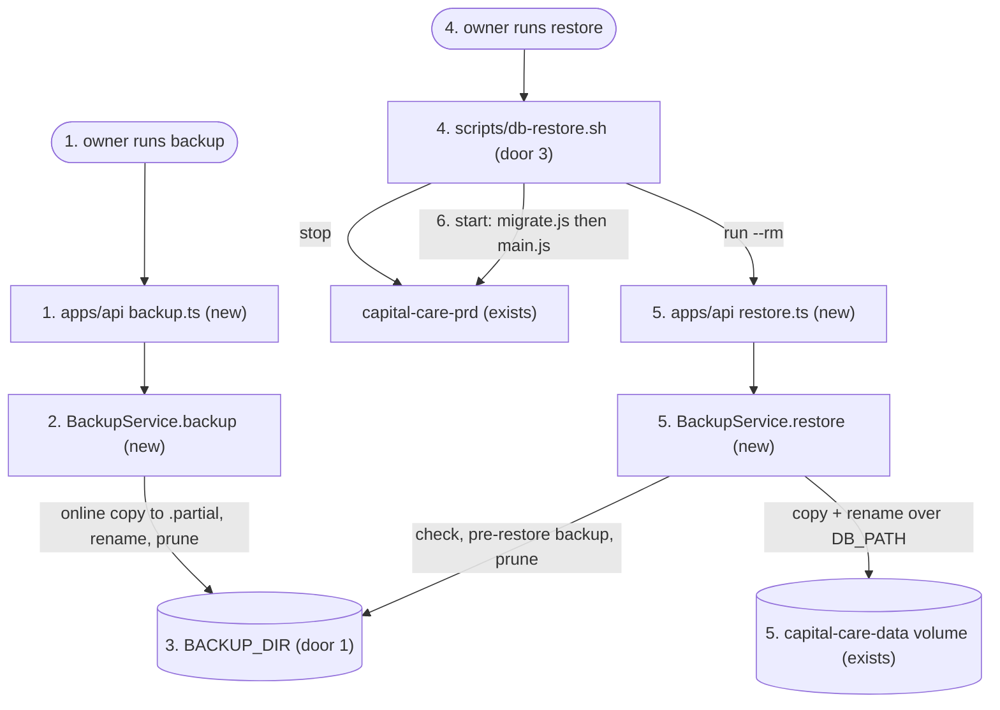
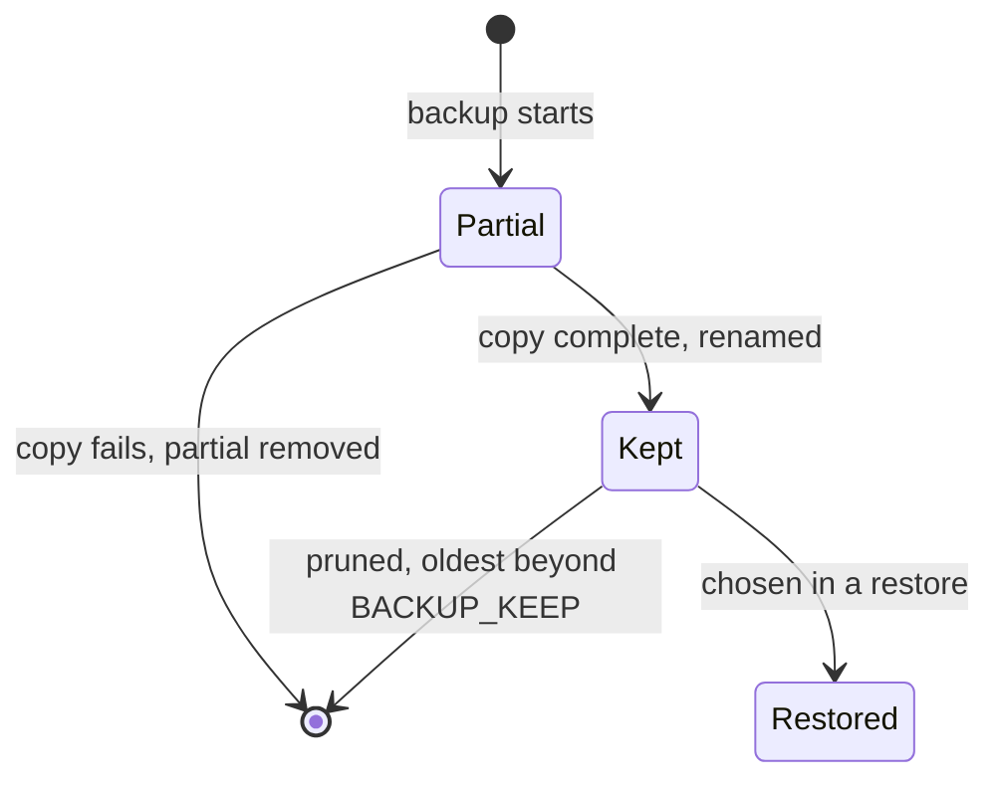

# Database Backup and Restore

**Approved**: <written when the user approves - YYYY-MM-DD - user: "their words">

## Problem

The production database (`capital-care-data` volume) has no backup. If the volume is lost or
damaged, or the owner deletes something by mistake, every financial record is gone and there is no
way back. The owner pays for it alone: there is no substitute today. Evidence: none, no loss has
happened yet; the PRD rests on the cost of a single loss (`.prd/database-backup-and-restore.md`).

When this ships, the owner runs one command to take a backup while the app is running, and one
command to put a chosen backup back and see the data as it was at that backup, with the data from
just before the restore kept so the restore can be undone.

## Shape

This reuses the ledger module's database file, its committed migrations and the container image's
existing `migrate && start` command (which brings an older backup up to date), and adds no new
dependency: `better-sqlite3`'s online backup API makes the consistent copy that `database.md`
requires. The rules that decide an outcome (file names, which backups to prune, whether a backup is
too new, the order of the restore steps) run in `modules/ledger/src/backup/backup.service.ts`,
which unit tests reach through in-memory fakes of the file system and the database; the adapters
are proven by integration tests against real temporary SQLite files.

1. owner runs `backup` in the running container -> `apps/api/src/backup.ts` (new) - reads
   `DB_PATH`, `BACKUP_DIR`, `BACKUP_KEEP` and calls `BackupService.backup()`
2. `BackupService` (new) - names the file from the clock, copies the live database with the online
   backup API to `<name>.partial` (door 2), renames it to `<name>` only when the copy is complete,
   then prunes the oldest backups beyond `BACKUP_KEEP`
3. out: the backup file in `BACKUP_DIR` (door 1), and one line on stdout with its name; exit `0`
4. owner runs `scripts/db-restore.sh <backup-name>` on the host (new, door 3) - stops
   `capital-care-prd`, runs `restore.js <backup-name>` in a one-off container of the same image,
   and starts `capital-care-prd` again whatever the outcome
5. `apps/api/src/restore.ts` (new) -> `BackupService.restore(name)` - checks the chosen backup
   exists, passes `PRAGMA integrity_check` and is not from a newer app version; saves the current
   data as a `-pre-restore` backup; copies the chosen backup next to `DB_PATH` and renames it over
   `DB_PATH`; then prunes
6. out: one line on stdout naming the restored backup and the pre-restore backup; exit `0`. On
   start, the existing `migrate.js` (exists) applies any migration the backup lacks

**Commands** - two commands in the image and one host script:

| Command | In | Out | Exit code | Who |
| --- | --- | --- | --- | --- |
| `node dist/backup.js` (prod: `docker compose --profile prod exec capital-care-prd node dist/backup.js`) | env `DB_PATH`, `BACKUP_DIR`, `BACKUP_KEEP` | stdout `Backup created: <name>`; stderr `Backup failed: <reason>` | `0` created, `1` failed | the owner, with shell access to the Docker host; nobody reaches it over HTTP |
| `node dist/restore.js <name>` | backup file name; same env | stdout `Restored <name>. Current data saved as <pre-restore name>.`; stderr `Restore failed: <reason>. Current data was not changed.` | `0` restored, `1` failed | the owner, as above |
| `scripts/db-restore.sh <name>` | backup file name | the restore's output, then whether the app started again | `0` restored, `1` failed | the owner, on the Docker host |

**Changes underneath**

| Front | What changes |
| --- | --- |
| domain | nothing - no business term changes meaning |
| stored data | nothing to migrate; the schema is unchanged. A new storage location for backups appears (door 1) |
| readers | `docker-compose.yml` `capital-care-prd` gains the backups mount and two variables; the `dev` service gets no backups (PRD: Unchanged) |
| config | `.env.example` documents `BACKUP_DIR` and `BACKUP_KEEP` |

Data: none - no table or column changes. A backup file is a complete copy of the database file,
including the `__drizzle_migrations` table that the version check reads.

## Surface

None - no HTTP route; nothing is consumed outside the host. The commands are listed under Shape.

## Landing

| One-way door | Literal shape | Alternative rejected |
| --- | --- | --- |
| 1. Where backups live | Host folder bind-mounted into the prod container: `${BACKUP_HOST_DIR:-./backups}:/app/backups`, `BACKUP_DIR=/app/backups` in the image. The host folder must be writable by UID 1000 (documented) | A named Docker volume: survives like the data volume, but the owner must `docker cp` each file out to copy it elsewhere, and the PRD leaves copying off the machine to the owner by hand |
| 2. Backup file name | `capital-care-<YYYYMMDD>T<HHMMSS><mmm>Z.db`, UTC, e.g. `capital-care-20261127T210500123Z.db`; a pre-restore backup adds `-pre-restore` before `.db`. Only names matching `^capital-care-\d{8}T\d{9}Z(-pre-restore)?\.db$` are listed, pruned or restored; everything else in the folder is left alone. Sorting the names sorts by time | Local time or seconds-only names: local time sorts wrongly across DST changes, and two backups in the same second would collide |
| 3. A host script that stops and starts the app | `scripts/db-restore.sh <name>`: `docker compose --profile prod stop capital-care-prd`, then `docker compose --profile prod run --rm --no-deps --pull never capital-care-prd node dist/restore.js <name>`, then `docker compose --profile prod start capital-care-prd` under a `trap`, so the app always starts again | Restoring into the running app: the server keeps its connection open on the old file and could write over the restored data, and the owner said a brief stop is fine |

- Nothing else in this change is hard to reverse

## Criteria

### S1: Take a backup while the app is running (P1)

The owner takes a consistent, timestamped backup without stopping the app.

**Acceptance Criteria**

1. WHEN the owner runs `backup` THEN the system SHALL write a file named
   `capital-care-<YYYYMMDD>T<HHMMSS><mmm>Z.db` (UTC clock at the start of the backup) in
   `BACKUP_DIR`, print `Backup created: <name>` and exit `0`
   - clock 2026-11-27 21:05:00.123 UTC → `capital-care-20261127T210500123Z.db`
2. WHEN a backup completes THEN the backup file SHALL hold the same rows as the database at the
   moment of the copy, and `PRAGMA integrity_check` on it SHALL return `ok`
3. WHILE the app writes, WHEN the owner runs `backup` THEN the backup SHALL hold all or none of
   each committed write, and the app SHALL keep answering requests
   - a transaction inserting 1,000 rows commits during the backup → the backup has 0 or 1,000 of them
4. WHEN two backups are taken in a row THEN each SHALL get its own file and neither SHALL replace
   the other
   - two backups 1 ms apart → two files; a name that already exists → the backup fails and the
     existing file is untouched
5. WHEN a backup completes and more than `BACKUP_KEEP` backups exist THEN the system SHALL delete
   the oldest ones until exactly `BACKUP_KEEP` remain, counting pre-restore backups, and SHALL NOT
   touch files whose names do not match door 2
   - `BACKUP_KEEP=5`, 5 backups exist → after the 6th, the oldest is gone and 5 remain;
     `BACKUP_KEEP=5`, 3 exist → 4 remain; a file `notes.txt` in the folder → still there
6. The system SHALL read `BACKUP_KEEP` as a whole number of at least 1, default `5` when unset
   - unset → 5; `"05"` → 5; `"0"`, `"-1"`, `"2.5"`, `"abc"` → exit `1` with
     `Backup failed: BACKUP_KEEP must be a whole number of at least 1, got "<value>"` before
     anything is written
7. IF the backup cannot complete THEN the system SHALL remove its `.partial` file, delete no
   earlier backup, leave the database unchanged, print `Backup failed: <reason>` on stderr and
   exit `1`
   - folder missing → exit 1; folder not writable → exit 1; database file missing → exit 1

### S2: Restore a chosen backup (P1)

The owner puts a backup back and sees the data as it was at that backup.

**Acceptance Criteria**

8. WHEN the owner runs `restore <name>` with a valid backup THEN the system SHALL first save the
   current data as `capital-care-<timestamp>-pre-restore.db`, then replace the database with the
   chosen backup, print `Restored <name>. Current data saved as <pre-restore name>.` and exit `0`
   - backup of 26 Nov; a category deleted on 27 Nov; restore the 26 Nov backup → the category is
     back, and rows created after the 26 Nov backup are gone
9. WHEN a restore completes THEN the pre-restore backup SHALL be a normal backup: restoring it
   SHALL bring back the data from just before the first restore
10. WHEN a restore completes THEN pruning SHALL run as in criterion 5, after the chosen backup is
    in place, so the chosen backup is never pruned before it is restored
    - `BACKUP_KEEP=1`, one backup exists, restore it → the database holds its data; afterwards
      only the pre-restore backup remains
11. IF the chosen backup name is invalid THEN the restore SHALL change nothing, print
    `Restore failed: <reason>. Current data was not changed.` and exit `1`
    - name not given, name not matching door 2, or no such file in `BACKUP_DIR` → exit 1
    - no argument → fails; `../capital-care.db` → fails, no file outside `BACKUP_DIR` is read
12. IF the chosen backup is damaged THEN the restore SHALL fail as in criterion 11 and SHALL NOT
    create a pre-restore backup
    - `PRAGMA integrity_check` not `ok` → exit 1; a text file renamed to a backup name → exit 1
13. IF the chosen backup is from a newer app version THEN the restore SHALL fail as in criterion
    11 with the reason `the backup comes from a newer version of the app`
    - newest `__drizzle_migrations.created_at` in the backup later than the newest journal `when`
      the app ships → exit 1; equal → restored
14. WHEN the chosen backup lacks migrations the app ships THEN the restore SHALL succeed, and the
    next app start SHALL apply the missing migrations with the existing migrate step
    - a backup taken before migration `0003` → restored; after start the schema includes `0003`
15. IF a step after the checks fails THEN the file at `DB_PATH` SHALL be byte-for-byte what it
    was before the restore, and the restore SHALL exit `1` with the message of criterion 11
    - pre-restore backup fails → exit 1; copy fails → exit 1; rename fails → exit 1
16. WHEN the database file at `DB_PATH` does not exist (data lost) THEN the restore SHALL skip the
    pre-restore backup, put the chosen backup in place and say `Restored <name>. There was no
    current data to save.`

### S3: Run it in production (P1)

The commands work on the prod container and the owner knows how to use them.

**Acceptance Criteria**

17. WHEN the owner runs `scripts/db-restore.sh <name>` THEN the script SHALL stop
    `capital-care-prd`, run the restore in a one-off container of the same image with the same
    volumes, and start `capital-care-prd` again whether the restore succeeded or failed, exiting
    with the restore's exit code
18. The `capital-care-prd` service SHALL mount the backups folder at `/app/backups` from
    `${BACKUP_HOST_DIR:-./backups}`, separate from the `capital-care-data` volume, and the image
    SHALL set `BACKUP_DIR=/app/backups`; the `capital-care-dev` service SHALL get no backups mount
19. The documentation SHALL describe: taking a backup, restoring one, undoing a restore, setting
    `BACKUP_KEEP` and `BACKUP_HOST_DIR`, preparing the host folder for UID 1000, copying backups
    elsewhere, and that backups are not encrypted (known limitation)

## Out of scope

| Excluded | Why |
| --- | --- |
| Scheduled or automatic backups | PRD: manual only, owner's choice 2026-11-27 |
| Encryption | PRD: not needed while backups stay on the machine; documented as a known limitation |
| Copying backups off the machine | PRD: the owner does it by hand |
| Backup or restore from the web app or an API route | PRD: a task the owner runs on the server |
| A command that lists backups | Not confirmed in the PRD; the owner lists the host folder (`ls backups/`), and names sort by time |
| Backups in the DEV environment | PRD Unchanged: DEV data is throw-away |

## Assumptions

| Assumption | Chosen default | Rationale | Confirmed? |
| --- | --- | --- | --- |
| Where the docs live | A new `docs/operations/backup-and-restore.md`, linked from `README.md` and from `database.md` Backups | `docs/` holds every document (root AGENTS.md); there is no operations doc yet | n |
| Time in names | UTC with milliseconds | names sort by time in any time zone and never collide in the same second | n |
| How "newer version" is detected | The backup's newest `__drizzle_migrations.created_at` against the newest `when` in the app's migration journal | the schema version is what decides whether the running app can read the data; the package version does not change with every schema change | n |

**Open questions:** none - all resolved or logged above.

## Differences from the source

None - the product matches the source

## Sources

- `.prd/database-backup-and-restore.md` - binding - confirmed by tghcastro, 2026-11-27; every Journey state maps to a criterion above
- Linear [CAP-24](https://linear.app/tghcastro/issue/CAP-24/database-backup-and-restore) - binding - acceptance criteria and Agent notes (use SQLite's backup mechanism; data in `capital-care-data`)
- `docs/tech/definitions/database.md` Backups - binding - "use SQLite's backup mechanism ... Do not copy the live database file directly"
