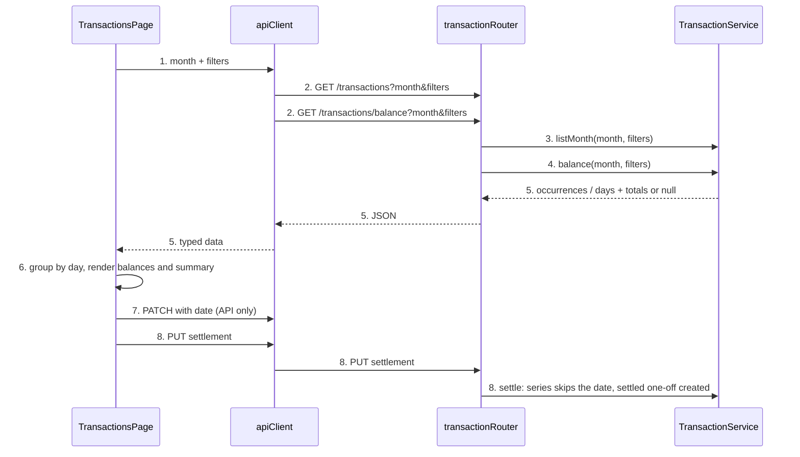
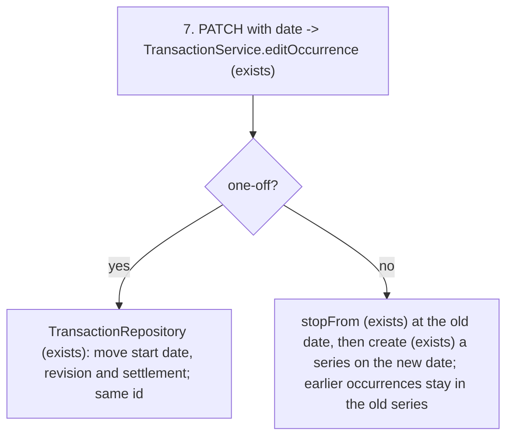
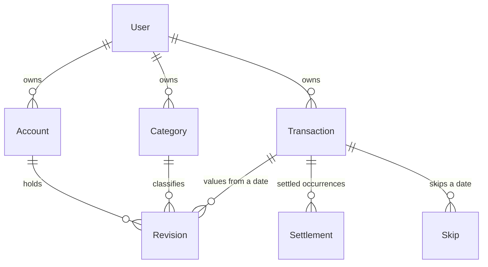

# Monthly Balance

## Problem

The transactions page shows one month at a time, and every balance on it starts again at 0.00 on the first day of the month (AD-003). The "Final available balance" is therefore only that month's net total, not the money the owner has. To know how much money they actually have, overall or in one account, the owner adds up previous months by hand, which stops the page from replacing the old tool's monthly view (the cutover goal of the Transactions PRD). The web page also computes balances, totals and filters itself, so the rules that decide what the owner reads live in the browser. A past transaction cannot be moved to another day through the API, and a settled occurrence of a recurring entry stays tied to its series, so changing or stopping the series can rewrite money that has already moved. Evidence: none measured; the owner's own judgment from using the first version (`.prd/monthly-balance.md`, confirmed 2026-11-17).

When this ships, the owner opens any month, with no filter or with an account filter, and reads the money they have from the day balances and the Final available balance, carried over from every earlier month; with a category filter they see only that month's category movement and no summary totals. Every number comes from the API on each read, so editing, deleting or moving a past transaction shows in every later month at once.

## Shape

Reuses the occurrence expansion in `TransactionService` (`listMonth`, schedule, revisions, settlements) and the existing `stopFrom` and `create` repository operations; the only stored addition is a list of dates a series skips (door 3). Every rule that changes what the owner reads - filtering, the opening balance, the running balance, the totals, when the opening is 0.00 and when totals are hidden, moving a date, splitting a settled occurrence off its series - runs in `TransactionService` in `modules/ledger`, reached by its unit tests (mock repository) and by the API component tests; the web sends the month and the selected filters and displays what comes back (AD-006).

1. Browser `/` -> `TransactionsPage` (exists) - holds month and selected accounts/categories; asks `apiClient.listMonth(month, filters)` and `apiClient.getBalance(month, filters)` (door 1)
2. `apiClient` (exists) -> `GET /transactions?month=YYYY-MM[&category=..][&account=..]` (exists, filters added - door 1) and `GET /transactions/balance?month=YYYY-MM[&category=..][&account=..]` (new - door 1)
3. `transactionRouter` (exists) -> `TransactionService.listMonth` (exists, filters added) - the month's occurrences matching the filters
4. `transactionRouter` (exists) -> `TransactionService.balance` (new) - with no category filter: opening = every matching occurrence dated before `YYYY-MM-01`; with a category filter: opening 0.00; then one balance per day with matching occurrences, and totals unless a category filter is present
5. out: `{ occurrences }` and `{ days: [{ date, balance }], totals | null }`
6. `TransactionsPage` (exists) groups the listed occurrences by day (presentation), shows each day's `balance` from the response, and the summary only when `totals` is not null
7. `PATCH /transactions/:id/occurrences/:date` with `date` (exists, field added - door 2) -> `TransactionService.editOccurrence` (exists, changed) - moves a one-off in place through `TransactionRepository` (exists), or shifts a recurring/instalment series from that occurrence on, via `stopFrom` (exists) and `create` (exists)
8. `PUT /transactions/:id/occurrences/:date/settlement` on a recurring or instalment occurrence (exists, changed - door 3) -> `TransactionService.settle` (exists, changed) - in one database transaction: the series skips that date (`transaction_skip`, door 3) and a settled one-off transaction is created with that occurrence's values; the series carries on

**Changes underneath**

| Front | What changes |
| --- | --- |
| domain | "Final available balance" meant the month's net (AD-003); now means the closing balance: previous closing balance plus the month's net. The day "Balance" carries over too. AD-003 superseded by AD-005 |
| domain | With a category filter the summary totals were shown for the visible rows; now the API returns `totals: null` and the page hides them |
| domain | Filtering, balances and totals move from `apps/web` `ledgerView.buildLedger` to `TransactionService` (AD-006); `buildLedger` keeps only grouping by day |
| domain | A settled occurrence of a recurring or instalment entry was a settlement row on the series; now it is its own settled one-off transaction (new `transactionId`, no `recurrence`, no `instalment`) and the series skips that date. Unsettling it leaves a forecast one-off. Read by `listMonth`, `editOccurrence`, `stopFrom`, the web settle toggle and the recurring icon |
| stored data | new table `transaction_skip`; backfill now in the migration: every existing settlement on a recurring or instalment entry becomes a settled one-off plus a skip row, so stored history reads the same as new settlements; balances stay derived on every read |
| readers | `GET /transactions?month=` gains optional filters (without them it answers as today); `PATCH .../occurrences/:date` gains optional `date`; `PUT .../settlement` on a series answers with the new one-off's `transactionId`; `packages/shared` client gains `getBalance` and filter arguments on `listMonth`; web tests tied to AD-003 and to client-side filtering (web-transactions-page criteria 10-12, 23, 29, 30) change with their criteria |

New: `Skip` (a series' skipped occurrence date). One-way constraints: `Skip` keyed by transaction and date, removed with its transaction (door 3); the balance route and filter params (door 1); the `date` field and its series rule (door 2).

## Surface

| Route | In | Out | Status | Who |
| --- | --- | --- | --- | --- |
| `GET /transactions/balance` (new) | `month=YYYY-MM`; optional `category`, `account`, each repeatable, sent only when a filter is selected (`none` = no category / no account) | `{ days: [{ date, balance }], totals: { received, debits, net, finalBalance } or null }` - signed canonical decimal strings | `200`, `400` bad month, `401` | the acting user named by `X-User-Id`; a request without it gets `401`; ids of another user match nothing |
| `GET /transactions` (changed) | `month=YYYY-MM`; optional `category`, `account` as above | `{ occurrences }` matching the filters | `200`, `400` bad month, `401` | as above |
| `PATCH /transactions/:id/occurrences/:date` (changed) | optional `date` beside the existing fields | the occurrence on its new date | `200`, `400` invalid date, `404` not the caller's or not an occurrence, `401` | as above; another user's transaction gets `404` |
| `PUT /transactions/:id/occurrences/:date/settlement` (changed) | as today | the settled occurrence; on a recurring or instalment entry it is a one-off with a new `transactionId` | `200`, `404`, `409` already settled, `401` | as above |

## Landing

| One-way door | Literal shape | Alternative rejected |
| --- | --- | --- |
| 1. Balance route and filter params | `GET /transactions/balance?month=2027-01&category=<id>&account=<id>&account=none` returns `{ "days": [{ "date": "2027-01-01", "balance": "8641" }], "totals": { "received": "4000", "debits": "1110", "net": "2890", "finalBalance": "7531" } }`, `totals` `null` while any `category` is given; no filter → only `month` is sent; `GET /transactions` takes the same `category`/`account` params; OR within one param, AND between the two; client: `listMonth(month, { accountIds, categoryIds })`, `getBalance(month, { accountIds, categoryIds })` | (a) `openingBalances` per account on the month response with the web summing it: leaves the carry-over rule, the category rule and the totals in the browser, which the owner ruled out ("all business logic should be kept on API"); (b) the web walking earlier months: unbounded requests and the rule in the client; (c) comma-separated ids in one param: ids could later contain commas; (d) an empty value or a separate flag for "no category": the owner chose `none` |
| 2. `date` on PATCH and the series rule | `PATCH /transactions/:id/occurrences/2026-12-15` `{ "date": "2027-01-02" }`; one-off: moved in place, same `transactionId`, settlement (if any) moves with it; recurring/instalment occurrence (always a forecast, door 3): the old series stops at the old date and keeps its earlier occurrences; a new series starts on the new date with the same recurrence, the values in force on the old date, and the instalment numbering continuing (new `transactionId`) | (a) move that occurrence alone: needs a "moved occurrence" table; (b) one-off only: the owner chose to shift the series ("Shift the series from there"); (c) earlier forecast occurrences become one-offs: the owner chose "Stay in the old series" |
| 3. Settling splits an occurrence off its series | table `transaction_skip (transaction_id text not null references transaction(id) on delete cascade, occurrence_date text not null, primary key (transaction_id, occurrence_date))`; settling a recurring or instalment occurrence inserts a skip row and a new one-off transaction (start date = occurrence date, values in force, overridden `amount` if given) with its settlement, in one database transaction; unsettle deletes only the one-off's settlement; the migration backfills every existing settlement on a recurring or instalment entry the same way | (a) keep the settlement on the series and add a `date` column to it: unsettling would put the occurrence back in the series, which the owner ruled out ("Stays a one-off"), and a stop or shift would still delete settled history; (b) migrate on read: two meanings for one stored row for ever |

- Nothing else in this change is hard to reverse

## Criteria

### S1: Balances carry over between months with no filter (P1)

The day balances and the Final available balance continue from every earlier month; the Monthly net total stays the month's own net. All figures use the PRD background data.

**Acceptance Criteria**

1. WHEN `GET /transactions/balance?month=YYYY-MM` is called with no filter THEN the API SHALL return `totals.net` as that month's receipts minus debits and `totals.finalBalance` as every occurrence of the caller dated before `YYYY-MM-01` plus that net, settled and forecast alike, recurring and instalment occurrences expanded, stopped occurrences excluded, another user's never counted; and the page SHALL show them as "Monthly net total" and "Final available balance" in the standard money format
   - October 2026 → `0.00` / `0.00`; November 2026 → `2,321.00` / `2,321.00`; December 2026 → `2,320.00` / `4,641.00`; January 2027 → `2,890.00` / `7,531.00`; February 2027 → `0.00` / `7,531.00`; March 2027 → `3,000.00` / `10,531.00`; April 2027 → `0.00` / `10,531.00`
   - a monthly receipt of 100.00 from 2026-01-15, month 2026-04 → Final `300.00`; the same entry stopped from 2026-03-15 → `200.00`
2. WHEN a month has occurrences THEN the API SHALL return one `days` entry per date with occurrences, ascending, whose `balance` is the opening balance plus every occurrence up to and including that date, and the page SHALL show it as "Balance <value>" after that day's group
   - November 2026 → 2026-11-01 `3,000.00`, 2026-11-10 `2,771.00`, 2026-11-15 `2,321.00`
   - December 2026 → 2026-12-01 `5,321.00`, 2026-12-05 `5,201.00`, 2026-12-10 `5,091.00`, 2026-12-15 `4,641.00`
   - January 2027 (two receipts on the 1st, three debits on the 5th) → 2027-01-01 `8,641.00`, 2027-01-05 `7,961.00`, 2027-01-12 `7,761.00`, 2027-01-20 `7,611.00`, 2027-01-25 `7,531.00`
   - March 2027 → 2027-03-01 `10,531.00`
3. IF the month has no occurrences THEN the API SHALL return `days: []` with `totals.finalBalance` equal to the previous month's, and the page SHALL show "No transactions this month" with Monthly net total `0.00` (February 2027 → Final `7,531.00`; October 2026, before the first transaction → `0.00`)

### S2: An account filter scopes balances, still carrying over (P1)

**Acceptance Criteria**

4. WHILE `account` is given and no `category` is THEN the API SHALL list only occurrences of the given accounts and compute the opening balance, day balances and totals from those accounts only, `none` meaning occurrences with no account
   - Checking Account: November 2026 → `2,550.00` / `2,550.00`; December 2026 → `2,430.00` / `4,980.00`; January 2027 → `3,300.00` / `8,280.00`; February 2027 → `0.00` / `8,280.00`
   - Checking Account, January 2027 → only Checking Account rows listed; 2027-01-01 `8,980.00`, 2027-01-05 `8,480.00`, 2027-01-12 `8,280.00`
   - Checking Account and Credit Card both given, January 2027 → Final `7,531.00` (same as no filter)
5. WHEN the owner selects or deselects accounts or categories in the page THEN the page SHALL request both routes again with `month` plus one `category` / `account` param per selected id (`none` for "Uncategorized" / "Unassigned"), no filter param when nothing is selected, and display only what they return

### S3: A category filter covers the selected month only and hides the summary (P1)

**Acceptance Criteria**

6. WHILE `category` is given THEN the API SHALL list only occurrences of the given categories (and of the given accounts, if any) and start the running balance at 0.00 on the month's first day, counting only those occurrences
   - Shopping, January 2027 → Winter jacket and Running shoes listed; 2027-01-05 `-180.00`, 2027-01-20 `-330.00`
   - Groceries + Checking Account, January 2027 → only Supermarket 2027-01-12 listed; 2027-01-12 `-200.00`
7. WHILE `category` is given THEN the API SHALL return `totals: null` and the page SHALL not display "Total received", "Total debits", "Monthly net total" or "Final available balance"; WHEN the last category is deselected THEN the page SHALL display them again

### S4: Changing a past transaction updates every later balance (P1)

Balances are derived on every read; nothing is recalculated by hand.

**Acceptance Criteria**

8. WHEN a past occurrence's amount is edited THEN every later month SHALL reflect it
   - Dentist 2026-12-05 to `220.00` → December 2026 Final `4,541.00`; January 2027 Final `7,431.00`; 2027-01-01 day balance `8,541.00`
9. WHEN a past one-off transaction is deleted THEN every later month SHALL reflect it
   - New office chair 2026-11-10 → November 2026 Final `2,550.00`; December 2026 `4,870.00`; January 2027 `7,760.00`
10. WHEN a PATCH gives a one-off occurrence a new `date` THEN the API SHALL move it to that date with the same `transactionId` and values (and its settlement, if settled), and both months SHALL reflect it
    - Condo fees 2026-12-15 → 2027-01-02: December 2026 net `2,770.00` / Final `5,091.00`; January 2027 net `2,440.00` / Final `7,531.00`
11. WHEN a past occurrence's account is changed THEN the affected accounts' filtered balances SHALL reflect it from that month on
    - Wireless keyboard 2026-12-10 to Checking Account, Checking Account filter → December 2026 Final `4,870.00`; January 2027 Final `8,170.00`

### S5: Settled occurrences are one-offs; moving a recurring occurrence shifts the series (P2)

**Acceptance Criteria**

12. WHEN the owner settles an occurrence of a recurring or instalment entry THEN the API SHALL turn it into a settled one-off transaction (new `transactionId`, `recurrence` null, `instalment` null) with that occurrence's values and the settled amount, and the series SHALL keep every other occurrence unchanged
    - monthly 100.00 from 2027-01-10, settle 2027-02-10 with amount `95.00` → Feb 10 one-off settled `95`; Jan 10 and Mar 10 still monthly forecasts of `100`; February balance counts `95` once
13. WHEN the owner unsettles such a one-off THEN the API SHALL leave it a forecast one-off with the same values; the series SHALL not take it back
14. WHEN a PATCH gives a forecast occurrence of a recurring or instalment entry a new `date` THEN the API SHALL keep the earlier occurrences in the old series, unchanged, and replace that occurrence and every later one with a new series starting on the new date, same recurrence, the values in force on the old date, instalment numbers continuing; earlier settled one-offs SHALL stay as they are
    - monthly 100.00 from 2027-01-10 with Jan 10 settled, move 2027-03-10 → 2027-03-20: Jan 10 settled one-off, Feb 10 old series, Mar 20, Apr 20 new series; nothing on Mar 10 or Apr 10
    - instalments 3 of 6 from 2027-01-10, move the 4/6 on 2027-02-10 → 2027-02-25: 3/6 on Jan 10, 4/6 on Feb 25, 5/6 on Mar 25, 6/6 on Apr 25, nothing after
    - moving the first occurrence of a monthly entry → the whole series moves
15. WHEN a series is stopped from a date (`DELETE .../occurrences/:date`) THEN settled one-offs split from it on or after that date SHALL remain
16. IF `date` is not a real `YYYY-MM-DD` date THEN the API SHALL answer `400` with the shared date message and change nothing; a `date` equal to the current one moves nothing
17. WHEN the migration runs on a database with a settlement on a recurring or instalment entry THEN that occurrence SHALL read afterwards as a settled one-off with the same date, values and settled amount, and the series SHALL skip that date; `GET /transactions` for that month SHALL list the same dates and amounts as before the migration

## Out of scope

| Excluded | Why |
| --- | --- |
| Transfers between accounts | PRD: separate, later feature |
| Account opening balances | PRD: every account starts at 0.00; the owner records a Receipt or Debit |
| Balances for a range of months, reports, charts | PRD: not needed for parity |
| Moving one forecast occurrence of a series alone | the owner chose shifting the series |
| Rejoining an unsettled one-off to its series | the owner chose "Stays a one-off" |
| Editing, moving or deleting transactions from the web page | still excluded by the web-transactions-page plan; S4-S5 are proven through the API |
| Storing or caching balances | PRD: nothing stored changes; derived on read |
| Changing labels, month selection or money format | PRD: unchanged |

## Assumptions

| Assumption | Chosen default | Rationale | Confirmed? |
| --- | --- | --- | --- |
| Opening balance, scope and category rule | carry over from all earlier months; account filter scopes it; category filter starts at 0.00 and hides the four totals | PRD journey, confirmed by the owner 2026-11-17; AD-005 | y |
| Forecasts in balances | settled and forecast both count | PRD: "Both count towards every balance, as they do today" | y |
| Where the rules run | API computes filters, balances and totals; the web requests month and filters and displays | user: "all business logic should be kept on API. Front-end should only request month and lists to display data"; AD-006 | y |
| Balance route | `GET /transactions/balance` | user: "Seems that the /transactions/balance would be the best option" | y |
| List filters | `GET /transactions` filters too, same params | user chose "Yes, API filters both (Recommended)" | y |
| Moving a date | PATCH accepts `date`; a past transaction is moved by changing its date, account or category, and every GET reflects it | user: "It's only a change in transaction date and/or account and/or category... always when we request GET Transactions the values should be updated"; chose "Add date to PATCH" | y |
| Date on recurring/instalment entries | shift the series from that occurrence on | user chose "Shift the series from there" | y |
| Opening balance for "Unassigned" | occurrences with no account count when `none` is selected or no account filter is given | user: "Yes" | y |
| Settling a recurring occurrence | it becomes a one-off; the series continues | user: "When settling a transaction which was a recurrence, it should (that ocurrence in specific) change to a oneoff and others in next month continue as is" | y |
| Unsettling a split one-off | stays a forecast one-off | user chose "Stays a one-off (Recommended)" | y |
| Moving a recurring occurrence | earlier occurrences stay in the old series; the moved one and later form the changed series with a new `transactionId` | user: "previous trasactions continue as is... Future transactions will be part of the changed recurrence. I think it confirms the 2 question you asked"; chose "Stay in the old series (Recommended)" | y |
| Filter params | `category`, `account`, optional, repeatable, sent only when selected; `none` for no category / no account | user: "If there are no filters whe WEB will send only month/year. If there is a category filter WEB will add `&category=<id>`"; chose "category=none (Recommended)" | y |
| Instalment label on a split one-off | dropped: a settled instalment shows no `3/6` and no recurring icon | a one-off has no instalment plan in the stored model | n |
| A shifted series landing on a month that already has a settled one-off split from the old series | both are kept (the settled one-off and the new series' forecast) | settled history is never rewritten; the owner can delete the forecast | n |
| Stop (`DELETE`) on a series | settled one-offs split from it survive, since they are no longer part of it | follows from settling being a split | n |
| Acceptance test shape | one test per month, mirroring each PRD Gherkin scenario and Examples row | the task request: "Write the acceptance tests one month at a time, like the PRD's Gherkin scenarios" | n |

**Open questions:** none - all resolved or logged above.

## Differences from the source

None - the product matches the source

## Sources

- `.prd/monthly-balance.md` - binding - journey, boundary, terms and the acceptance scenarios (confirmed by tghcastro, 2026-11-17)
- `.specs/features/web-transactions-page/plan.md` - binding - the page, labels and filters this changes (criteria 10-12, 23, 29, 30 superseded)
- `docs/tech/definitions/api.md`, `docs/tech/definitions/web.md`, `docs/tech/definitions/testing.md` - binding - route and param conventions, stack, test levels
