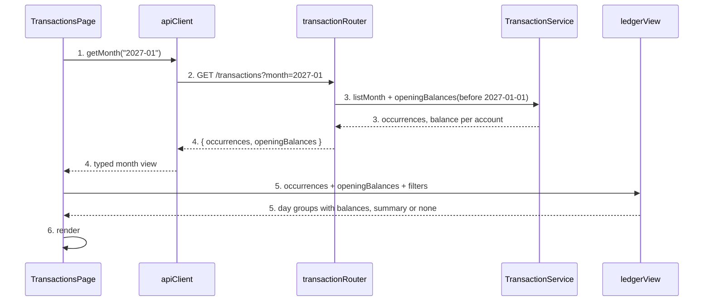
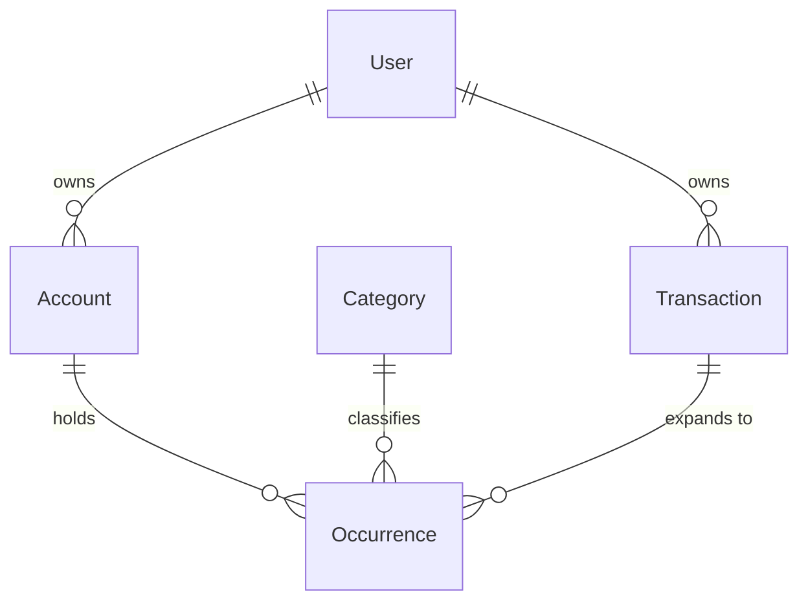

# Monthly Balance

## Problem

The transactions page shows one month at a time, and every balance on it starts again at 0.00 on the first day of the month (AD-003). The "Final available balance" is therefore only that month's net total, not the money the owner has. To know how much money they actually have, overall or in one account, the owner adds up previous months by hand, which stops the page from replacing the old tool's monthly view (the cutover goal of the Transactions PRD). Evidence: none measured; the owner's own judgment from using the first version (`.prd/monthly-balance.md`, confirmed 2026-11-17).

When this ships, the owner opens any month, with no filter or with an account filter, and reads the money they have from the day balances and the Final available balance, carried over from every earlier month; with a category filter they see only that month's category movement and no summary totals.

## Shape

Reuses the existing month listing (`GET /transactions?month=`), the occurrence expansion in `TransactionService` and the web's pure `buildLedger`; nothing stored changes. The rule that sums history (the opening balance per account before a month) runs in `TransactionService`, reached by the ledger unit and API component tests; the rules that combine it with the month (which accounts count, when the opening is 0.00, which totals show) run in the pure `ledgerView`, reached by the web unit tests, and the page only renders what it returns.

1. Browser `/` -> `TransactionsPage` (exists) - month and filters; asks `apiClient.getMonth(month)` (door 1)
2. `apiClient` (exists) -> `GET /transactions?month=YYYY-MM` (exists, response extended - door 1)
3. `transactionRouter` (exists) -> `TransactionService.listMonth` (exists) and `TransactionService.openingBalances` (new) - expands every occurrence dated before `YYYY-MM-01`, settled or forecast, and sums receipts minus debits per `accountId` (null included)
4. out: `{ occurrences, openingBalances: [{ accountId, balance }] }`
5. `ledgerView.buildLedger` (exists, changed) - no category filter: opening = sum of the openings of the selected accounts (all when none selected), running balance and Final available balance start from it; category filter active: opening 0.00 and the summary totals are not returned
6. `TransactionsPage` (exists) renders the day balances, and the summary only when `buildLedger` returns it

**Changes underneath**

| Front | What changes |
| --- | --- |
| domain | "Final available balance" meant the month's net (AD-003); now means the closing balance: previous closing balance plus the month's net. The day "Balance" now carries over too. AD-003 superseded by AD-005. Read by `buildLedger` and `TransactionsPage` only |
| domain | With a category filter the summary (Total received, Total debits, Monthly net total, Final available balance) was shown for the visible rows; now it is hidden |
| stored data | nothing to migrate; balances are derived on every read |
| readers | `GET /transactions?month=` gains `openingBalances` (additive; existing consumers ignore it); `packages/shared` client gains `getMonth`; `ledgerView.test.ts` and `TransactionsPage.test.tsx` claims tied to AD-003 change with their criteria (web-transactions-page criteria 10-12) |

New: nothing - read only. One-way constraints: the `openingBalances` response field (door 1).

## Surface

| Route | In | Out | Status | Who |
| --- | --- | --- | --- | --- |
| `GET /transactions?month=YYYY-MM` (changed) | `month`, header `X-User-Id` | `{ occurrences: Occurrence[], openingBalances: { accountId: string or null, balance: string }[] }` - `balance` a signed canonical decimal string (`"-180"`, `"2321"`), one entry per account (and `null`) with any occurrence before the month, the caller's own data only | `200`, `400` bad month, `401` | the acting user named by `X-User-Id`; a request without it gets `401`; another user's transactions never count |

## Landing

| One-way door | Literal shape | Alternative rejected |
| --- | --- | --- |
| 1. Opening balances on the month response | `GET /transactions?month=YYYY-MM` returns `openingBalances: [{ "accountId": "<id>" or null, "balance": "<signed decimal>" }]`, the sum of every occurrence dated before `YYYY-MM-01`, per account; the client adds `getMonth(month): Promise<{ occurrences, openingBalances }>` and keeps `listMonth` unchanged | (a) the web walks every earlier month: it does not know the first month, needs unbounded requests per page view and duplicates the sum in the client; (b) a separate `GET /transactions/balances?before=` route: two requests that can disagree between a write and the second read, for no caller that needs it alone; (c) one total per selected-account set as a query param: the web already filters accounts client-side, and per-account entries let it sum any selection from one response |

- Nothing else in this change is hard to reverse

## Criteria

### S1: Balances carry over between months with no filter (P1)

The day balances and the Final available balance continue from every earlier month; the Monthly net total stays the month's own net.

**Acceptance Criteria**

1. WHEN `GET /transactions?month=YYYY-MM` is called THEN the API SHALL return `openingBalances` with, per `accountId` (null included), the receipts minus debits of every occurrence of the caller dated before `YYYY-MM-01`, settled and forecast alike, with recurring and instalment occurrences expanded, and stopped occurrences excluded
   - PRD data, month 2027-01 → Checking Account `4980`, Credit Card `-339`; month 2026-11 (first ever) → `[]`; a monthly receipt of 100.00 from 2026-01-15 and month 2026-04 → `300`; the same entry stopped from 2026-03-15 → `200`; another user's transactions → not counted
2. WHEN the owner views a month with no filter THEN the system SHALL show the Monthly net total as that month's receipts minus debits, and the Final available balance as the sum of all opening balances plus that net, both in the standard money format
   - PRD data: October 2026 → `0.00` / `0.00`; November 2026 → `2,321.00` / `2,321.00`; December 2026 → `2,320.00` / `4,641.00`; January 2027 → `2,890.00` / `7,531.00`; February 2027 → `0.00` / `7,531.00`; March 2027 → `3,000.00` / `10,531.00`; April 2027 → `0.00` / `10,531.00`
3. WHEN the owner views a month with no filter THEN each day group SHALL show one "Balance <value>": the opening balance plus every occurrence up to and including that day
   - November 2026 → 2026-11-01 `3,000.00`, 2026-11-10 `2,771.00`, 2026-11-15 `2,321.00`; December 2026 → `5,321.00`, `5,201.00`, `5,091.00`, `4,641.00`; January 2027 (two receipts on the 1st, three debits on the 5th) → 2027-01-01 `8,641.00`, 2027-01-05 `7,961.00`, 2027-01-12 `7,761.00`, 2027-01-20 `7,611.00`, 2027-01-25 `7,531.00`; March 2027 → 2027-03-01 `10,531.00`
4. IF the month has no occurrences THEN the system SHALL show "No transactions this month", Monthly net total `0.00` and the Final available balance equal to the previous month's (February 2027 → `7,531.00`; October 2026, before the first transaction → `0.00`)

### S2: An account filter scopes balances, still carrying over (P1)

**Acceptance Criteria**

5. WHILE an account filter is active and no category filter is THEN the system SHALL compute the opening balance as the sum of the selected accounts' opening balances ("Unassigned" counting the `null` entry), and the day balances, Monthly net total and Final available balance from that opening and the selected accounts' occurrences only
   - Checking Account: November 2026 → `2,550.00` / `2,550.00`; December 2026 → `2,430.00` / `4,980.00`; January 2027 → `3,300.00` / `8,280.00`; February 2027 → `0.00` / `8,280.00`
   - Checking Account, January 2027 day balances → 2027-01-01 `8,980.00`, 2027-01-05 `8,480.00`, 2027-01-12 `8,280.00`, and only Checking Account rows listed
   - Checking Account and Credit Card both selected, January 2027 → Final available balance `7,531.00` (same as no filter)

### S3: A category filter covers the selected month only and hides the summary (P1)

**Acceptance Criteria**

6. WHILE a category filter is active THEN the system SHALL start the running balance at 0.00 on the first day of the month, counting only the visible rows, whatever account filter is also active
   - Shopping, January 2027 → rows Winter jacket and Running shoes; 2027-01-05 `-180.00`, 2027-01-20 `-330.00`
   - Groceries + Checking Account, January 2027 → only Supermarket 2027-01-12; 2027-01-12 `-200.00`
7. WHILE a category filter is active THEN the system SHALL not display "Total received", "Total debits", "Monthly net total" or "Final available balance", and SHALL display them again when the last category is deselected

### S4: Changing a past transaction updates every later balance (P1)

Balances are derived on every read, so a change made through the existing transaction routes shows in that month and every later one without any recalculation step.

**Acceptance Criteria**

8. WHEN a past occurrence's amount is edited (`PATCH /transactions/:id/occurrences/:date`) THEN every later month SHALL reflect it
   - Dentist 2026-12-05 to `220.00` → December 2026 Final `4,541.00`; January 2027 Final `7,431.00`; 2027-01-01 day balance `8,541.00`
9. WHEN a past one-off transaction is deleted (`DELETE /transactions/:id/occurrences/:date` on its start date) THEN every later month SHALL reflect it
   - New office chair 2026-11-10 → November 2026 Final `2,550.00`; December 2026 `4,870.00`; January 2027 `7,760.00`
10. WHEN a past transaction is moved to another month (deleted and recorded again on the new date, see Assumptions) THEN both months SHALL reflect it
    - Condo fees 2026-12-15 → 2027-01-02: December 2026 net `2,770.00` / Final `5,091.00`; January 2027 net `2,440.00` / Final `7,531.00`
11. WHEN a past occurrence's account is changed (`PATCH` with `accountId`) THEN the affected accounts' filtered views SHALL reflect it from that month on
    - Wireless keyboard 2026-12-10 to Checking Account, Checking Account filter → December 2026 Final `4,870.00`; January 2027 Final `8,170.00`

## Out of scope

| Excluded | Why |
| --- | --- |
| Transfers between accounts | PRD: separate, later feature |
| Account opening balances | PRD: every account starts at 0.00; the owner records a Receipt or Debit |
| Balances for a range of months, reports, charts | PRD: not needed for parity |
| Changing an occurrence's date through the API or the page | no date edit exists today; the PRD changes only how balances are calculated and shown, so it is not added here |
| Editing or deleting transactions from the web page | still excluded by the web-transactions-page plan; S4 is proven through the API routes that exist |
| Storing or caching balances | PRD: nothing stored changes; derived on read |
| Changing labels, month selection or money format | PRD: unchanged |

## Assumptions

| Assumption | Chosen default | Rationale | Confirmed? |
| --- | --- | --- | --- |
| Opening balance, scope and category rule | carry over from all earlier months; account filter scopes it; category filter starts at 0.00 and hides the four totals | PRD journey and scenarios, confirmed by the owner 2026-11-17; supersedes AD-003 as AD-005 | y |
| Forecasts in balances | settled and forecast occurrences both count | PRD: "Both count towards every balance, as they do today" | y |
| How the "move to the next month" scenario is performed | delete the occurrence and record it again on the new date | the API has no date edit; the balance outcome is the same either way | n |
| Opening balance for "Unassigned" | the `null` account entry, counted when "Unassigned" is selected or no account is selected | matches the existing "Unassigned" filter meaning | n |
| Acceptance test shape | one test per month, mirroring each PRD Gherkin scenario and Examples row | the task request: "Write the acceptance tests one month at a time, like the PRD's Gherkin scenarios" | n |

**Open questions:** none - all resolved or logged above.

## Differences from the source

None - the product matches the source

## Sources

- `.prd/monthly-balance.md` - binding - journey, boundary, terms and the acceptance scenarios (confirmed by tghcastro, 2026-11-17)
- `.specs/features/web-transactions-page/plan.md` - binding - the page, labels and filters this changes (criteria 10-12 superseded)
- `docs/tech/definitions/web.md`, `docs/tech/definitions/testing.md` - binding - stack, test levels and locations
