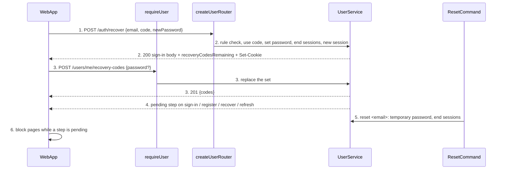
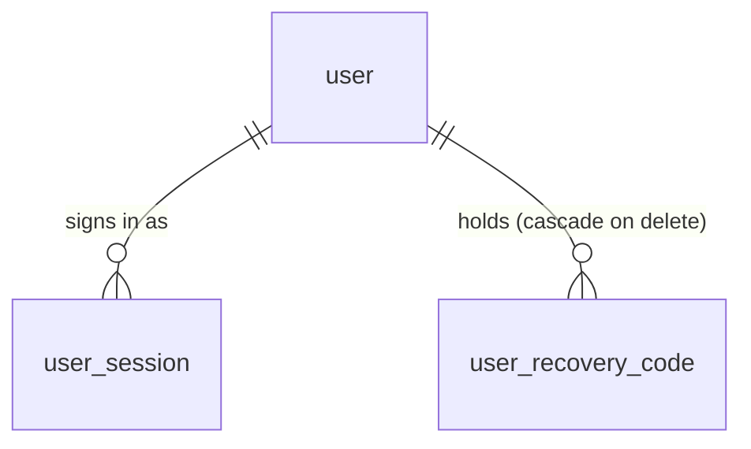
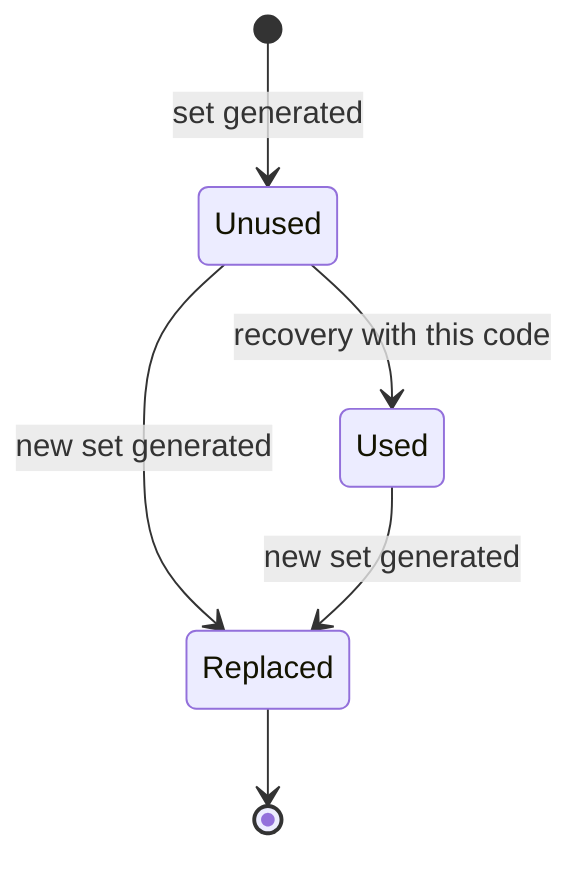

# Password recovery

**Approved**: 2026-11-25 - user: "Approved by tghcastro"

## Problem

Once registration is open, anyone who forgets their password loses their account and every record in it. There is no email server, so a reset link cannot be sent, and the only way back today would be the owner editing the database by hand. Evidence: `.prd/password-recovery.md` (approved); the base authentication and user management plans (approved 2026-11-25) give sign-in, sessions, registration and the profile, but no way back in without the password.

When this ships, every person holds a set of one-time recovery codes they saved when they registered (or at their first sign-in after this ships), uses one to set a new password on their own, can replace the set from their profile, and the owner can issue a 24-hour temporary password from the server when the codes are lost.

## Shape

This reuses everything base authentication and user management build in `modules/identity` - password hashing, the password rule, session creation and revocation, the refresh cookie, the audit log, the deletion path - and the web `AuthProvider` and redirects. The rules that change an outcome - code generation, normalisation and one-time use, the remaining-count warning, temporary password expiry, which step is pending after sign-in - run in `UserService` in `modules/identity/src/user/`, reached by unit tests with in-memory doubles; the web only shows the pending step the API reports (user chose web-only enforcement).

1. recovery request -> `createUserRouter` (exists after base authentication) - validates email, code and new password; hands them to `UserService`
2. `UserService` (exists after base authentication) - checks the new password rule first, then finds an unused code of that user (door 1), marks it used, sets the password, ends every earlier session, starts a new one, records an audit event; answers like sign-in plus the count of unused codes
3. codes request -> `requireUser` (exists after base authentication) -> `UserService` - checks the password unless the user has no codes yet, replaces the whole set, answers the new codes once
4. sign-in, registration, recovery and refresh answers -> `UserService` - report the pending step: `recoveryCodesRequired` when the user has no codes, `passwordChangeRequired` after an owner reset (door 2)
5. `ResetCommand` (new) -> `UserService` - for an existing email, sets a random temporary password valid 24 hours, flags a required change, ends every session, prints the password once
6. `WebApp` (exists) - forgot-password page, recovery codes screen, set-new-password screen; blocks every other page while a step is pending

**Changes underneath**

| Front | What changes |
| --- | --- |
| domain | "signed in" now carries a pending step: a signed-in user may first have to save codes or set a new password before using the app. Branching on it: the web `AuthProvider` and route guards; the API data routes do not branch (web-only enforcement) |
| stored data | new `user_recovery_code`; `user` gains `password_change_required` and `password_expires_at`. Nothing to backfill: users without codes are sent to the codes screen at their next sign-in, which is the PRD's behaviour for the five test users and earlier accounts |
| readers | sign-in, registration and refresh answers gain `recoveryCodesRequired` and `passwordChangeRequired`; `GET /users/me` gains `recoveryCodesRemaining`; base authentication's sign-in also rejects an expired temporary password; user management's deletion also removes the user's codes (cascade); `POST /auth/password` clears `password_change_required`; the web (new pages, `Forgot password?` on sign-in, codes section on the profile); the Bruno collection; `docs/tech/definitions/security.md`; the SPA route list (AD-010) gains `/recover`, `/recovery-codes`, `/set-password` |

New: `user_recovery_code` and its relation to `user`; `password_change_required` and `password_expires_at` on `user`. One-way constraints: `user_recovery_code.user_id` references `user(id)` with `ON DELETE CASCADE` (door 1).

## Surface

| Route | In | Out | Status | Who |
| --- | --- | --- | --- | --- |
| `POST /auth/recover` | `email`, `code`, `newPassword`; `User-Agent` | sign-in body + `recoveryCodesRemaining`; `Set-Cookie: cc_refresh` | `200`, `400` (invalid body or password rule), `401` (`Invalid email or recovery code`) | anyone |
| `POST /users/me/recovery-codes` | `Authorization: Bearer`; `password` (required when the user already has codes) | `codes` (8 strings `XXXXX-XXXXX`) | `201`, `400` (`Password is incorrect`), `401` | signed-in user; the rest get `401` |
| `GET /users/me` (signature changes) | `Authorization: Bearer` | adds `recoveryCodesRemaining` | `200`, `401` | signed-in user; the rest get `401` |
| `POST /auth/sign-in`, `POST /users`, `POST /auth/refresh` (signature changes) | unchanged | add `recoveryCodesRequired`, `passwordChangeRequired` (booleans) | `200` / `201` as before; sign-in with an expired temporary password → `401` `Invalid email or password` | unchanged |
| `GET /recover`, `GET /recovery-codes`, `GET /set-password` | - | `index.html` | `200` | anyone (only while `WEB_DIST_PATH` is set) |

## Landing

| One-way door | Literal shape | Alternative rejected |
| --- | --- | --- |
| 1. recovery codes table | identity migration `0001_*`: `user_recovery_code(id text PK uuid, user_id text NOT NULL REFERENCES user(id) ON DELETE CASCADE, code_hash text NOT NULL, used_at integer, created_at integer NOT NULL)`; `code_hash` = Argon2id of the normalised code (upper case, no spaces or hyphen); a new set deletes every row of the user and inserts 8. Codes: 10 characters from `ABCDEFGHJKMNPQRSTUVWXYZ23456789` (no `0 O 1 I L`), shown as `XXXXX-XXXXX` | SHA-256 of the code: about 50 bits per code can be brute-forced offline from a leaked database; storing the set as one JSON column: a used code could not be marked on its own |
| 2. temporary password state | identity migration `0001_*`: `user.password_change_required integer NOT NULL DEFAULT 0` (boolean), `user.password_expires_at integer` (epoch ms, nullable, set only for a temporary password); any password change clears both | a separate `user_temporary_password` table: one row per user at most, with no history the PRD needs |
| 3. owner reset command | `pnpm identity:reset-password <email>` runs `node dist/reset-password.js <email>` in `apps/api` (also `node dist/reset-password.js <email>` in the container); prints `Temporary password for <email>: <password>` and `Expires: <ISO 8601 UTC>`, exit `0`; unknown email prints `No user with email <email>` and exits `1`; no argument prints the usage and exits `1`. Temporary password: 16 characters from the code alphabet | an HTTP admin route: there is no administrator role, and a route would be reachable from outside the server |

- Nothing else in this change is hard to reverse

## Criteria

### S1: Recovery codes exist for everyone (P1)

**Acceptance Criteria**

1. WHEN a user with no codes signs in, registers or refreshes THEN the answer SHALL carry `recoveryCodesRequired: true`; once the user has a set (used or not) it SHALL be `false`
2. WHEN `POST /users/me/recovery-codes` is sent by a user with no codes, with or without a password THEN the system SHALL answer `201` with 8 distinct codes matching `^[A-HJ-KMNP-Z2-9]{5}-[A-HJ-KMNP-Z2-9]{5}$`
3. WHEN a user who already has codes sends `POST /users/me/recovery-codes` with the correct password THEN every earlier code, used or not, SHALL stop working, a new set of 8 SHALL be answered, and every open session SHALL keep refreshing
4. IF a user who already has codes sends no password or a wrong one THEN the system SHALL answer `400` with `detail` `Password is incorrect` and change nothing
5. The system SHALL store only Argon2id hashes of codes, never a code; `GET /users/me` SHALL answer `recoveryCodesRemaining` (the number of unused codes) and never a code

### S2: Recover with a code (P1)

**Acceptance Criteria**

6. WHEN `POST /auth/recover` carries a registered email, an unused code of that user and a valid new password THEN the system SHALL mark the code used, set the new password, end every earlier session of the user, and answer `200` with the sign-in body, a new `cc_refresh` and `recoveryCodesRemaining`
   - sessions A and B before; after recovery: refresh with A → 401, with B → 401, with the new cookie → 200; the old password → 401 at sign-in; the new one → 200
7. WHEN the code is typed in lower case, with spaces, or without the hyphen THEN it SHALL match the same code
   - `abcde-fghjk`, `ABCDE FGHJK`, `ABCDEFGHJK` all match `ABCDE-FGHJK`
8. IF the email is unknown, belongs to a deleted account, or the code is wrong, used or replaced THEN the system SHALL answer `401` with `detail` `Invalid email or recovery code` and change nothing; all causes give byte-identical bodies
   - a code used once, sent again → 401
9. IF the new password breaks the rule (12 to 128 characters) THEN the system SHALL answer `400` with `detail` `Password must be 12 to 128 characters` and SHALL NOT mark the code used
10. WHEN the recovery leaves 2 or fewer unused codes THEN the answer's `recoveryCodesRemaining` SHALL be that number
    - 8 codes, 6 used, a 7th used → `recoveryCodesRemaining` 1
11. WHEN a recovery succeeds for a user with a temporary password THEN `password_change_required` and `password_expires_at` SHALL be cleared

### S3: Owner reset with a temporary password (P1)

**Acceptance Criteria**

12. WHEN the owner runs the reset for a registered email THEN the command SHALL print a 16-character temporary password and its expiry 24 hours later, exit `0`, end every session of that user, and keep the user's recovery codes valid
    - email typed in another case or with spaces still matches
13. IF the email is unknown or missing THEN the command SHALL print `No user with email <email>` (or the usage) and exit `1`, changing nothing
14. WHEN the user signs in with a valid temporary password THEN the answer SHALL carry `passwordChangeRequired: true`; WHEN they then change it through `POST /auth/password` (current = the temporary password) THEN later answers SHALL carry `passwordChangeRequired: false`
15. IF the user signs in with a temporary password 24 hours or more after it was issued THEN the system SHALL answer `401` `Invalid email or password`
    - issued at T: sign-in at T+23h59m → 200; at T+24h → 401

### S4: Audit record (P1)

**Acceptance Criteria**

16. WHEN a recovery, a code-set generation or an owner reset succeeds or fails THEN the system SHALL write one log line in the base authentication format with `event` `auth.recover`, `user.recovery_codes_generate` or `auth.owner_reset`, its `outcome`, its `reason` on failure (`unknown_email`, `invalid_code`, `invalid_new_password`, `wrong_password`), and `userId` and masked email when known; a sign-in refused for an expired temporary password SHALL log `reason` `temporary_password_expired`
17. The system SHALL never write a password, a temporary password, a recovery code or a token to the log; the reset command prints the temporary password to its own output only

### S5: Web app (P1)

The screens have no binding capture; layout follows `docs/tech/definitions/design.md`.

**Acceptance Criteria**

18. WHILE the signed-in user has `recoveryCodesRequired`, every page SHALL show `/recovery-codes` instead; the screen SHALL generate the set, show the 8 codes once with `Copy` and `Download`, and show `/` (or the page first requested) only after the user uses `I saved my codes`
19. WHEN the user uses `Copy` THEN the 8 codes SHALL be written to the clipboard one per line; WHEN they use `Download` THEN a text file `capital-care-recovery-codes.txt` SHALL be saved with the 8 codes one per line
20. WHILE the signed-in user has `passwordChangeRequired`, every page SHALL show `/set-password` with `New password` and `Confirm new password`; after a successful change it SHALL show `/`
21. WHEN a visitor uses `Forgot password?` on `/sign-in` THEN the system SHALL show `/recover` with `Email`, `Recovery code`, `New password` and `Confirm new password`
22. WHEN the recovery succeeds THEN the system SHALL sign the user in and show `/` with `Password changed. You have <n> recovery codes left.`; IF `<n>` is 2 or fewer THEN it SHALL also show `Generate new recovery codes from your profile.`
23. IF the API answers `401` THEN the form SHALL show `Invalid email or recovery code` and keep the email; IF the confirmation differs THEN `Passwords do not match` and no request is sent
24. WHEN the signed-in user opens `/settings/profile` THEN it SHALL show `Recovery codes: <n> left` and a `Generate new codes` control that asks for the password and then shows the new set on the same screen as criterion 18; IF the API answers `400` THEN it SHALL show `Password is incorrect`
25. WHILE `WEB_DIST_PATH` is set, WHEN a client requests `GET /recover`, `GET /recovery-codes` or `GET /set-password` THEN the API SHALL answer `200 text/html` with the built `index.html`

### S6: Tooling and documents follow (P2)

**Acceptance Criteria**

26. The Bruno collection SHALL register a uniquely named user, generate codes, recover with one, show that the same code fails again (401), and delete the user
27. The system SHALL update `docs/tech/definitions/security.md` (recovery codes, temporary password, reset command), `README.md` (how to run the reset command on the host and in the container) and `tools/AGENTS.md`
28. WHEN `pnpm build`, `pnpm type-check` and `pnpm test` run THEN each SHALL exit 0

## Out of scope

| Excluded | Why |
| --- | --- |
| recovery by email or SMS | no email server; SMS is another external service |
| security questions | answers can be guessed or found publicly |
| MFA and passkeys | not a requirement for now |
| limiting repeated recovery-code attempts | rate limiting PRD |
| API-side blocking while a step is pending | user chose web-only enforcement; calling the API directly can skip the screens, which only affects that user |
| a temporary password that also ends after first use | the PRD bounds it by 24 hours and a required change; changing it clears it |

## Assumptions

| Assumption | Chosen default | Rationale | Confirmed? |
| --- | --- | --- | --- |
| enforcement of pending steps | web only | Approved by tghcastro | y |
| codes, format, copy/download, remaining count, warning at 2 or fewer | as in the PRD | PRD, Approved by tghcastro | y |
| temporary password life | 24 hours | PRD, Approved by tghcastro | y |
| "has no codes" | the user has no code rows at all; a user who used all 8 gets the warning, not the mandatory screen | the mandatory screen is for people who never saved a set | n |
| generating codes without a password | allowed only while the user has no codes | the person just signed in or registered with their password; asking again on the mandatory screen adds a step with no protection | n |
| code hashing | Argon2id per code; a recovery checks the user's unused codes one by one (at most 8) | about 50 bits per code is too little for a fast hash if the database leaks | n |
| route names | `POST /auth/recover`, `POST /users/me/recovery-codes` | recovery is a session action (`/auth`), codes belong to the profile (`/users/me`) | n |
| reset command name | `pnpm identity:reset-password <email>` | follows `db:seed-test-users` style and names the module | n |
| page copy | `Forgot password?`, `I saved my codes`, `Copy`, `Download`, `Generate new codes`, the messages in S5 | no capture; PRD fixes the codes screen labels and errors | n |

**Open questions:** none - all resolved or logged above.

## Differences from the source

None - no binding source.

## Sources

- `.prd/password-recovery.md` - binding - approved; Journey table is the product acceptance criteria
- `.specs/features/base-authentication/plan.md`, `.specs/features/user-management/plan.md` - binding - approved 2026-11-25; identity module, password rule, sessions, cookie, audit format, deletion path
- `.specs/STATE.md` AD-008 to AD-011 - binding - module boundary, token contract, explicit SPA routes, cross-module deletion
