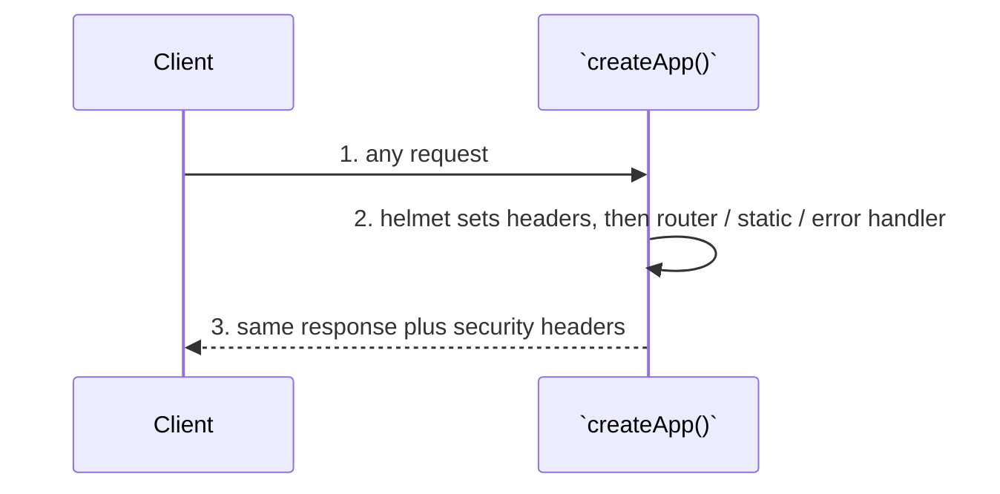

# Security headers and pipeline hardening

**Approved**: 2026-11-17 - user: "approved"

## Problem

Three things are true today that should not be:

- The API and the web app it serves answer with no security headers. Aikido's SAST finding "Express is not emitting security headers" says so, and `docs/tech/definitions/security.md` already decides on `helmet()` with its defaults, but nothing implements it. Aikido's autofix PR (tghcastro/capital-care-v2#29) adds `app.use(helmet())` to `apps/api/src/app.ts` without adding `helmet` to any `package.json` or the lockfile, so its `test` job fails and it cannot merge.
- Every `actions/checkout` step in both workflows persists the job's `GITHUB_TOKEN` in `.git/config` (Aikido's Git Credentials finding). The change is already made and pushed at the user's request in this session; this plan now records it.
- No job in `ci-cd.yml` or `codeql.yml` has a `timeout-minutes`, so a hung job runs for the 6-hour default and holds the concurrency group on `main`.
- `pnpm audit` reports 2 moderate advisories, both in dev-only dependencies: `esbuild@0.18.20` (via `drizzle-kit > @esbuild-kit/esm-loader > @esbuild-kit/core-utils`, fixed in >=0.25.0) and `minimatch@10.2.6` (via ESLint, fixed in >=11.0.1). Dependabot raises the same two on every push.

When this ships, every response from the API carries the helmet default headers, every job has a time limit, and `pnpm audit` reports no vulnerabilities.

## Shape

This reuses the helmet decision already written in `security.md` and the existing component-test harness in `apps/api/test/`. The header rule runs in `createApp()` (the composition root), which the component tests in `apps/api/test/` reach without a network.

1. request -> `createApp()` (exists) - `helmet()` runs first, before `express.json`, so it sets headers on every response, including errors and static files
2. `createApp()` (exists) - routers, `express.static` and the error handler run as today and keep the headers helmet set
3. out: the unchanged response body plus the helmet headers

**Changes underneath**

| Front | What changes |
| --- | --- |
| domain | nothing - no term changes meaning |
| stored data | nothing to migrate |
| readers | the browser reading `apps/web` served by `express.static` now receives helmet's default `Content-Security-Policy` (`script-src 'self'`, `upgrade-insecure-requests`); the Docker `HEALTHCHECK` and the CI smoke test read only status and `content-type`, so they are unaffected |
| dependencies | `helmet` is added to `apps/api`; `pnpm-workspace.yaml` gains two `overrides` for dev-only transitive packages |
| pipeline | `timeout-minutes` on all five jobs; `docs/tech/definitions/ci-cd.md` is updated to match |

Data: none - no stored data is touched.

## Surface

None - nothing consumed outside. No route is added or changes signature; only response headers change.

## Landing

| One-way door | Literal shape | Alternative rejected |
| --- | --- | --- |
| new runtime dependency | `apps/api/package.json` dependencies: `"helmet": "^8.3.0"` | hand-written `res.setHeader` calls: they drift from the helmet defaults that `security.md` names and miss new headers helmet adds |
| dependency overrides | `pnpm-workspace.yaml`: `overrides:` `'@esbuild-kit/core-utils>esbuild': ^0.25.12` and `'minimatch@>=10.0.0 <11.0.1': ^11.0.8` (11.0.9 is inside the repo's 3-day `minimumReleaseAge`) | upgrading `drizzle-kit` and `eslint`: neither has a release that drops the vulnerable range today; leaving the findings: Dependabot keeps raising them |

- Nothing else in this change is hard to reverse

## Criteria

### S1: Every response carries the helmet headers (P1)

A request to any route of the API process gets the default helmet security headers, and the web app still loads.

**Acceptance Criteria**

1. WHEN a client requests `GET /health` THEN the system SHALL answer `200` with `X-Content-Type-Options: nosniff`, `X-Frame-Options: SAMEORIGIN`, a `Strict-Transport-Security` header, a `Content-Security-Policy` header containing `default-src 'self'`, and no `X-Powered-By` header
2. WHEN a client requests a route that fails THEN the system SHALL send the same headers on the error response
   - `GET /categories` without the acting-user header → 401 with the headers; `GET /does-not-exist` → 404 with the headers, where the CSP is Express's own stricter `default-src 'none'` (its 404 handler replaces helmet's policy)
3. WHILE `WEB_DIST_PATH` is set, WHEN a client requests `GET /` THEN the system SHALL answer `200 text/html` with the same headers
4. WHILE the built image is running, WHEN a browser opens `/` THEN the page SHALL render the app with no Content-Security-Policy violation in the console
5. WHEN `pnpm install --frozen-lockfile` runs THEN `helmet` SHALL resolve from `apps/api` without changing `pnpm-lock.yaml`

### S2: Pipeline jobs are time-limited and hold no stored credential (P2)

A hung job ends on its own, and no job keeps the token on disk.

**Acceptance Criteria**

6. The system SHALL declare `timeout-minutes` on every job in `.github/workflows/ci-cd.yml` and `.github/workflows/codeql.yml`: test 15, security 10, build 20, publish 15, analyze 30
   - each of the five jobs is checked by name; a job without the key fails the check

### S3: The dependency audit is clean (P2)

**Acceptance Criteria**

7. WHEN `pnpm audit` runs with no severity filter THEN the system SHALL report no vulnerabilities (today: 2 moderate)
8. WHEN the overrides are applied THEN `pnpm build`, `pnpm type-check` and `pnpm test` SHALL still exit 0, and `pnpm lint` SHALL fail on no more files than it does before the change
9. The system SHALL document in `docs/tech/definitions/ci-cd.md` the job time limits and the two overrides
10. The system SHALL set `persist-credentials: false` on every `actions/checkout` step in `.github/workflows/ci-cd.yml` and `.github/workflows/codeql.yml`
    - the `publish` job's `git fetch origin` still works because the repository is public

## Out of scope

| Excluded | Why |
| --- | --- |
| `raw-body` in `pnpm-lock.yaml` | no advisory exists in `pnpm audit`; the user will paste the Aikido finding and it is handled separately |
| a custom Content-Security-Policy or other helmet options | `security.md` decides on the defaults; a change needs the user |
| Dockerfile digest pins | not chosen for this change |
| merging, closing or pushing to PR #29 | the PR belongs to Aikido's branch; the fix lands on this branch and the user decides what happens to the PR |
| CORS and rate limiting | `security.md` marks both as not needed |

## Assumptions

| Assumption | Chosen default | Rationale | Confirmed? |
| --- | --- | --- | --- |
| helmet options | `helmet()` with its defaults | `security.md` says so; the user answered "Yes, defaults" | y |
| scope of hardening | job timeouts and the two audit findings | the user chose both when asked | y |
| raw-body | out of scope until the finding is shown | the user chose this when asked | y |
| timeout values | test 15, security 10, build 20, publish 15, analyze 30 minutes | each is well above a normal run (the test job ran about 20 seconds on PR #29) and far below 6 hours | n |
| `upgrade-insecure-requests` | kept, as a helmet default | it is part of `helmet()`; it makes a browser request `http://` sub-resources over `https://`, so the app may not load when served over plain http from a host other than localhost. C4 checks `http://127.0.0.1` only | n |
| repository visibility | public, so `publish`'s `git fetch origin +refs/heads/main` needs no stored credential | the user said "It's a public repository" | y |
| lint baseline | measure it before any change and compare after | `ci-cd.md` says lint fails with parser errors and is not part of the pipeline | n |

**Open questions:** none - all resolved or logged above.

## Differences from the source

None - no binding source.

## Sources

- Aikido finding "Express is not emitting security headers" and PR tghcastro/capital-care-v2#29 (diff: `app.use(helmet())` in `apps/api/src/app.ts`; `helmet` not installed) - binding - settles the middleware and its position
- `docs/tech/definitions/security.md` - binding - `helmet()` with defaults as global middleware
- `pnpm audit` run in this session (esbuild GHSA-67mh-4wv8-2f99, minimatch GHSA-g3hv-75wg-m249) - binding - the two findings to clear
