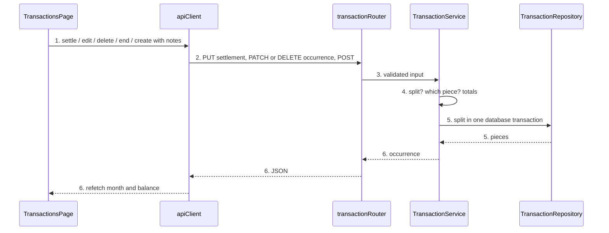
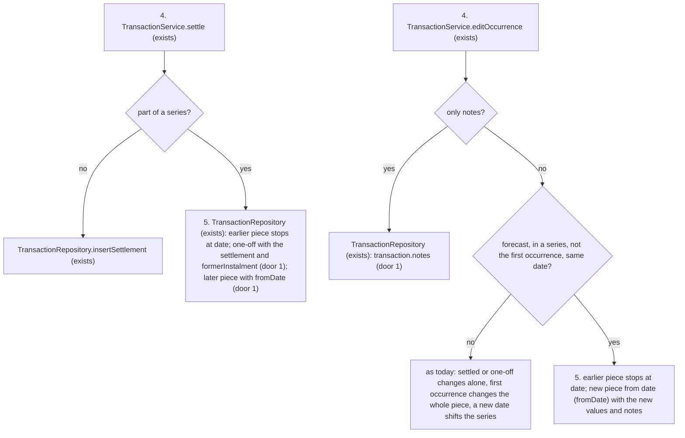
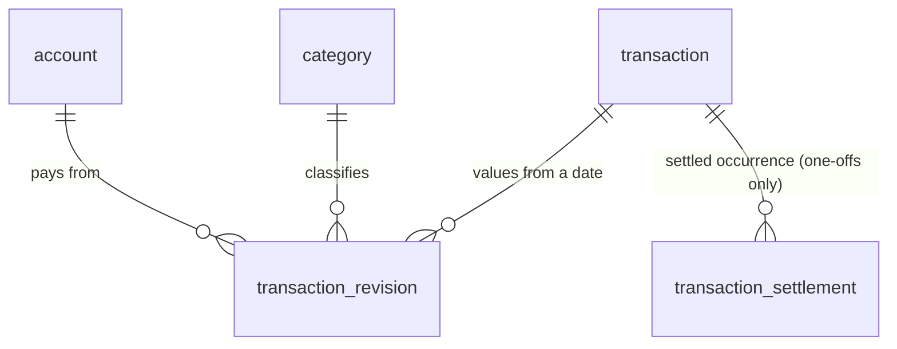
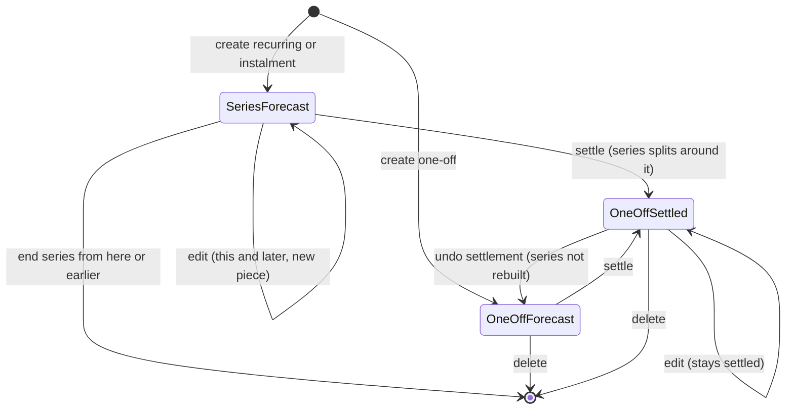

# Transaction Details, Edit and Delete

**Approved**: <pending>

## Problem

The web page lists a month of transactions, but the owner cannot open one to see all of it, correct a mistake, delete a one-off or end a series there; the API can change and stop occurrences, and the web client does not expose either. A purchase in instalments shows its number ("17 of 48") but never how much is left. There is no place for context longer than the 100-character description. Settling an occurrence of a series keeps it inside the series, so a series mixes paid and unpaid occurrences and its totals and later changes have no clean boundary. Evidence: none measured; the owner's decisions in `.prd/transaction-details-edit-and-delete.md` (confirmed 2026-11-25) and Linear CAP-9.

When this ships, the owner expands any row to see every field, its notes and, for an instalment series, Up to this instalment, Total and Left; edits it from there, told first whether the change reaches only this occurrence or this one and every later one; deletes a one-off or ends a series after confirming; and keeps multi-line notes on each entry. A settled occurrence becomes its own one-off and the series splits around it, so each piece has its own totals.

## Shape

Reuses the occurrence expansion in `TransactionService` (schedule, revisions, settlements), the existing `PATCH` and `DELETE /transactions/:id/occurrences/:date` routes, `shiftSeries` for date moves, and the existing month and balance reads; the web adds the details, edit form and confirmations to `TransactionsPage`. Every rule - splitting on settle and edit, which piece a change reaches, totals, notes copying - runs in `TransactionService` in `modules/ledger`, reached by its unit tests (mock repository) and the repository integration tests; the web sends the gesture and displays what comes back (AD-006).

1. Browser `/` -> `TransactionsPage` (exists) - row toggle, details, edit form, confirmations, Quick Add notes; calls `apiClient` (exists)
2. `apiClient` (exists, `packages/shared`) - gains `editOccurrence` and `deleteOccurrence`, `notes` on create; -> `POST /transactions`, `PATCH|DELETE /transactions/:id/occurrences/:date`, `PUT|DELETE .../settlement` (all exist; fields added - door 3)
3. `transactionRouter` (exists) - validates `notes` in `transaction.dto` (exists), hands on to `TransactionService`
4. `TransactionService` (exists) - `settle` turns a series occurrence into a one-off and splits the series around it; `editOccurrence` updates notes series-wide, or splits a series at a forecast occurrence; `listMonth` adds `notes`, `series` and `totals` to each occurrence
5. `TransactionRepository` (exists) - one database transaction per split: ends the earlier piece (`stopDate`), inserts the later piece (same anchor, `fromDate` - door 1) and the one-off (`formerInstalment*`, door 1) with copied notes and revisions
6. out: the occurrence JSON (its `transactionId` may be new after a split); `TransactionsPage` refetches the month and the balance

**Changes underneath**

| Front | What changes |
| --- | --- |
| domain | "a settled occurrence of a series" stops existing: settling splits it out as a one-off (AD-016). `listMonth`, `balance`, `stopFrom`, `shiftSeries` and the web settle button read settlements today; balances keep their values because every occurrence keeps its date and amount |
| domain | "a forecast change reaches every later month" now stops at the end of its piece (AD-017); Transactions plan criteria and checks on changes after a settled occurrence change with it |
| domain | `Occurrence.instalment` on a one-off becomes a label of the instalment it was settled from; the web "Recurring" marker reads the new `series` field instead |
| stored data | migration 0004 deletes every settlement of a series (AD-016); the new columns are nullable with nothing to backfill |
| readers | `TransactionsPage` and Quick Add; `packages/shared` client and `Occurrence` type; the Bruno `Transactions/` folder (settle, undo settlement and stop requests on a series now see new ids); Transactions checks that settle inside a series, refuse a move with 409 or delete settlements on stop change with their criteria |

New: `transaction.notes`, `transaction.fromDate`, `transaction.formerInstalmentNumber`, `transaction.formerInstalmentTotal` (door 1); no new entity or relation. One-way constraints: `transaction_settlement` rows belong only to one-off transactions (door 2).

## Surface

| Route | In | Out | Status | Who |
| --- | --- | --- | --- | --- |
| `POST /transactions` | adds optional `notes` (string, up to 2000 characters) | the transaction with `notes` | `201`, `400`, `401` | the acting user; no user `401` |
| `GET /transactions?month=YYYY-MM` | unchanged | each occurrence adds `notes` (string or null), `series` (boolean), `totals` (`{ upToThis, total, left }` decimal strings, or null) | `200`, `400`, `401` | the acting user, own occurrences only |
| `PATCH /transactions/:id/occurrences/:date` | adds optional `notes` (string; empty clears) | the changed occurrence, possibly with a new `transactionId` | `200`, `400`, `401`, `404` | the owner; another user's id `404` |
| `PUT /transactions/:id/occurrences/:date/settlement` | unchanged | the settled occurrence; for a series occurrence a one-off with a new `transactionId` | `200`, `400`, `401`, `404`, `409` | the owner; another user's id `404` |

## Landing

| One-way door | Literal shape | Alternative rejected |
| --- | --- | --- |
| 1. Stored columns on `transaction` | `notes TEXT NULL`; `fromDate TEXT NULL` (inclusive `YYYY-MM-DD`: occurrences before it belong to an earlier piece; null = from `startDate`); `formerInstalmentNumber INTEGER NULL`, `formerInstalmentTotal INTEGER NULL` (label of a one-off settled out of an instalment series) | a skip list (`transaction_skip`, as AD-007 sketched): the pieces stay one transaction, so totals and later changes would cross the split, against AD-017; starting the later piece as a new series on its first date (like `shiftSeries`): loses the month-end anchor, a monthly entry from 2027-01-31 split at 2027-02-28 would fall on 2027-03-28 instead of 2027-03-31 |
| 2. Migration 0004 deletes series settlements | `DELETE FROM transaction_settlement WHERE transactionId IN (SELECT id FROM transaction WHERE frequency IS NOT NULL OR instalmentStartNumber IS NOT NULL)` | splitting existing settlements into one-offs at deploy: the owner chose deletion (AD-016) |
| 3. API contract fields | `Occurrence.notes: string \| null`, `Occurrence.series: boolean`, `Occurrence.totals: { upToThis: string; total: string; left: string } \| null`; `notes` accepted on `POST` and `PATCH` | totals computed in the web: AD-006 keeps rules in the API |

- Nothing else in this change is hard to reverse

## Criteria

### S1: Settling an occurrence of a series splits it out as a one-off (P1)

The owner settles one occurrence and it leaves the series; what is left of the series is unchanged in dates, values and numbering.

**Acceptance Criteria**

1. WHEN the owner settles a forecast occurrence of a recurring or instalment series THEN the system SHALL return it with `status: "settled"`, `series: false`, `totals: null`, a `transactionId` different from the series, the same date and values, and the amount given when one is sent
   - "Sofa" 300.00 from 2027-01-10, instalment 1 of 12, settle 2027-10-10 → settled one-off on 2027-10-10 at 300.00; settle with amount 310.00 → 310.00
2. WHEN an occurrence in the middle of a series is settled THEN the system SHALL keep the earlier occurrences as one series ending just before it and the later occurrences as another series with the same dates, values and instalment numbers
   - "Sofa", settle 2027-10-10 → 2027-07-10 to 2027-09-10 share one `transactionId`, 2027-11-10 and 2027-12-10 share another, 2027-11-10 is instalment 11 of 12
   - monthly "Rent" from 2027-01-31, settle 2027-02-28 → March 2027 lists it on 2027-03-31, not 2027-03-28
3. WHEN the first occurrence of a series is settled THEN the system SHALL leave no earlier piece; WHEN the last occurrence of an instalment series is settled THEN the system SHALL leave no later piece
   - monthly "Condo fees" from 2026-11-05, settle 2026-11-05 → the series starts at 2026-12-05; "Sofa" settle 2027-12-10 → nothing after it
4. WHEN an occurrence of a series with no end is settled THEN the later piece SHALL have no end
   - weekly "Cleaning service" from 2026-11-05, settle 2026-11-12 → listed on 2026-11-19 and on 2027-11-04
5. WHEN an occurrence of an instalment series is settled THEN the one-off SHALL keep `instalment: { number, total }` of that occurrence as a label
   - "Sofa" settle 2027-10-10 → `instalment: { number: 10, total: 12 }`, `series: false`
6. WHEN the owner undoes the settlement of a former occurrence THEN the system SHALL return it as a forecast one-off with the same `transactionId`, and the pieces of the series SHALL stay separate
   - "Sofa" settle then unsettle 2027-10-10 → forecast, `series: false`; 2027-09-10 and 2027-11-10 keep different `transactionId`s
7. WHEN an occurrence is settled at its forecast amount THEN `GET /transactions/balance` SHALL return the same days and totals for that month and every later month as before
   - "Sofa", balance of 2027-10 and 2027-12 before and after settling 2027-10-10 → equal
8. WHEN a series had a change planned for a date after the settled occurrence THEN the later piece SHALL keep it
   - "Condo fees" 450.00 from 2026-11-05, changed from 2027-03-05 to 500.00, settle 2027-01-05 → 2027-02-05 450.00, 2027-03-05 500.00

### S2: Changing a transaction (P1)

The owner corrects any field; a forecast change in a series reaches its own piece only.

**Acceptance Criteria**

9. WHEN only `notes` is changed on an occurrence of a series THEN every occurrence of that series, earlier ones included, SHALL return the new notes and the series SHALL keep one `transactionId`
   - "Condo fees" notes "Unit 302", change notes on 2027-01-05 → 2026-11-05 and 2027-04-05 return the new notes, same `transactionId`
10. WHEN a field other than `notes` is changed on a forecast occurrence of a series that is not its first THEN the earlier occurrences SHALL keep their values in a series ending just before it, and this occurrence and every later one SHALL form a new series with the new values and a new `transactionId`, replacing changes planned for later dates
    - "Solar panels" 20.00 from 2026-11-15, instalment 10 of 100, change 2027-06-15 to 25.00 → 2027-05-15 20.00; 2027-06-15 25.00 instalment 17 of 100; 2034-05-15 25.00 instalment 100 of 100
11. WHEN the first occurrence of a series is changed THEN the whole series SHALL change and keep its `transactionId`
    - "Condo fees" change 2026-11-05 to 430.00 → 2027-05-05 430.00, same id
12. WHILE a series is split, WHEN a forecast occurrence of the earlier piece is changed THEN the later piece SHALL keep its values (AD-017)
    - "Sofa" split at settled 2027-10-10, change 2027-08-10 to 320.00 → 2027-09-10 320.00, 2027-11-10 300.00
13. WHEN `notes` and another field are changed together on a forecast occurrence of a series that is not its first THEN the new piece SHALL have the new notes and the earlier piece SHALL keep the old notes
    - "Solar panels" notes "Installer: SunCo", change 2027-06-15 to 25.00 with notes "New rate" → 2027-06-15 "New rate", 2027-05-15 "Installer: SunCo"
14. WHEN a settled one-off is changed THEN it SHALL stay settled with the new values
    - "New office chair" settled 229.00, change category to "Health" → settled, category "Health"
15. WHEN a forecast occurrence of a series is moved to another date THEN the moved occurrences SHALL keep the notes, the instalment numbers and the totals
    - "Solar panels" notes "Installer: SunCo", move 2027-06-15 to 2027-06-20 → 2027-06-20 instalment 17 of 100, notes "Installer: SunCo", totals 340.00 / 2000.00 / 1660.00; 2026-12-15 totals 220.00 / 320.00 / 100.00

### S3: Totals of an instalment series (P1)

Each occurrence of an instalment series says how much is up to it, the total and what is left, computed from its own piece.

**Acceptance Criteria**

16. WHERE an occurrence belongs to an instalment series the system SHALL return `totals` with `upToThis` = n × a, `total` = N × a and `left` = `total` − `upToThis`, where n is its instalment number, a its amount and N the last instalment of its series
    - "Solar panels" 20.00 from 2026-11-15, 10 of 100 → 2026-11-15 200.00 / 2000.00 / 1800.00; 2027-06-15 340.00 / 2000.00 / 1660.00; 2034-05-15 2000.00 / 2000.00 / 0.00
    - with 2026-11-15 to 2027-05-15 settled → 2027-06-15 still 340.00 / 2000.00 / 1660.00
17. WHEN a change splits an instalment series THEN each piece's totals SHALL use its own amount and last instalment
    - "Solar panels" 2027-06-15 changed to 25.00 → 2026-12-15 220.00 / 320.00 / 100.00; 2027-05-15 320.00 / 320.00 / 0.00; 2027-06-15 425.00 / 2500.00 / 2075.00
18. WHEN a settlement splits an instalment series THEN each piece's totals SHALL use its own last instalment
    - "Sofa" with 2027-01-10 to 2027-06-10 and 2027-10-10 settled → 2027-07-10 2100.00 / 2700.00 / 600.00; 2027-11-10 3300.00 / 3600.00 / 300.00
19. WHEN an instalment series is ended THEN N SHALL be the last instalment that still exists, and the instalment label SHALL keep its original total
    - "Sofa" with 1 to 6 settled, ended from 2027-09-10 → 2027-07-10 2100.00 / 2400.00 / 300.00, instalment 7 of 12
20. IF an occurrence is a one-off, a former occurrence settled out of a series, or of a series with no end THEN `totals` SHALL be null
    - "Dentist" one-off → null; "Sofa" settled 2027-10-10 → null; monthly "Condo fees" → null

### S4: Notes (P1)

Optional multi-line notes, shared by every occurrence of a series and copied when it splits.

**Acceptance Criteria**

21. WHEN a transaction is created with `notes` THEN every occurrence SHALL return them exactly, line breaks included; WHEN created without notes THEN `notes` SHALL be null
    - "Bought at the outlet store.\nWarranty until 2028-11-10." → returned identical; no `notes` → null
22. IF `notes` is longer than 2000 characters THEN the system SHALL answer 400 `ValidationError` "notes must not exceed 2000 characters"
    - 2000 characters → accepted; 2001 → 400; 2000 emoji (one character each) → accepted
23. IF `notes` is not a string THEN the system SHALL answer 400 `ValidationError` "notes must be a string"
    - `notes: 5` → 400
24. WHEN `notes` is empty or only whitespace THEN the system SHALL store no notes and return `notes: null`
    - `PATCH` with `notes: ""` on "Condo fees" → null on every occurrence
25. WHEN a series is split by a settlement THEN the one-off and both pieces SHALL keep a copy of the notes, independent from then on
    - "Gym" notes "Plan: basic", settle 2026-11-05, change notes on 2026-12-05 to "Plan: premium" → 2026-11-05 "Plan: basic"; 2026-12-05 and 2027-01-05 "Plan: premium"

### S5: Deleting a one-off and ending a series (P1)

**Acceptance Criteria**

26. WHEN the owner deletes a one-off, forecast or settled THEN the system SHALL answer 204 and no month SHALL list it
    - "New office chair" settled on 2026-11-10, delete → November 2026 lists nothing on 2026-11-10
27. WHEN the owner ends a series from an occurrence THEN that occurrence and every later one of the series SHALL be gone, earlier ones SHALL stay, and former occurrences settled out of it SHALL stay
    - "Sofa" with 2027-10-10 settled, end from 2027-09-10 → September, November and December 2027 list nothing; October lists "Sofa" settled; July lists instalment 7 of 12
28. WHEN migration 0004 runs THEN every settlement of a recurring or instalment series SHALL be deleted and settlements of one-offs SHALL stay
    - before: monthly "Gym" settled on 2026-11-05 and one-off "New office chair" settled → after: "Gym" 2026-11-05 forecast, the chair settled

### S6: Details, edit, delete and end in the web page (P1)

**Acceptance Criteria**

29. WHEN the owner uses "Show details" on a row THEN the row SHALL show Date, Description, Amount, Type, Account, Category, Status, either "Repeats" with the frequency or "Instalment" with "n of N", Notes ("No notes" when empty) and, when `totals` is present, "Up to this instalment", "Total" and "Left"; WHEN they use "Hide details" THEN only the row SHALL show
    - "Car loan" 17 of 48 → "Instalment 17 of 48"; monthly "Condo fees" → "Repeats Monthly"; "Dentist" → no totals
30. WHEN the owner uses "Edit" in the details THEN the system SHALL open a form with description, amount, type, category, account, date and notes filled with the occurrence's current values
31. WHILE the edit form is open the system SHALL state "This change applies to this occurrence only." for a one-off or a settled occurrence, and "This change applies to this occurrence and every later one." for a forecast occurrence of a series, and for a series also "Notes apply to every occurrence of this series."
32. WHEN the owner saves the form THEN the system SHALL send only the changed fields, close the form and show the refreshed month and balance; IF the API refuses THEN the system SHALL show its `detail` and keep the form open with what was entered
33. WHEN the owner uses "Delete" on a one-off THEN the system SHALL ask "Delete this transaction? This cannot be undone." with "Delete" and "Cancel"; "Delete" removes it and refreshes the month, "Cancel" keeps it
34. WHEN the owner uses "End series from here" on an occurrence of a series THEN the system SHALL ask "End this series from <date>? This occurrence and every later one will be removed." with "End series" and "Cancel"; "End series" removes them and refreshes the month, "Cancel" keeps them
35. WHEN the owner records a transaction with Quick Add THEN an optional multi-line "Notes" field SHALL be sent as `notes`
36. The "Recurring" marker SHALL show only on occurrences with `series: true`
    - a settled former instalment → no marker
37. The system SHALL show notes in the details with their line breaks
38. WHILE the page is 375 px wide the details, the edit form and the confirmations SHALL fit without horizontal page scroll

## Out of scope

| Excluded | Why |
| --- | --- |
| Totals that add up several pieces of a split series | PRD: each piece shows its own totals |
| Rebuilding a series when a settlement is undone | PRD and AD-016 |
| Totals for a series with no end | PRD: no totals |
| Undo after delete or end | not requested; both confirm first |
| Settling with a different amount from the web | not requested; the API already accepts it |
| Splitting existing series settlements into one-offs | the owner chose deleting them (AD-016) |

## Assumptions

| Assumption | Chosen default | Rationale | Confirmed? |
| --- | --- | --- | --- |
| Existing settlements of series | deleted by migration 0004 | AD-016 | y |
| A change in an earlier piece reaching later pieces | it does not | AD-017 | y |
| Label of a settled former instalment | kept as "n of N", no totals | PRD open question 1; user chose "Keep both" | y |
| N after a series is ended | the last instalment that still exists | PRD open question 2; user chose "Keep both" | y |
| Notes in Quick Add | optional multi-line field | user chose "Quick Add and Edit form" | y |
| Notes changed with another field | the new piece gets the new notes, the earlier keeps the old | PRD open question 3 | y |
| a in the totals | the amount of the occurrence shown | within a piece every occurrence has one amount unless a later change was planned; the occurrence shown is what the owner reads | n |
| A former occurrence after its settlement is undone | keeps its instalment label | same one-off, only the status changes | n |
| Empty or whitespace-only notes | stored as no notes | nothing to show; the details say "No notes" | n |
| Characters in notes | counted as Unicode characters, line breaks kept, not trimmed | the same counting as the description; notes are free text | n |
| Width the page must fit | 375 px, as a phone | no capture; the page already works at phone width | n |

**Open questions:** none - all resolved or logged above.

## Differences from the source

None - the product matches the source

## Sources

- `.prd/transaction-details-edit-and-delete.md` - binding - journey states and the totals rule
- `.specs/features/transaction-details-edit-and-delete/acceptance-tests.md` - binding - business scenarios and worked numbers
- Linear CAP-9 - binding - scope and acceptance criteria as updated on 2026-11-25
