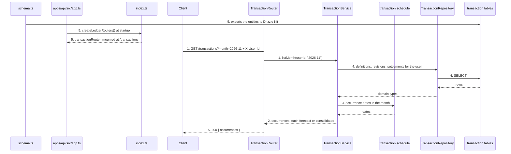
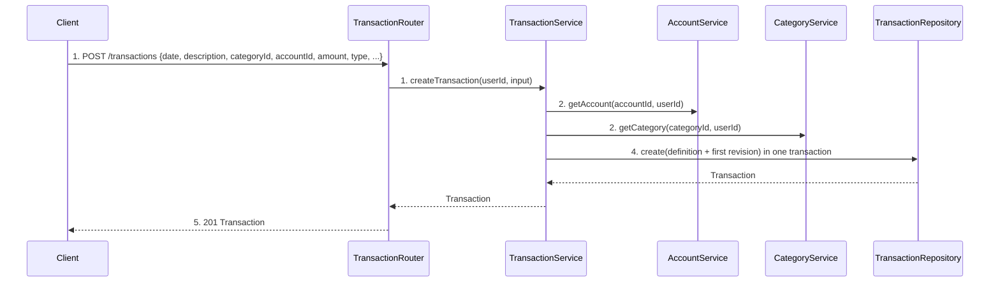
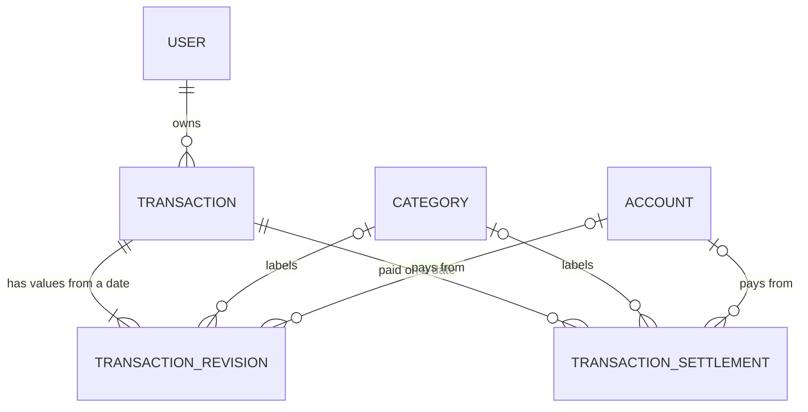
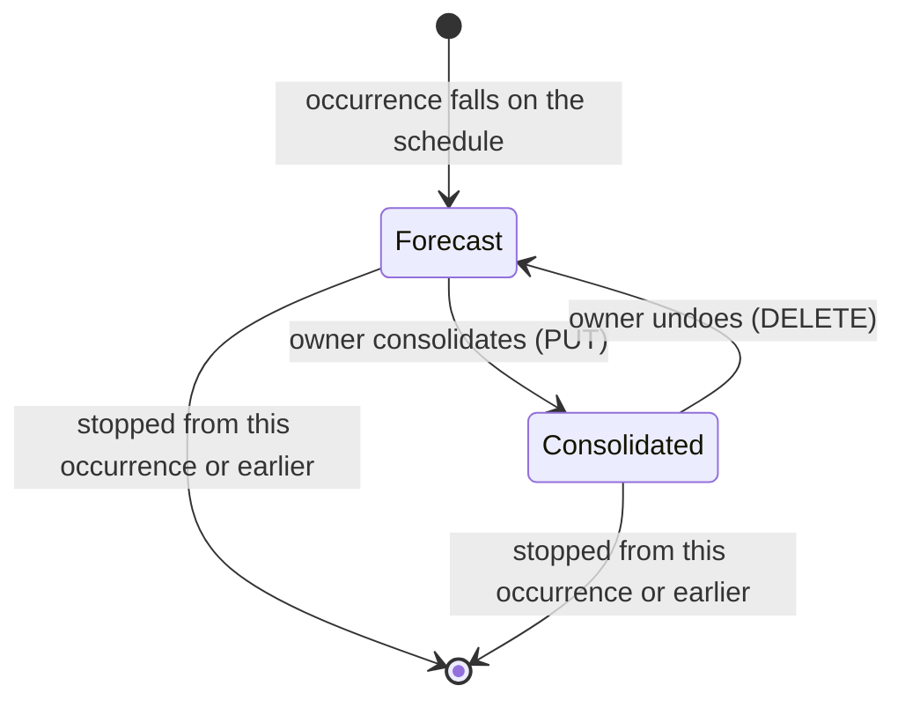

# Transactions

**Approved**: <pending - written only when the user approves>

## Problem

Capital Care can describe categories and accounts but cannot record money. The owner still keeps every expense, receipt and forecast in a third-party tool they find too complex and badly usable, and cannot see what they owe next month in their own product. The PRD gives no usage numbers: nothing is measured, and the capability does not exist yet ([`.prd/transactions.md`](../../../.prd/transactions.md)).

The behaviour is also described as examples in [acceptance-tests.md](acceptance-tests.md), written in Gherkin and free of technical detail, to read the system's behaviour at a glance.

When this ships, a caller of the API can record one-off, recurring (daily, weekly, monthly, annual) and instalment transactions, see any month of past and future entries, mark entries as paid (consolidated) by hand, correct, stop and delete them, and rely on a deleted category or account leaving the entries in place.

## Shape

This reuses the `category` and `account` layering (controller -> service -> repository), the `X-User-Id` header, the shared error classes and the `AccountService` / `CategoryService` lookups; the rules that change an outcome (field validation, the occurrence schedule, edit and stop semantics, consolidation, the month view) run in `TransactionService`, a pure schedule module and the Zod schemas, which the unit tests reach with an in-memory repository mock ([testing.md](../../../docs/tech/definitions/testing.md)).

A transaction is stored once as a definition (start date, frequency, instalment counters) with dated value revisions; its occurrences are computed from the schedule on read, and only paid ones are stored (settlements).

1. `POST /transactions`, `GET /transactions?month=`, `PATCH` / `DELETE /transactions/:id/occurrences/:date`, `PUT` / `DELETE /transactions/:id/occurrences/:date/consolidation` with `X-User-Id` -> `TransactionRouter` (new, door 4) - reads the user id (401 if absent), validates input with the Zod schemas, calls the service
2. `TransactionService` (new) - checks the account and category belong to the user through `AccountService.getAccount` and `CategoryService.getCategory` (exist), decides which dates are occurrences, applies the edit / stop / consolidate rules, throws `ValidationError` / `ConflictError` / `NotFoundError`
3. `transaction.schedule` (new) - pure functions: the occurrence dates of a transaction in a month, whether a date is an occurrence, the instalment number of a date; month-end clamping anchored on the start date
4. `TransactionRepository` (new) - persists and reads `transaction`, `transaction_revision` and `transaction_settlement` rows (door 1), maps rows to domain types, wraps multi-row writes in one SQLite transaction (door 1)
5. out: `Transaction` JSON, `{ occurrences: [...] }`, `Occurrence` JSON or `204`; `createLedgerRouters()` in `index.ts` (exists) returns `transactionRouter`, `apps/api/src/app.ts` (exists) mounts it at `/transactions`, and `schema.ts` (exists) exports the new entities to Drizzle Kit

**Changes underneath**

| Front | What changes |
| --- | --- |
| domain | `Transaction` is a new entity in the Ledger context; no existing term changes meaning. "Occurrence" (one dated appearance of a transaction) is new |
| stored data | three new tables via a generated migration; nothing to backfill, nothing existing is touched. `category` and `account` rows gain referencing foreign keys from the new tables |
| readers | none yet besides the Web later; `CategoryService` and `AccountService` delete paths are unchanged and now cause `SET NULL` on referencing rows |
| config | none |

New: `Transaction`, `TransactionRevision`, `TransactionSettlement`, and their references to `Category` and `Account`. One-way constraints: calendar dates stored as `YYYY-MM-DD` text, references nulled when the category or account is deleted, and one settlement per `(transactionId, occurrenceDate)` (doors 1, 2, 3).

## Surface

| Route | In | Out | Status | Who |
| --- | --- | --- | --- | --- |
| `POST /transactions` | `{ date, description, categoryId, accountId, amount, type, recurrence?, instalment? }` | `Transaction` | `201`; `400` ValidationError; `401` | current user only; no `X-User-Id` gets `401` |
| `GET /transactions?month=YYYY-MM` | query `month` | `{ occurrences: Occurrence[] }` | `200`; `400`; `401` | current user only |
| `PATCH /transactions/:id/occurrences/:date` | any of `{ description, categoryId, accountId, amount, type }` | `Occurrence` | `200`; `400`; `404`; `401` | current user only; another user's transaction gets `404` |
| `DELETE /transactions/:id/occurrences/:date` | none | empty | `204`; `404`; `401` | current user only; another user's gets `404` |
| `PUT /transactions/:id/occurrences/:date/consolidation` | `{ amount? }` | `Occurrence` | `200`; `400`; `404`; `409` already consolidated; `401` | current user only; another user's gets `404` |
| `DELETE /transactions/:id/occurrences/:date/consolidation` | none | `Occurrence` | `200`; `404`; `409` not consolidated; `401` | current user only; another user's gets `404` |

`Transaction` is `{ id, userId, date, description, categoryId, accountId, type, amount, recurrence, instalment, createdAt, updatedAt }`, with the values of its first occurrence. `Occurrence` is `{ transactionId, date, description, categoryId, accountId, type, amount, recurrence, instalment, status }`. `type` is `"receipt"` or `"debit"`. `recurrence` is `null`, `"daily"`, `"weekly"`, `"monthly"` or `"annually"`. `instalment` is `null` or `{ number, total }`; on an occurrence `number` is that occurrence's own number. `status` is `"forecast"` or `"consolidated"`. `amount` is a canonical decimal string, and on a consolidated occurrence it is the amount actually paid. `categoryId` and `accountId` are `null` after the category or account was deleted. Error bodies are `{ type, detail }`, the shape the Account routes return today. Unknown request fields are ignored ([api.md](../../../docs/tech/definitions/api.md#validation)).

## Landing

| One-way door | Literal shape | Alternative rejected |
| --- | --- | --- |
| Stored shape of a transaction and its occurrences | `transaction(id TEXT PK, userId TEXT NOT NULL, startDate TEXT NOT NULL, frequency TEXT NULL, instalmentStartNumber INTEGER NULL, instalmentTotal INTEGER NULL, stopDate TEXT NULL, createdAt INTEGER, updatedAt INTEGER)`; `transaction_revision(transactionId TEXT REFERENCES transaction ON DELETE CASCADE, effectiveFrom TEXT, description TEXT, categoryId TEXT NULL, accountId TEXT NULL, type TEXT, amount TEXT, PK (transactionId, effectiveFrom))`; `transaction_settlement(transactionId TEXT REFERENCES transaction ON DELETE CASCADE, occurrenceDate TEXT, description TEXT, categoryId TEXT NULL, accountId TEXT NULL, type TEXT, amount TEXT, settledAt INTEGER, PK (transactionId, occurrenceDate))`. `stopDate` is exclusive. Occurrences are computed, never stored, until paid; amounts are canonical-decimal `TEXT` as in database.md | storing every occurrence as a row - a daily entry with no end has no last row, and an edit "from here on" would rewrite a growing set; splitting a series into two transactions on every edit - the id of later occurrences would change under the caller |
| Calendar dates are `YYYY-MM-DD` text, not instants | `startDate`, `effectiveFrom`, `occurrenceDate`, `stopDate` hold `2026-11-05`; month-end clamping is anchored on `startDate` (a monthly entry starting on the 31st falls on the last day of shorter months and returns to the 31st; an annual one starting on 29 Feb falls on 28 Feb in common years) | `timestamp_ms` as database.md uses for instants - the same bill would move to the previous or next day in another time zone, and "05/Nov" is a day, not a moment |
| Deleting a category or account never blocks and never deletes transactions | `categoryId` and `accountId` on `transaction_revision` and `transaction_settlement` are nullable `REFERENCES category(id) ON DELETE SET NULL` / `REFERENCES account(id) ON DELETE SET NULL` | no foreign key plus clean-up calls from the Category and Account services - those aggregates would have to know about transactions, breaking the aggregate boundary rule; refusing the delete while transactions use it - contradicts the PRD |
| The contract a future Web client binds to | routes and JSON exactly as in `Surface`, an occurrence addressed by `/:id/occurrences/:date`, lowercase enum values, amounts as strings | a numeric `amount` - binary floating point; addressing an occurrence by its own generated id - occurrences are not stored until paid |

- Reaches past this feature: the calendar-date convention goes into `.specs/STATE.md` as `AD-001` once the plan is approved
- Nothing else in this change is hard to reverse

## Criteria

### S1: Record a transaction (P1)

The caller can record one transaction and read back what was stored.

**Acceptance Criteria**

1. WHEN a user POSTs `{ "date": "2026-11-01", "description": "My Company - Monthly Income", "categoryId": <their category>, "accountId": <their account>, "amount": "1000.00", "type": "receipt" }` to `/transactions` THEN the system SHALL return `201` with `{ id (UUID), userId, date: "2026-11-01", description, categoryId, accountId, type: "receipt", amount: "1000", recurrence: null, instalment: null, createdAt, updatedAt }`, timestamps as ISO 8601 UTC strings
   - `"229.00"` → `"229"`; `"0.5"` → `"0.5"`; `"20"` → `"20"`
2. WHEN a transaction is created THEN its occurrence SHALL be a forecast, whatever its date
   - date `2026-01-05` (in the past) → `GET ?month=2026-01` shows `status: "forecast"`
3. IF `type` is anything other than `"receipt"` or `"debit"`, or is missing, THEN POST SHALL return `400` ValidationError and save nothing
   - `"Debit"` → `400`; `"expense"` → `400`; absent → `400`
4. IF `amount` is not a string holding a positive decimal with at most 12 integer digits and at most 4 decimals THEN POST, PATCH and consolidation SHALL return `400` ValidationError and change nothing
   - `"0"` → `400`; `"-5"` → `400`; `"1,5"` → `400`; `"abc"` → `400`; the JSON number `229` → `400`; `"12.12345"` → `400`; `"12.1234"` → accepted; `"1234567890123"` (13 digits) → `400`; `"123456789012"` → accepted
5. IF `description` is empty, only spaces, or longer than 100 characters after trimming THEN POST and PATCH SHALL return `400` ValidationError; WHEN it has leading or trailing spaces THEN the system SHALL trim them before saving
   - `""` → `400`; `"   "` → `400`; 100 characters → accepted; 101 → `400`; `"  Gym  "` → saved as `"Gym"`
6. IF `date` is not a real calendar date written `YYYY-MM-DD` THEN POST SHALL return `400` ValidationError
   - `"2026-02-30"` → `400`; `"2026-1-5"` → `400`; `"05/11/2026"` → `400`; `"2028-02-29"` → accepted
7. IF `categoryId` or `accountId` is missing, or is not an existing category or account of the calling user, THEN POST and PATCH SHALL return `400` ValidationError naming the field and change nothing
   - unknown id → `400`; another user's account → `400`, the same as unknown; `categoryId: null` on PATCH → `400`
8. IF the body carries both `recurrence` and `instalment`, or `recurrence` is not `"daily"`, `"weekly"`, `"monthly"` or `"annually"` THEN POST SHALL return `400` ValidationError
9. WHEN a body carries `id`, `userId`, `createdAt`, `status` or any field not in `Surface` THEN the system SHALL ignore it

### S2: See any month (P1)

The caller can see a month, past or future, with every entry that falls in it.

**Acceptance Criteria**

1. WHEN a user GETs `/transactions?month=2026-11` THEN the system SHALL return `200` with `{ occurrences }` holding every occurrence dated from `2026-11-01` to `2026-11-30`, and only the calling user's
2. WHEN the month has no occurrences THEN the system SHALL return `200` with `{ "occurrences": [] }`
3. WHEN a month holds forecast and consolidated occurrences, and forecasts whose date has already passed, THEN the system SHALL return all of them together, none hidden
   - on any day of November, an unconsolidated `2026-11-03` occurrence is listed as `forecast`
4. WHEN a month is listed THEN occurrences SHALL be ordered by date, then by description ignoring case, then by `transactionId`
   - `11-05 "Gym"`, `11-05 "condo"`, `11-02 "Zed"` → `Zed`, `condo`, `Gym`
5. IF `month` is missing or not `YYYY-MM` with a month from `01` to `12` THEN the system SHALL return `400` ValidationError
   - absent → `400`; `"2026-13"` → `400`; `"2026-1"` → `400`; `"2026-11-05"` → `400`
6. WHEN an occurrence is listed THEN it SHALL carry `{ transactionId, date, description, categoryId, accountId, type, amount, recurrence, instalment, status }` with the values in force on that date (S5)

### S3: Schedules - one-off, recurring, instalments (P1)

An entry appears in exactly the months its schedule says, and in no month before its start.

**Acceptance Criteria**

1. WHEN a transaction has no `recurrence` and no `instalment` THEN it SHALL have exactly one occurrence, on its `date`
2. WHEN `recurrence` is `"daily"` and `date` is `2026-11-29` THEN the system SHALL list it on every day from that date with no end
   - `2026-10` → none; `2026-11` → `29`, `30`; `2026-12` → 31 occurrences
3. WHEN `recurrence` is `"weekly"` and `date` is `2026-11-05` THEN it SHALL fall every 7 days from that date with no end
   - `2026-11` → `05`, `12`, `19`, `26`; `2026-12` → `03`, `10`, `17`, `24`, `31`
4. WHEN `recurrence` is `"monthly"` and `date` is `2026-11-05` THEN it SHALL fall on the 5th of every month from `2026-11` with no end
   - `2026-10` → none; `2026-11` → `05`; `2027-06` → `05`
5. WHEN a monthly transaction starts on a day a later month lacks THEN it SHALL fall on that month's last day and return to the start day afterwards
   - start `2026-01-31` → `01-31`, `02-28`, `03-31`, `04-30`; start `2028-01-31` → `2028-02-29`
6. WHEN `recurrence` is `"annually"` THEN it SHALL fall once a year on the start month and day; a start of 29 Feb falls on 28 Feb in common years
   - start `2026-11-05` → `2027-11-05`; start `2024-02-29` → `2025-02-28`, `2028-02-29`
7. WHEN `instalment` is `{ number: 97, total: 504 }`, `date` is `2026-11-15` and `amount` is `"100"` THEN the system SHALL list occurrence number 97 on `2026-11-15`, number 98 on `2026-12-15`, and so on monthly up to number 504, with `recurrence: null` and `instalment: { number, total }` on each, and nothing before `2026-11` or after number 504
   - `2026-11` → number 97; `2026-12` → 98; `2060-10` → 504; `2060-11` → none; `2026-10` → none
8. WHEN `instalment` is `{ number: 1, total: 10 }` and `date` is `2026-11-15` THEN number 10 SHALL fall on `2027-08-15` and `2027-09` SHALL be empty
9. IF `instalment.number` or `instalment.total` is not a whole number, `number` is below 1 or above `total`, or `total` is above 999, THEN POST SHALL return `400` ValidationError
   - `{ 0, 10 }` → `400`; `{ 11, 10 }` → `400`; `{ 1, 999 }` → accepted; `{ 1, 1000 }` → `400`; `{ 1.5, 10 }` → `400`
10. WHEN occurrences of one transaction are listed in different months THEN they SHALL carry the same `transactionId`

### S4: Consolidate and undo (P1)

Only the owner marks an entry paid, one occurrence at a time, and can take it back.

**Acceptance Criteria**

1. WHEN a user PUTs `/transactions/:id/occurrences/:date/consolidation` with `{}` on a forecast occurrence THEN the system SHALL return `200` with that occurrence as `status: "consolidated"` and its amount unchanged, and later listings SHALL show it consolidated
2. WHEN the body carries `amount` THEN the system SHALL record that amount for this occurrence only; every other occurrence SHALL keep its own amount
   - monthly `"20"`, consolidate `2026-12-05` with `"22"` → Nov `20` forecast, Dec `22` consolidated, Jan `20` forecast
3. IF the occurrence is already consolidated THEN PUT SHALL return `409` ConflictError and change nothing
4. WHEN a user DELETEs `/transactions/:id/occurrences/:date/consolidation` on a consolidated occurrence THEN the system SHALL return `200` with it back as `status: "forecast"` carrying the forecast values of that date, dropping any real amount; IF it is a forecast THEN DELETE SHALL return `409`
5. WHILE no consolidation was requested, the system SHALL keep every occurrence a forecast, for every kind of transaction, however old
   - an instalment occurrence dated `2026-01-15` listed in November is `forecast`; a one-off dated last year is `forecast`
6. IF `:date` is not an occurrence of the transaction THEN consolidation, edit and delete SHALL return `404` NotFoundError
   - monthly on the 5th, `2026-11-06` → `404`; a date before the start → `404`; an instalment's date after number 504 → `404`; a malformed date → `404`

### S5: Edit (P1)

A correction reaches the occurrences it should and no others.

**Acceptance Criteria**

1. WHEN a user PATCHes a forecast occurrence of a recurring or instalment transaction THEN the new values SHALL apply to that occurrence and every later forecast occurrence, and earlier occurrences SHALL be unchanged
   - condo fee `"20"` from `2026-11-05`; PATCH `2026-12-05` with `amount: "25"` → Nov `20`, Dec `25`, Jan `25`
2. WHEN later occurrences are already consolidated THEN an edit SHALL NOT change them
   - Jan consolidated at `20`, then PATCH Dec with `"25"` → Jan stays `20` consolidated, Feb `25`
3. WHEN a user PATCHes a consolidated occurrence THEN only that occurrence SHALL change
4. WHEN a later forecast edit was made earlier THEN an edit from an earlier date SHALL replace it: from the edited date on, every forecast occurrence takes all the values of the edited occurrence
   - PATCH Jan with `"30"`, then PATCH Dec with `"25"` → Jan forecast is `25`
5. WHEN the edited occurrence is the first one of the transaction THEN the edit SHALL apply to the whole series from its start
6. WHEN a user PATCHes a one-off forecast THEN the entry SHALL carry the new values
7. IF the PATCH body has none of `description`, `categoryId`, `accountId`, `amount`, `type` THEN the system SHALL return `400` ValidationError and change nothing; `date`, `recurrence` and `instalment` SHALL be ignored
8. WHEN an instalment is edited THEN its `instalment.number` of each occurrence SHALL still follow the schedule from the original start

### S6: Stop and delete (P1)

Removing the future never touches what already happened.

**Acceptance Criteria**

1. WHEN a user DELETEs `/transactions/:id/occurrences/:date` on an occurrence THEN the system SHALL return `204`, remove that occurrence and every later one, and leave every earlier occurrence, forecast or consolidated, exactly as it was
   - monthly from `2026-11-05`, Nov consolidated, DELETE `2027-01-05` → Nov and Dec still listed (Nov consolidated), Jan and later gone
2. WHEN `:date` is the first occurrence of the transaction, or the transaction is a one-off, THEN the whole transaction SHALL be removed
3. WHEN a transaction was stopped THEN a request for a removed occurrence SHALL return `404`, and `GET` SHALL no longer list it
4. WHEN an instalment is deleted from an occurrence THEN the same rules SHALL apply
5. WHEN the occurrence is in the past THEN DELETE SHALL still be allowed

### S7: Deleted category or account (P1)

**Acceptance Criteria**

1. WHEN a category used by transactions is deleted THEN the delete SHALL succeed as the Category rules say, every occurrence of those transactions, forecast and consolidated, SHALL stay listed with `categoryId: null`, and nothing else about them SHALL change
2. WHEN an account used by transactions is deleted THEN the same SHALL hold with `accountId: null`
3. WHEN a deleted category was one of several used by a user's transactions THEN only the occurrences that used it SHALL show `categoryId: null`
4. WHEN a user PATCHes an occurrence whose category is `null` with only a `description` THEN the system SHALL return `200` and keep `categoryId: null`

### S8: Ownership and authentication (P1)

**Acceptance Criteria**

1. IF a request to any `/transactions` route has no `X-User-Id` header, or a blank one, THEN the system SHALL return `401`
2. IF a user addresses a transaction that does not exist, or one that belongs to another user, THEN PATCH, DELETE and consolidation SHALL return `404` NotFoundError (not `403`) and change nothing
3. WHEN two users each have transactions THEN `GET /transactions` SHALL list only the calling user's

## Out of scope

| Excluded | Why |
| --- | --- |
| Web UI and the instalment total display (value x occurrences) | PRD Out: a Web-round concern |
| Importing history from the old tool | PRD Out: the owner starts fresh from the cutover month |
| Reports, budgets, charts, account balances | PRD Out |
| Filters by account or category, and pagination on the month view | not in the PRD; a month is bounded (a daily entry gives at most 31 per month) |
| Editing `date`, `recurrence`, or the instalment `total` | not in the PRD; delete from the first occurrence and create again |
| Removing one occurrence in the middle of a series (skipping a month) | asked and declined: stop-from-here only |
| Changing only one forecast occurrence and keeping the later ones | PRD: a forecast edit applies to later occurrences |
| `GET /transactions/:id` | not in the PRD; the month view carries everything |
| Transfers between accounts, currency | PRD silent; amounts are currency-agnostic ([database.md](../../../docs/tech/definitions/database.md)) |
| Automatic consolidation, or an "overdue" marker | PRD: nothing is consolidated automatically; a past forecast is simply listed as `forecast` |
| Changing how categories or accounts are deleted | PRD Unchanged: only their effect on transactions is specified here |
| Daily, weekly or annual instalments | asked: instalments are monthly only |

## Assumptions

| Assumption | Chosen default | Rationale | Confirmed? |
| --- | --- | --- | --- |
| Month-end for monthly and annual entries | last day of the shorter month, back to the start day later | the user chose it when asked | y |
| Instalment frequency and numbering | monthly only; the `date` belongs to the entered `number`; earlier numbers are not created | the user chose it when asked | y |
| Undo of consolidation | allowed, back to forecast | the user chose it when asked | y |
| Stopping a series | from a chosen occurrence, that one and later removed; a one-off is deleted whole; no single-occurrence removal | the user chose it when asked | y |
| Recurring frequencies | daily, weekly, monthly, annually | the user added weekly and daily to the PRD | y |
| Edit scope | forecast edit applies to later forecast occurrences, consolidated edit to one occurrence, real paid amount to one occurrence | PRD Journey rows, confirmed in the interview | y |
| Deleted category or account | transactions stay; the API returns `null` for the id, and "No category" / "No account" is the label a client draws | the user said to reuse the behaviour of the old tool; the label is presentation | n |
| Description rule | 1 to 100 characters after trimming, any characters | the PRD gives none; descriptions such as "Market chair New office chair" need free text | n |
| Amount rule | positive, at most 12 integer digits and 4 decimals, sent as a string | the PRD gives none; database.md fixes the storage, not the bounds | n |
| Instalment total bound | at most 999 | the PRD example is 504; the bound only stops absurd input | n |
| Consolidating a future-dated occurrence | allowed | the owner compares with the real account and decides; no PRD rule against it | n |
| Consolidating twice, or undoing a forecast | `409` both | a state conflict, as Account reports duplicates | n |
| Undo drops edits made on the consolidated occurrence | the occurrence returns to the schedule's values | the settled values were a snapshot of one occurrence | n |
| Stopping at a consolidated occurrence | removes it too | the user chose "that occurrence and all later ones" | n |
| A bad reference in the body | `400` naming the field, same for unknown and another user's | existing error shape; never reveals another user's data | n |
| Error body shape | `{ type, detail }` as the Account routes return | consistency with the code that exists today | n |
| Month view size | not paginated | a month is bounded | n |
| Enum spelling | `"receipt"`, `"debit"`, `"daily"`, `"weekly"`, `"monthly"`, `"annually"` | the PRD's own words, lowercase for JSON | n |

**Open questions:** none - all resolved or logged above.

## Differences from the source

None - the product matches the source; the source is a PRD, not a capture.

## Sources

- [`.prd/transactions.md`](../../../.prd/transactions.md) - binding - confirmed 2026-11-11; scope, journey states and the user's interview answers
- [`acceptance-tests.md`](acceptance-tests.md) - binding - the behaviour in Gherkin with the owner's own examples; no field limits or error cases (those are in the criteria above)
- [`docs/tech/definitions/`](../../../docs/tech/definitions/) - binding - architecture, database, API and testing conventions
- `modules/ledger/src/account/` - precedent - layering, routes and error shape to reuse
