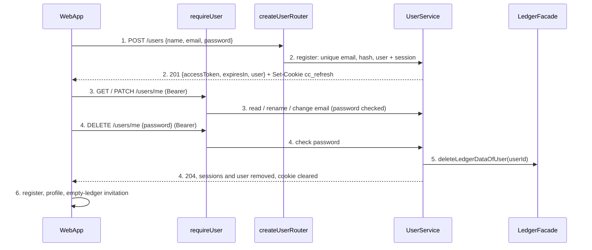
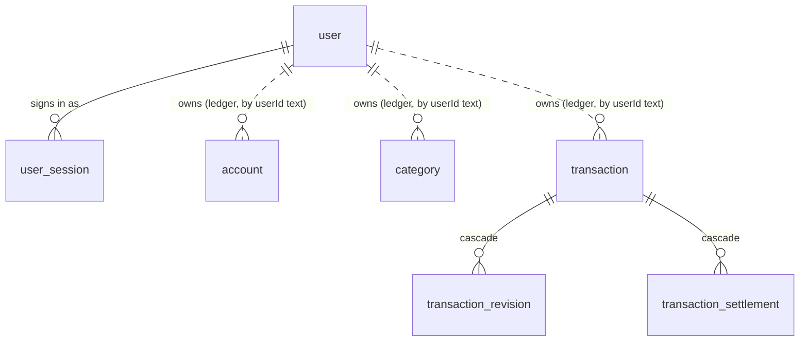

# User management

**Approved**: <pending>

## Problem

After base authentication ships, the only accounts are the five the owner creates with a script: nobody new can use Capital Care without the owner adding them by hand, nobody can change their name or email, and nobody can leave and take their data with them. There is a single kind of user and no administrator, so each person has to manage their own account. Evidence: `.prd/user-management.md` (confirmed 2026-11-23, email verification dropped 2026-11-25); the base authentication plan (`.specs/features/base-authentication/plan.md`, approved 2026-11-25) closes public user creation (its criterion 11), which this feature reopens.

When this ships, a visitor registers with name, email and password and is signed in straight away into an empty ledger; a signed-in user can see and edit their name and email, and can delete their account, which removes every account, category and transaction they own.

## Shape

This reuses everything base authentication builds in `modules/identity` (the `user` aggregate, password hashing, session creation, the refresh cookie, the audit log, the password rule) and the web `AuthProvider`, API client and sign-in redirects. The rules that change an outcome - name and email rules, duplicate email, password re-check, the deletion order - run in `UserService` in `modules/identity/src/user/` and in the ledger's own service for wiping a user's data, both reached by unit tests with in-memory doubles.

1. register request -> `createUserRouter` (exists after base authentication) - validates name, email, password; hands them to `UserService`
2. `UserService` (exists after base authentication) - rejects a taken email, hashes the password, creates the user and a session exactly as sign-in does, records an audit event; the router answers like sign-in and sets the refresh cookie
3. profile requests -> `requireUser` (exists after base authentication) -> `UserService` - reads the user, renames, or changes the email after checking the password
4. delete request -> `requireUser` -> `UserService` - checks the password, calls the deletion hook (door 2), then removes the user and all their sessions; the router clears the refresh cookie
5. `LedgerFacade` (door 2) - `deleteLedgerDataOfUser` removes the user's transactions (their revisions and settlements cascade), accounts and categories in one ledger transaction
6. `WebApp` (exists) - register page, profile page, empty-ledger invitation on the main page

**Changes underneath**

| Front | What changes |
| --- | --- |
| domain | "user creation" was closed to the public (base authentication criterion 11: `POST /users` → `404`); now `POST /users` is open registration. Branching on it: that criterion's test in the base authentication checks, which this feature replaces in the same commit |
| stored data | nothing to migrate: the `user` and `user_session` tables from base authentication already hold what this needs. A deleted user's row is removed, not marked, so the email can be registered again; `status` stays for later use |
| readers | the web app (new pages, a `Profile` link in the header, a `Create account` link on sign-in); the Bruno collection (new requests); `docs/tech/definitions/security.md` (registration route, deletion); the SPA route list (AD-010) gains `/register` and `/settings/profile` |
| modules | `modules/ledger` gains `deleteLedgerDataOfUser` in its facade and `index.ts`; `modules/identity` takes a deletion hook; `apps/api` wires one to the other (AD-008: neither module imports the other) |

New: nothing stored - this reads and deletes rows of tables that exist. One-way constraints: none added; `user.email` unique (base authentication door 1) is what makes a duplicate registration fail.

## Surface

| Route | In | Out | Status | Who |
| --- | --- | --- | --- | --- |
| `POST /users` | `name`, `email`, `password`; `User-Agent` | same body as `POST /auth/sign-in`; `Set-Cookie: cc_refresh` | `201`, `400` (invalid field), `409` (`This email is already registered`) | anyone |
| `GET /users/me` | `Authorization: Bearer` | `id`, `email`, `name` | `200`, `401` | signed-in user; the rest get `401` |
| `PATCH /users/me` | `Authorization: Bearer`; `name?`, `email?`, `password` (required when `email` is sent) | `id`, `email`, `name` | `200`, `400` (invalid field, missing or wrong password), `409` (`This email is already registered`), `401` | signed-in user; the rest get `401` |
| `DELETE /users/me` | `Authorization: Bearer`; `password` | nothing; `cc_refresh` cleared | `204`, `400` (missing or wrong password), `401` | signed-in user; the rest get `401` |
| `GET /register`, `GET /settings/profile` | - | `index.html` | `200` | anyone (only while `WEB_DIST_PATH` is set) |

## Landing

| One-way door | Literal shape | Alternative rejected |
| --- | --- | --- |
| 1. registration and profile contract | `POST /users` (register), `GET`/`PATCH`/`DELETE /users/me`; duplicate email answers `409` with RFC 7807 `type` `ConflictError` and `detail` `This email is already registered`; wrong password answers `400` with `detail` `Password is incorrect` | `/auth/register` and `/auth/me`: `security.md` already names `POST /users` as registration, and `/auth` is kept for sessions so the cookie path stays narrow |
| 2. cross-module deletion | `createIdentityRouters({ beforeUserDelete })` takes `beforeUserDelete: (userId: string) => void`; `apps/api` passes the ledger's exported `deleteLedgerDataOfUser`. Order: ledger data first, then the user's sessions and row in one identity transaction; a retry after a failure in between finds no ledger data and finishes | identity importing the ledger: breaks AD-008; deleting the user first: a failure in between leaves data no one can ever reach or delete, against the PRD's "no data remains" |

- Nothing else in this change is hard to reverse

## Criteria

### S1: Register and land in an empty ledger (P1)

**Acceptance Criteria**

1. WHEN `POST /users` receives a valid name, a new email and a valid password THEN the system SHALL answer `201` with the same body and cookie as a sign-in, store the user with status `active`, and the new access token SHALL be accepted by `/accounts`
   - `  User@Example.COM ` is stored as `user@example.com`
2. IF the email is already registered THEN `POST /users` SHALL answer `409` with `detail` `This email is already registered` and create nothing
   - `user@example.com` registered; `USER@example.com` → 409
3. WHEN the email belongs to a deleted account THEN `POST /users` SHALL create a new user with a new id and an empty ledger
4. IF the name is missing, empty after trimming, or longer than 100 characters after trimming THEN `POST /users` SHALL answer `400` with field `name`; a name with spaces at the ends SHALL be stored trimmed
   - 100 characters → 201; 101 → 400; `"   "` → 400; `"  Ana  "` → `Ana`; `"José Ñandú 李"` → 201
5. WHEN a second user registers with a name another user has THEN the system SHALL answer `201`
6. IF the password is shorter than 12 or longer than 128 characters THEN `POST /users` SHALL answer `400` with `detail` `Password must be 12 to 128 characters`
7. WHEN a new user lists accounts, categories and the month's transactions THEN each list SHALL be empty: no default categories or accounts are created

### S2: See and edit one's own profile (P1)

**Acceptance Criteria**

8. WHEN a signed-in user sends `GET /users/me` THEN the system SHALL answer `200` with `id`, `email`, `name` and no password field
9. WHEN a signed-in user sends `PATCH /users/me` with only `name` THEN the system SHALL save the trimmed name without asking for the password, with the rules of criterion 4
10. WHEN a signed-in user sends `PATCH /users/me` with `email` and the correct `password` THEN the system SHALL save the normalised email; the next sign-in SHALL work with the new email and not the old one, and every open session SHALL keep refreshing
11. IF `email` is sent with no password or a wrong password THEN the system SHALL answer `400` with `detail` `Password is incorrect` and change nothing
12. IF the new email is registered to another account THEN `PATCH /users/me` SHALL answer `409` with `detail` `This email is already registered`; sending one's own current email SHALL answer `200` and change nothing
13. IF `GET`, `PATCH` or `DELETE /users/me` has no valid access token THEN the system SHALL answer `401`

### S3: Delete one's own account with all its data (P1)

**Acceptance Criteria**

14. WHEN a signed-in user sends `DELETE /users/me` with the correct password THEN the system SHALL remove every transaction (with its revisions and settlements), account and category whose `userId` is that user, every session of the user and the user row, clear `cc_refresh`, and answer `204`
    - user A and user B each with data; A deletes → B's data is untouched; A's rows count 0 in every ledger table
15. WHEN a deleted user's refresh cookie is sent to `/auth/refresh` THEN the system SHALL answer `401`; WHEN their email and old password are sent to sign-in THEN `401` `Invalid email or password`
16. IF the password is missing or wrong THEN `DELETE /users/me` SHALL answer `400` with `detail` `Password is incorrect` and delete nothing
17. IF removing the user fails after the ledger data was removed THEN a repeated `DELETE /users/me` with the correct password SHALL finish the deletion and answer `204`
18. The system SHALL keep `modules/identity` and `modules/ledger` free of imports of each other; the deletion hook SHALL be wired in `apps/api`

### S4: Audit record (P1)

**Acceptance Criteria**

19. WHEN a registration, a name change, an email change or an account deletion succeeds or fails THEN the system SHALL write one log line in the base authentication format with `event` `user.register`, `user.rename`, `user.email_change` or `user.delete`, its `outcome`, its `reason` on failure (`email_taken`, `invalid_input`, `wrong_password`), and `userId` and masked email when known
    - an email change logs the masked old and new email; a failed registration has no `userId`
20. The system SHALL never write a password or token to the log for these events

### S5: Web app (P1)

The screens have no binding capture; layout follows `docs/tech/definitions/design.md`.

**Acceptance Criteria**

21. WHEN a visitor uses `Create account` on `/sign-in` THEN the system SHALL show `/register` with `Name`, `Email`, `Password` and `Confirm password`, and a `Sign in` link back
22. WHEN the visitor submits valid values THEN the system SHALL register, sign them in, and show `/` with the empty-ledger invitation
23. IF the confirmation differs from the password THEN the form SHALL show `Passwords do not match` and send no request; IF a field breaks its rule THEN the form SHALL show the field's message (`Enter your name`, `Name must be 100 characters or fewer`, `Enter a valid email`, `Password must be 12 to 128 characters`) and send no request
24. WHEN the API answers `409` THEN the form SHALL show `This email is already registered` and keep the values entered except the passwords
25. WHEN a signed-in user opens `/register` THEN the system SHALL show `/` without the form
26. WHILE the signed-in user has no account and no category, the main page SHALL show `Create your first account and your first category to start recording transactions` with the controls to create them
27. WHEN the signed-in user uses `Profile` in the page header THEN the system SHALL show `/settings/profile` with their name and email, a name form, an email form with `Password`, and a `Delete account` section
28. WHEN the user saves a new name THEN the page SHALL show the new name and `Profile updated`; WHEN they save a new email with the correct password THEN the page SHALL show the new email and `Profile updated`; IF the API answers `400` or `409` THEN the form SHALL show the API's `detail`
29. WHEN the user uses `Delete account` THEN the system SHALL show the warning `This permanently deletes your account and all your accounts, categories and transactions. This cannot be undone.`, a `Password` field and a `Delete account permanently` button; nothing is sent until that button is used
30. WHEN the deletion answers `204` THEN the system SHALL forget the access token and show `/sign-in` with `Account deleted`; IF it answers `400` THEN it SHALL show `Password is incorrect` and stay on the page
31. WHILE `WEB_DIST_PATH` is set, WHEN a client requests `GET /register` or `GET /settings/profile` THEN the API SHALL answer `200 text/html` with the built `index.html`

### S6: Tooling and documents follow (P2)

**Acceptance Criteria**

32. The Bruno collection SHALL register a uniquely named user, read and edit its profile, try a duplicate registration (409) and a wrong password (400), and delete the user it created
33. The system SHALL update `docs/tech/definitions/security.md` (registration route, profile routes, account deletion) and `tools/AGENTS.md`
34. WHEN `pnpm build`, `pnpm type-check` and `pnpm test` run THEN each SHALL exit 0

## Out of scope

| Excluded | Why |
| --- | --- |
| email verification | there is no email server (user, 2026-11-25) |
| administrator, roles, deactivating other people's accounts | single kind of user for now |
| default categories or accounts | the account starts empty (PRD) |
| exporting data before deletion | PRD boundary |
| rate limiting and anti-bot on registration | rate limiting PRD; accepted while local |
| immediate cut-off of a deleted user's other devices | user chose "Accept the gap": another device keeps its access token until it expires (default 15 min); data it creates in that window stays orphaned and unreachable |
| password recovery codes at registration | password recovery PRD adds the mandatory codes screen after registration |

## Assumptions

| Assumption | Chosen default | Rationale | Confirmed? |
| --- | --- | --- | --- |
| confirm field on registration | yes, `Confirm password` | Approved by tghcastro | y |
| a deleted user's other devices | keep access until their access token expires | user chose "Accept the gap" | y |
| deletion removes data | permanently, transactions, accounts and categories | PRD, confirmed by user | y |
| duplicate email message | `This email is already registered`, revealing the email has an account | PRD open question, default accepted while local | y |
| deleted user row | removed, not marked `deleted` | the PRD lets the email be registered again and keeps no data; `database.md` hard-deletes by default | n |
| route names | `POST /users`, `GET`/`PATCH`/`DELETE /users/me` | `security.md` names `POST /users` as registration | n |
| wrong password status | `400` | same reason as base authentication: a `401` would sign the user out | n |
| email change with sessions | sessions keep working; the access token carries no email | PRD: open sessions stay signed in | n |
| page copy | `Create account`, `Profile`, `Profile updated`, the deletion warning and button text above | no capture; PRD fixes only the messages | n |

**Open questions:** none - all resolved or logged above.

## Differences from the source

None - no binding source.

## Sources

- `.prd/user-management.md` - binding - confirmed 2026-11-23, email verification dropped 2026-11-25; Journey table is the product acceptance criteria
- `.specs/features/base-authentication/plan.md` - binding - approved 2026-11-25; the identity module, password rule, sessions, cookie, audit format this builds on
- `docs/tech/definitions/database.md` - binding - hard delete by default; cascade behaviour must be specified
- `.specs/STATE.md` AD-008, AD-009, AD-010 - binding - module boundary, token contract, explicit SPA routes
