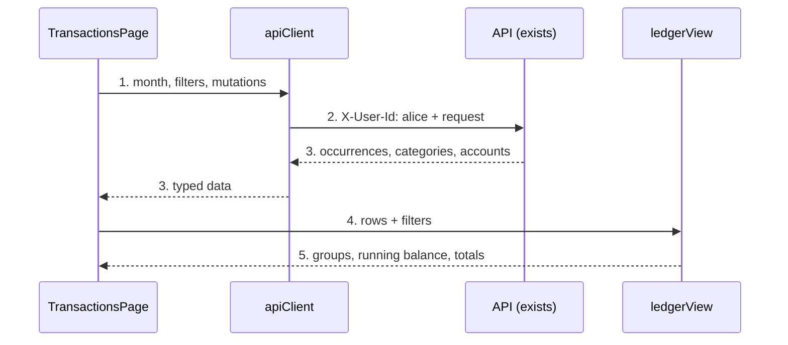
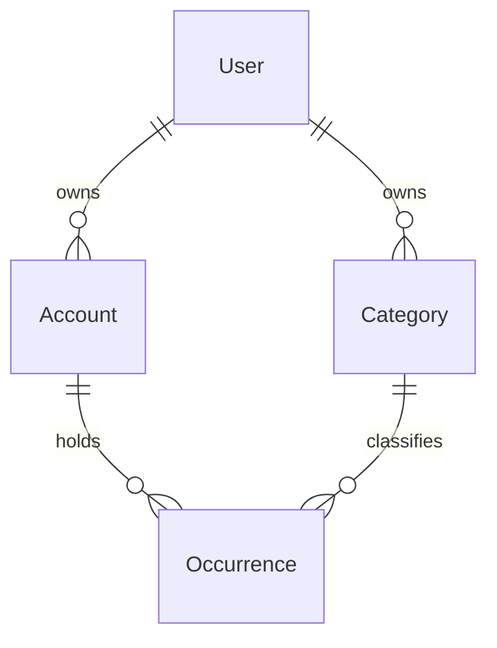
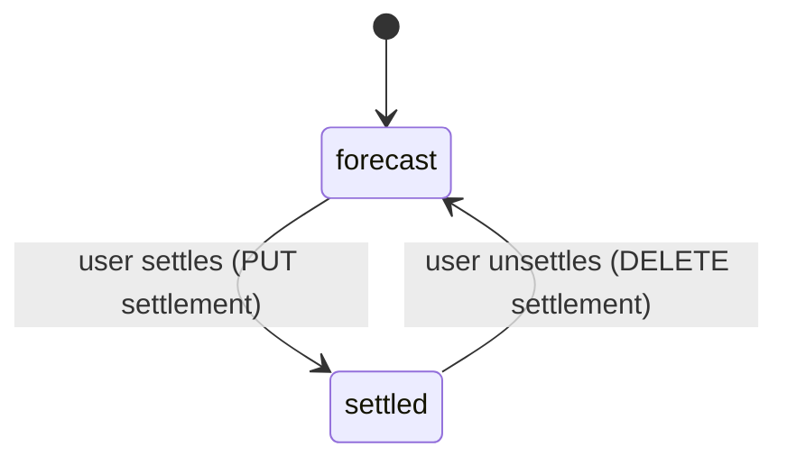

# Web Transactions Page

**Approved**: <pending - written only when the user approves>

## Problem

Today the only screen in `apps/web` is the temporary health page. Categories, accounts and transactions exist only behind the API, so a person can record or review an expense only by crafting HTTP requests. The request gives no usage evidence beyond the functional description in `.prompts/front-end-creation-prompt.md`; no PRD exists for this layer.

When this ships, a person opens the site, sees their transactions for a month grouped by day with a running balance, can add a transaction, mark it settled, filter by categories and accounts, and manage categories and accounts, all without touching the API directly.

## Shape

Reuses the existing `/categories`, `/accounts` and `/transactions` routers over HTTP, and the Zod request schemas from `packages/shared` for form validation; the rules that change what a user sees (grouping, ordering, filtering, running balance, totals) are pure functions in `apps/web/src/features/transaction/`, reachable by the web project's Vitest unit tests.

1. Browser `/` -> `TransactionsPage` (new) - holds month, filters and user context; asks the three queries for data
2. `TransactionsPage` (new) -> `apiClient` (door 1) - typed `fetch`, the only place that sets `X-User-Id`
3. `apiClient` -> `GET /transactions?month=YYYY-MM`, `GET /categories`, `GET /accounts` (exist) - returns occurrences and names
4. `ledgerView` (new, pure) - filters, orders by date, groups by day, computes running balance and month totals with `decimal.js`
5. `TransactionsPage` renders list, footer, filter panels; mutations (`POST /transactions`, `PUT|DELETE .../settlement`, category and account CRUD) go back through `apiClient` and invalidate the queries

**Changes underneath**

| Front | What changes |
| --- | --- |
| domain | `Uncategorized` / `Unassigned` are view-only pseudo-entries meaning `categoryId` / `accountId` is null on an occurrence; no stored data represents them |
| stored data | nothing to migrate; no API or schema change |
| readers | `apps/web/vite.config.ts` dev proxy gains `/categories`, `/accounts`, `/transactions`; `packages/shared` (empty today) gains the API client; `main.tsx` renders the new page instead of `HealthPage` |

New: nothing - read and write through existing APIs. One-way constraints: the client's exported function names and `X-User-Id` placement (door 1).

## Surface

None - nothing consumed outside. The web page consumes existing routes only; no route is added or changed.

## Landing

| One-way door | Literal shape | Alternative rejected |
| --- | --- | --- |
| 1. Typed API client in `packages/shared` | `createApiClient({ baseUrl: '', userId })` returning `listMonth(month)`, `createTransaction(input)`, `settle(id, date, amount?)`, `unsettle(id, date)`, `listCategories()`, `createCategory/updateCategory/deleteCategory`, same for accounts; the only code that sets `X-User-Id` | per-component `fetch`: scatters the acting-user header that `docs/tech/definitions/web.md` reserves for one place and makes the later JWT swap touch every screen |

- Dependencies named in `docs/tech/definitions/web.md` (react-router, react-hook-form, `@hookform/resolvers`, decimal.js, date-fns, shadcn/ui) are already decided there; adding them is not a new decision
- Nothing else in this change is hard to reverse

## Criteria

### S1: See a month of transactions grouped by day (P1)

The Transactions page lists the selected month's occurrences grouped by day, in date order, with the page header and signed-in user.

**Acceptance Criteria**

1. WHEN the page opens THEN the system SHALL show the site title "Capital Care" and the signed-in user `alice`, sent as `X-User-Id: alice` on every API request
2. WHEN the page opens THEN the system SHALL load the current month (browser clock) from `GET /transactions?month=YYYY-MM`
3. WHILE occurrences are loading the system SHALL show a loading state; IF the request fails THEN the system SHALL show the API `detail` (or "Something went wrong" when none) with a "Try again" button that refetches
4. IF the month has no occurrences THEN the system SHALL show "No transactions this month" and still show the footer with 0.00 totals
5. WHEN occurrences exist THEN the system SHALL group them by `date`, order groups ascending, and title each group `DD/MM/YYYY - Weekday` (2026-11-16 → `16/11/2026 - Monday`)
6. WHEN a row renders THEN the system SHALL show description, account name, category name, amount with a credit/debit indication (a `receipt` shows `+`, a `debit` shows `-`), a recurring icon when `recurrence` or `instalment` is set, and a settled icon when `status` is `settled`
   - receipt 500.01 → `+500.01`; debit 100.35 → `-100.35`; `categoryId` null → "Uncategorized"; `accountId` null → "Unassigned"
7. WHEN amounts display THEN the system SHALL format them with grouping and exactly two decimals (`1399.66` → `1,399.66`; `0.5` → `0.50`), computed with `decimal.js`, never native float math

### S2: Month navigation (P1)

**Acceptance Criteria**

8. WHEN the user picks a month and year in the date filter THEN the system SHALL load that month and show only its occurrences
9. WHEN the user uses "Previous month" / "Next month" THEN the system SHALL move one month, rolling the year (2026-12 → next → 2027-01; 2027-01 → previous → 2026-12)

### S3: Running balance and monthly summary (P1)

**Acceptance Criteria**

10. WHEN a day group ends THEN the system SHALL show the available balance after that day, starting from 0.00 at the month's start (AD-003)
    - debit 100.35 and receipt 500.01 on day one → `399.66`; a later day with a debit of 400.00 → `-0.34`
11. WHEN the month list is shown THEN the system SHALL show in the footer Total Received (sum of receipts), Total Debits (sum of debits), Monthly Net Total (received minus debits) and Final Available Balance (the last group's running balance, `0.00` when empty)
12. WHEN a category or account filter is active THEN the running balance and the footer totals SHALL cover only the visible rows (AD-003)
13. WHEN the user uses "Back to top" THEN the system SHALL scroll the window to the top

### S4: Add a transaction (P1)

**Acceptance Criteria**

14. WHEN the user fills date, description, account, category, amount, type in the quick-add form and submits THEN the system SHALL `POST /transactions` and show the new occurrence in the list if its date is in the selected month
15. WHEN the user opens "More details" THEN the system SHALL offer recurrence (daily, weekly, monthly, annually) or an instalment (number and total), never both at once, and send them on submit
16. IF the form is invalid THEN the system SHALL show the message from the shared Zod request schema next to the field and send no request
    - amount `0` → "amount must be greater than zero"; description of 101 characters → "description must not exceed 100 characters"
17. IF the API answers 4xx on submit THEN the system SHALL show its `detail` and keep the typed values
18. WHEN submit succeeds THEN the system SHALL clear the form and refetch the month

### S5: Settle and unsettle (P2)

**Acceptance Criteria**

19. WHEN the user clicks the settled icon of a `forecast` occurrence THEN the system SHALL `PUT /transactions/:id/occurrences/:date/settlement` and show it settled
20. WHEN the user clicks the settled icon of a `settled` occurrence THEN the system SHALL `DELETE` the settlement and show it as forecast
21. IF the settle or unsettle request fails THEN the system SHALL show the API `detail` and leave the icon unchanged

### S6: Categories panel (P1)

**Acceptance Criteria**

22. WHEN the page opens THEN the system SHALL list "Uncategorized" first, then all categories alphabetically (AD-002: flat)
23. WHEN the user clicks one or more categories THEN the system SHALL show only occurrences whose `categoryId` is any selected one; "Uncategorized" matches `categoryId` null; clicking a selected item deselects it; none selected shows all
24. WHEN the user uses "Add category" and submits name (and optional description) THEN the system SHALL `POST /categories` and add it to the list
25. WHEN the user edits a category THEN the system SHALL `PATCH /categories/:id` and show the new name; "Uncategorized" offers no edit or delete
26. WHEN the user confirms deleting a category THEN the system SHALL `DELETE /categories/:id` and remove it; IF the API answers 409 THEN the system SHALL show its `detail` and keep the category
27. IF a category name is empty or already exists (409) THEN the system SHALL show the message and keep the dialog open

### S7: Accounts panel (P1)

**Acceptance Criteria**

28. WHEN the page opens THEN the system SHALL list "Unassigned" first, then accounts alphabetically, flat
29. WHEN the user clicks accounts THEN filtering, add, edit (`PATCH /accounts/:id`) and delete (`DELETE`) SHALL behave as criteria 23-27 for accounts, "Unassigned" matching `accountId` null with no edit or delete
30. WHEN a category filter and an account filter are both active THEN the system SHALL show only rows matching both

### S8: Look and layout (P1)

**Acceptance Criteria**

31. WHEN any screen renders THEN the system SHALL follow `docs/tech/definitions/design.md` (lime `#9fe870` primary buttons, 24px card/button radius, Inter, sage `#e8ebe6` canvas with white cards)
32. WHEN the window is under 768px wide THEN the system SHALL stack the filter panels above the list with no horizontal page scroll

## Out of scope

| Excluded | Why |
| --- | --- |
| Category hierarchy and expand/collapse | API has no parent field (AD-002) |
| Editing or deleting a transaction or stopping a recurrence | not requested; only settle/unsettle was chosen |
| Real sign-in, user switching, user profile | user is hardcoded to `alice`; no user API |
| A starting-balance or carried-over balance | no API; month opens at 0.00 (AD-003) |
| Currency symbol or multiple currencies | no currency in the API |
| New or changed API routes | prompt rule |
| Server-side SPA fallback | single page at `/` needs none |

## Assumptions

| Assumption | Chosen default | Rationale | Confirmed? |
| --- | --- | --- | --- |
| Subcategories | flat list | user chose it, AD-002 | y |
| Opening balance and scope of totals | 0.00; all occurrences; filtered rows only | user chose it, AD-003 | y |
| Row actions | settle/unsettle toggle only | user chose it | y |
| Routing | React Router with one route `/`; month and filters live in component state, not the URL | one page; `web.md` names React Router | n |
| Filter combination | OR within categories, OR within accounts, AND between the two | the usual multi-select reading | n |
| Order inside one day | the API's order is kept | no tie-break requested | n |
| Number format | `en` locale grouping, 2 decimals, no currency symbol | API holds amounts with no currency | n |
| Weekday and labels | English | repo rule: everything in English | n |
| Delete confirmation | a confirm dialog naming the item before any delete | destructive action | n |
| Uncategorized/Unassigned counts | shown always, even when no row matches | stable list | n |

**Open questions:** none - all resolved or logged above.

## Differences from the source

None - the product matches the source

## Sources

- `.prompts/front-end-creation-prompt.md` - binding - functional description of the page
- `docs/tech/definitions/design.md` - binding - visual design system (no capture files exist; layout is the builder's call held to it)
- `docs/tech/definitions/web.md` - binding - stack and folder layout
