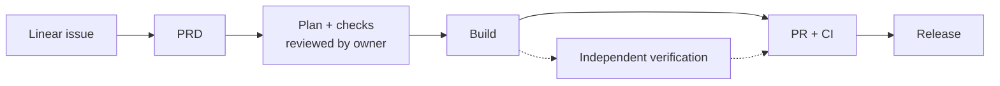

# Capital Care

[](https://github.com/tghcastro/capital-care-v2/actions/workflows/ci-cd.yml)
[](https://github.com/tghcastro/capital-care-v2/actions/workflows/codeql.yml)

A lightweight personal finance tracker for recording expenses (transactions), each classified by a category and paid from an account.

Example transaction:

| Date | Description | Amount | Category | Account |
|------|-------------|--------|----------|---------|
| 29/Oct/2026 | Best Market - Some groceries | 20.00 | Groceries | Credit Card |

## About This Project

This is a learning project: the real goal is practicing agentic development workflows, with the finance tracker itself as the vehicle.

### How it is built

One developer and AI agents (Claude Code), working through a spec-driven flow where the human makes every product decision and the agents plan, build and verify:



- **Linear** tracks the work, **Claude Code** plans and builds it, **GitHub Actions** tests and ships it, **Slack** gets the updates.
- Every feature has a PRD ([`.prd/`](.prd/)), a reviewed plan with proof-backed checks ([`.specs/features/`](.specs/features/)), and a decision log ([`.specs/STATE.md`](.specs/STATE.md)).
- Agents get context through [`AGENTS.md`](AGENTS.md) files and reusable [skills](.claude/skills/).

The full process, with one feature followed end to end, is in **[docs/workflow.md](docs/workflow.md)**.

---

## Getting Started

### Prerequisites

- **Node.js**: 24.x (LTS) — check with `node --version`
- **pnpm**: 12.21.0+ — install with `npm install -g pnpm`

### Setup

1. **Install dependencies** (one time, from the repo root):
   ```bash
   pnpm install
   ```

2. **Build the project**:
   ```bash
   npm run build
   ```
   
   This compiles TypeScript in all packages. Output goes to `dist/` directories.

---

## Running the API

### Start the server

```bash
npm run dev
```

The API starts on `http://localhost:3000`.

Health check: `curl http://localhost:3000/health`

---

## Running with Docker

The app (API + web UI, one image, one origin) runs in a container defined in a single
`docker-compose.yml`, with one Compose profile per environment. Both run pending
migrations before the server starts, and both serve the web UI at the root URL.

| Profile | Service | Host port | Database | Command |
|---------|---------|-----------|----------|---------|
| `dev` (local work, builds the image from source) | `capital-care-dev` | `3000` | In memory (`tmpfs`). Discarded when the container stops or restarts — every run starts clean. | `docker compose --profile dev up --build` |
| `prod` (pulls the published image) | `capital-care-prd` | `8000` | Named volume `capital-care-data`. Survives restarts. | `docker compose --profile prod up -d` |

- The container always listens on port 3000 internally; only the published host port
  differs. Override it with `DEV_PORT` (dev) or `PRD_PORT` (prod) if needed.
- **DEV**: web UI and API at `http://localhost:3000`. Health check: `curl http://localhost:3000/health`
- **PRD**: web UI and API at `http://localhost:8000`. Health check: `curl http://localhost:8000/health`
- Stop DEV with `docker compose --profile dev down`. No data is kept.
- Stop PRD with `docker compose --profile prod down` (data is kept). Delete PRD data with
  `docker compose --profile prod down -v`. This is irreversible.
- PRD backups are not configured yet (see [database.md](docs/tech/definitions/database.md)).

### Published images

Every push to `main` and every release tag is published to GitHub Container Registry. Pull and run a published image without building it locally:

```bash
docker pull ghcr.io/tghcastro/capital-care-v2:latest   # most recent build of main
docker pull ghcr.io/tghcastro/capital-care-v2:0.1.0    # a release (see below)

docker run -p 3000:3000 ghcr.io/tghcastro/capital-care-v2:latest
curl http://localhost:3000/health
```

- The database lives in `/app/data` inside the container. Mount a volume there to keep data after the container is removed, for example `-v capital-care-data:/app/data`.
- Pipeline details, tags and the release rules are in [ci-cd.md](docs/tech/definitions/ci-cd.md).

### Releasing

A release is a version tag on a commit that is already on `main`. Use the release script, which checks out the latest `main`, tags it and pushes the tag:

```bash
scripts/release.sh 0.1.0
```

It refuses to run with uncommitted changes, an invalid `MAJOR.MINOR.PATCH` version, or a tag that already exists. The manual equivalent is:

```bash
git switch main && git pull
git tag v0.1.0
git push origin v0.1.0
```

The pipeline publishes `0.1.0`, `0.1` and `sha-<short-sha>`. It does not move `latest`. A tag whose commit is not on `main` fails before anything is published.

### Database migrations

```bash
pnpm build          # compiles TypeScript and copies SQL migrations into dist/
pnpm db:migrate     # applies pending migrations to DB_PATH (default ./data/capital-care.db)
pnpm db:generate    # after changing a schema: generates a new SQL migration
```

---

## Testing Manually

### API Collection (Bruno)

The API requests live in a [Bruno](https://www.usebruno.com) collection (open-source API client, plain-text `.bru` files) at [tools/bruno/capital-care](tools/bruno/capital-care).

- **Open it:** in Bruno, choose *Open Collection* and select `tools/bruno/capital-care`.
- **Pick an environment** (top-right in Bruno):
  - `DEV`: `baseUrl` `http://localhost:3000`
  - `PRD`: `baseUrl` `http://localhost:8000`
  - `userId` is the user sent in the `X-User-Id` header (every request). `otherUserId` is a second user, used to check that one user cannot read another user's data.
- **Run from the CLI** (optional): `npm i -g @usebruno/cli`, then `cd tools/bruno/capital-care && bru run --env DEV -r`. Start the API first (see [Running the API](#running-the-api) or [Running with Docker](#running-with-docker)).
- **Accounts folder:** `Accounts/` mirrors `Categories/`. Its last error request fills `otherUserId`'s accounts up to the account limit (`ACCOUNT_LIMIT`: 5 in DEV, 99 in PRD) and checks that the next create is refused, then deletes everything it created.
- **Transactions folder:** `Transactions/` creates its own category and account, then walks a monthly, a one-off and an instalment transaction through create, month view, edit, settle, undo settlement and stop, and removes everything it created. Its `Errors/` folder covers the 4xx responses (invalid fields, unknown category, another user's transaction, settling twice).
- **Add requests:** create a `.bru` file in the matching folder (or use *New Request* in Bruno), then commit it with the code. Keep names unique per run (for example with `{{$timestamp}}`), and delete any data the request creates, because PRD data persists.

### API Usage Example

The full API reference — every endpoint, request/response shapes, and error cases — lives
in the Bruno collection above ([tools/bruno/capital-care](tools/bruno/capital-care)). Here
is one example, creating a category, to get started:

```bash
curl -X POST http://localhost:3000/categories \
  -H "Content-Type: application/json" \
  -H "X-User-Id: user-123" \
  -d '{"name": "Groceries", "description": "Food and household items"}'
```

**Expected response** (201 Created):
```json
{
  "id": "550e8400-e29b-41d4-a716-446655440000",
  "userId": "user-123",
  "name": "Groceries",
  "description": "Food and household items",
  "createdAt": "2026-11-06T13:45:30.123Z",
  "updatedAt": "2026-11-06T13:45:30.123Z"
}
```

---

## Running Tests

### Unit tests (if pnpm cache is healthy)

```bash
npm test
```

Tests are located in `modules/ledger/src/category/__test__/` and cover:
- Create (7 tests)
- Uniqueness (1 test)
- List & sort (3 tests)
- Update (4 tests)
- Delete (2 tests)

### Build & type check

```bash
npm run build        # TypeScript compilation
npm run type-check   # Type checking only (no emit)
npm run lint         # ESLint (if setup complete)
```

---

## Project Structure

```
capital-care/
  apps/api/                    # Express API app
    src/app.ts                 # Composition root, mounts routers
  modules/ledger/              # Category, transaction, account logic
    src/
      category/                # Category aggregate (C R U D)
        category.controller.ts # HTTP handlers
        category.service.ts    # Business logic
        category.repository.ts # DB access
        category.entity.ts     # Drizzle table
        __test__/              # Unit tests
      shared/                  # DB client, error types
  packages/shared/             # Shared types, Zod schemas (future)
  tools/bruno/capital-care/    # Bruno API collection (DEV/PRD environments)
  docs/tech/definitions/       # Architecture decisions (read for context)
```

---

## Contributing / AI Agent Context

If you're an AI agent working in this repo, start at [AGENTS.md](AGENTS.md) instead of this file.
