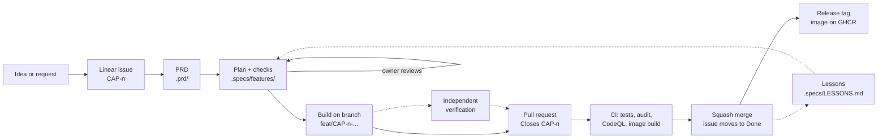

# How Capital Care Is Built

Capital Care is a personal finance tracker, but the real product is the **process**: a solo developer working with AI agents (Claude Code) through a repeatable, documented, reviewable workflow. This page explains that workflow and follows one feature through it from start to finish.

## Principles

1. **The human decides, the agent builds.** Every product decision (scope, trade-offs, business rules) is made and approved by the owner. Agents propose, ask, and implement.
2. **Written before built.** No feature starts without a PRD (the *what* and *why*) and a reviewed plan (the *how*, with testable criteria).
3. **Proof over trust.** Each acceptance criterion has a check that proves it, and an independent verifier, not the agent that wrote the code, confirms the result.
4. **Context is engineered.** Agents get only the documents relevant to their task (progressive disclosure through `AGENTS.md` files), not the whole repository.
5. **Everything is traceable.** Request, issue, PRD, plan, decision, PR and release are linked to each other.

## Tools and Their Roles

| Tool | Role |
|---|---|
| **Linear** | Source of truth for work. One issue per feature, labelled by `Type` and `Area`, with blocking links that show the build order. |
| **Claude Code** | Plans and builds features, opens pull requests, runs on the web, so several features can move forward in parallel. |
| **GitHub** | Code, pull requests (squash merge), CI/CD with GitHub Actions, CodeQL, Dependabot, container images on GHCR. |
| **Slack** | `#capital-care` receives updates and a weekly summary that a scheduled Claude task writes from Linear and GitHub. |

## The Flow

### 1. Request and issue

A feature starts as a request. Requests written as prompts are kept in [`.prompts/`](../.prompts/), a public record of what was asked of the agents. Each piece of work becomes a Linear issue (`CAP-n`) with the problem, the scope and the key behaviors, plus an "Agent notes" section with details for the agents.

### 2. PRD: the *what* and *why*

The [`tlc-prd`](../.claude/skills/tlc-prd/) skill interviews the owner and writes a Product Requirements Document in [`.prd/`](../.prd/): situation, problem, how success is measured, what is in and out of scope, and the user journey. It stops before any technical design. The owner confirms it before work moves on.

### 3. Plan and checks: the *how*

The [`tlc-spec-lean`](../.claude/skills/tlc-spec-lean/) skill turns the PRD into a single plan in [`.specs/features/<feature>/`](../.specs/features/):

- **`plan.md`**: acceptance criteria in [EARS](https://alistairmavin.com/ears/) format, entities, interfaces, and "one-way doors" (decisions that are expensive to undo). **The owner reviews and approves this plan. It is the main checkpoint where the human steers.**
- **`checks.md`**: for every criterion, the test or step that proves it, written *before* the code.
- **`verification.md`**: written after the build by a verifier that did not write the code. It reports which criteria pass, which fail, and why.

Decisions taken along the way are recorded in [`.specs/STATE.md`](../.specs/STATE.md) with the question asked, the option chosen, and the owner's words. Stack-level decisions live in [`docs/tech/definitions/`](tech/definitions/), and the most significant ones are written up as [Architecture Decision Records](adr/README.md).

### 4. Build, review, ship

The agent works on a branch named after the issue, follows [Conventional Commits](https://www.conventionalcommits.org/) and opens a PR from the [template](../.github/PULL_REQUEST_TEMPLATE.md) with `Closes CAP-n`. The Linear GitHub integration moves the issue as the PR opens and merges. CI runs tests, a dependency audit and CodeQL, builds the Docker image, and publishes it to GHCR. Conventions are in [`git.md`](tech/definitions/git.md) and [`ci-cd.md`](tech/definitions/ci-cd.md).

### 5. Learn

Verification findings become **lessons** in [`.specs/LESSONS.md`](../.specs/LESSONS.md), maintained by a script. A lesson starts as a *candidate* and is promoted to guidance for future plans only after it shows up in two different features, so one-off mistakes do not turn into rules.

## Worked Example: Monthly Balance

The first transactions page reset every balance to 0.00 at the start of each month, so the "Final available balance" was really just that month's net total.

| Step | Artifact | What happened |
|---|---|---|
| PRD | [`.prd/monthly-balance.md`](../.prd/monthly-balance.md) | Problem framed as "the owner has to add up previous months themselves". Success defined as reading real money from the month's balance. Confirmed by the owner on 2026-11-17. |
| Plan review | [`.specs/features/monthly-balance/plan.md`](../.specs/features/monthly-balance/plan.md) | Reviewing the plan, the owner rejected putting balance logic in the web client: *"all business logic should be kept on API"*. This became decision **AD-006** and replaced an earlier client-side approach (**AD-003 → AD-005**). |
| Scope control | [`.specs/STATE.md`](../.specs/STATE.md) | A proposed change to how settling recurring transactions works (**AD-007**) was **withdrawn** and deferred to its own future PRD, which kept the feature small. |
| Checks and verification | [`checks.md`](../.specs/features/monthly-balance/checks.md), [`verification.md`](../.specs/features/monthly-balance/verification.md) | Each criterion has a proof, and an independent pass verified it. |
| Ship | [PR #31](https://github.com/tghcastro/capital-care-v2/pull/31) `feat: carry monthly balances over between months` | Squash-merged, CI green, image published. |

The result, with the balance carried over from October into November:

## The Agent Harness

What keeps agents consistent is a small set of files, not a long prompt:

- [`AGENTS.md`](../AGENTS.md): entry point with project rules, work tracking, and where to look next.
- [`docs/tech/AGENTS.md`](tech/AGENTS.md): an index that tells agents which technical definition to read for which task (an API endpoint, a web feature, a PR...).
- [`.claude/skills/`](../.claude/skills/): reusable skills for PRDs, specs, ADRs, RFCs and auditing the harness itself (`harness-eval`).

The spec and PRD skills are adapted from [Tech Leads Club](https://github.com/tech-leads-club).

## What I Learned

- **Reviewing the plan pays off more than reviewing the code.** The decisions that mattered most (AD-006, withdrawing AD-007) were made while reading a plan, before any code existed.
- **Agents test the happy path in-memory.** Most lesson candidates so far are "prove it against the real database" and "test the edge input" (blank headers, Unicode names, tie-break order). Writing checks before the code is what catches these.
- **Small, explicit context beats big context.** Telling an agent *which* file to read for a task works better than giving it every document.
