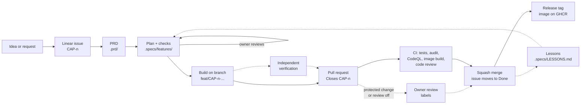
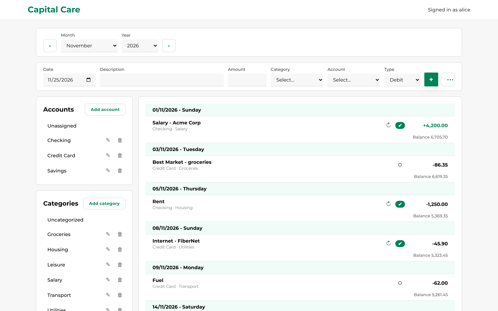

# How Capital Care Is Built

Capital Care is a personal finance tracker, but the real product is the **process**: a solo developer working with AI agents (Claude Code) through a repeatable, documented, reviewable workflow. This page explains that workflow and follows one feature through it from start to finish.

## Principles

1. **The human decides, the agent builds.** Every product decision (scope, trade-offs, business rules) is made and approved by the owner. Agents propose, ask, and implement.
2. **Written before built.** No feature starts without a PRD (the *what* and *why*) and a reviewed plan (the *how*, with testable criteria).
3. **Proof over trust.** Each acceptance criterion has a check that proves it, and an independent verifier, not the agent that wrote the code, confirms the result.
4. **Context is engineered.** Agents get only the documents relevant to their task (progressive disclosure through `AGENTS.md` files), not the whole repository.
5. **Everything is traceable.** Request, issue, PRD, plan, decision, PR and release are linked to each other.

## Tools and Their Roles

| Tool | Role |
|---|---|
| **Linear** | Source of truth for work. One issue per feature, labelled by `Type` and `Area`, with blocking links that show the build order. |
| **Claude Code** | Plans and builds features, opens pull requests, runs on the web, so several features can move forward in parallel. |
| **GitHub** | Code, pull requests (squash merge), CI/CD with GitHub Actions, CodeQL, Dependabot, container images on GHCR. |
| **Slack** | `#capital-care` receives updates, a weekly summary that a scheduled Claude task writes from Linear and GitHub, and an immediate message when an agent [stops and needs the owner](#stop-conditions-and-owner-notification). |

## The Flow



### 1. Request and issue

A feature starts as a request. Requests written as prompts are kept in [`.prompts/`](../.prompts/), a public record of what was asked of the agents. Each piece of work becomes a Linear issue (`CAP-n`) with the problem, the scope and the key behaviors, plus an "Agent notes" section with details for the agents.

### 2. PRD: the *what* and *why*

The [`tlc-prd`](../.claude/skills/tlc-prd/) skill interviews the owner and writes a Product Requirements Document in [`.prd/`](../.prd/): situation, problem, how success is measured, what is in and out of scope, and the user journey. It stops before any technical design. The owner confirms it before work moves on.

### 3. Plan and checks: the *how*

The [`tlc-spec-lean`](../.claude/skills/tlc-spec-lean/) skill turns the PRD into a single plan in [`.specs/features/<feature>/`](../.specs/features/):

- **`plan.md`**: acceptance criteria in [EARS](https://alistairmavin.com/ears/) format, entities, interfaces, and "one-way doors" (decisions that are expensive to undo). **The owner reviews and approves this plan. It is the main checkpoint where the human steers.**
- **`checks.md`**: for every criterion, the test or step that proves it, written *before* the code.
- **`verification.md`**: written after the build by a verifier that did not write the code. It reports which criteria pass, which fail, and why.

Decisions taken along the way are recorded in [`.specs/STATE.md`](../.specs/STATE.md) with the question asked, the option chosen, and the owner's words. Stack-level decisions live in [`docs/tech/definitions/`](tech/definitions/), and the most significant ones are written up as [Architecture Decision Records](adr/README.md).

### Approval policy

Decided in [ADR-004](adr/004-plan-auto-approval-policy.md). The agent approves a plan itself only under **AP-1**; in every other case it stops and notifies the owner.

**AP-1: auto-approve a plan** when all of these hold:

1. The PRD it implements is confirmed by the owner.
2. The plan has no one-way door.
3. The plan has no open question.
4. The plan does not differ from the PRD: no scope added or removed, no new decision for `.specs/STATE.md`, no entry in `## Differences from the source`.

**Stop and notify the owner** if any condition fails, or if the agent is unsure. Doubt counts as failure. What "stop and notify" means, step by step, is defined in [Stop conditions and owner notification](#stop-conditions-and-owner-notification).

**Record.** An auto-approval is written in `plan.md` as `**Approved**: <date> - policy: AP-1 - <which conditions were checked>`, never as the owner's words. The owner's own approval keeps `user: "<their words>"`.

**What the PRD approval authorizes.** Local edits and commits, pushing the feature branch, opening the pull request, and merging it once every required check and the independent verifier pass. The required checks include `code-review` and `human-approval`, so a PR with a protected change, or opened while the automated review is off, merges only after the owner's label ([operations/code-review.md](operations/code-review.md)). It never authorizes a release, a deploy or a production data change: those need an explicit go-ahead for that action.

The skill change is a documented fork, see [`FORK.md`](../.claude/skills/tlc-spec-lean/FORK.md).

### Stop conditions and owner notification

Decided in [ADR-005](adr/005-agent-stop-and-notify-policy.md). An agent that works alone must never stay silently blocked. These rules are written so that an orchestrator agent (the "ship CAP-n" skill) can apply them without judgment calls. `n` below is the issue number.

**Stop conditions.** The agent stops as soon as **any one** holds. Doubt counts as holding.

| Code | Condition | Detected when |
|---|---|---|
| SC-1 | One-way door | A plan has a one-way door (a decision expensive to undo), or the build is about to create one that the plan does not list. |
| SC-2 | Open question | The plan, the PRD or the issue leaves a question that needs the owner's answer. |
| SC-3 | Deviation | The plan differs from the PRD (any AP-1 condition 1 or 4 fails). |
| SC-4 | Fix attempts exhausted | The same check or test is still red after `fix_attempts` fix attempts. A fix attempt is one code change followed by one re-run of that check. |
| SC-5 | Time limit | Wall time since the run started reaches `wall_time`. |
| SC-6 | Cost limit | Cost of the run reaches `cost_usd`. |
| SC-7 | Blocked by access | A permission, credential, tool or network host is missing or denied, and the agent cannot continue without it. |
| SC-8 | Action beyond authority | The next step is a release, a deploy, a production data change, or changing a check only to make it pass. |
| SC-9 | Waiting for a human gate | `human-approval` fails because the PR makes a protected change, or `code-review` fails because the automated review is off or did not finish. See [operations/code-review.md](operations/code-review.md). |

SC-1 to SC-3 are the AP-1 failures, named so the notification can cite them. A stop caused by SC-4 never ends with the agent weakening, skipping or deleting the red test. A stop caused by SC-9 never ends with the agent adding `owner-approved` or `review-override`: only the owner adds them ([ADR-006](adr/006-human-approval-and-review-gates.md)). A blocking finding from `code-review` is not SC-9: the agent fixes it like a red check (SC-4 limits apply), and stops with SC-2 if it believes the finding is wrong.

**Limits.** A limit is a number the run checks; reaching it is a stop, not a warning.

| Limit | Key | Default |
|---|---|---|
| Failed fix attempts per check | `fix_attempts` | 2 |
| Wall time per feature | `wall_time` | 1h |
| Cost per feature | `cost_usd` | 5 |

- **Defaults live here**, in this table, and nowhere else.
- **Override per feature** with one line, in this order of precedence: the `**Limits**:` line in the feature's `plan.md`, then a `Limits:` line in the issue's "Agent notes". Anything not named keeps its default. Format: `**Limits**: fix_attempts=3 wall_time=2h cost_usd=10`. Only the owner sets or raises a limit; an agent never raises its own.
- **When they are checked.** Before each phase starts (plan, checks, build, verify, pull request) and after every failed test run. The clock starts at the first action on the issue. If the cost cannot be measured in the current environment, the agent says so in its first Linear comment or final report and enforces the other limits; it does not guess a number.

**When the agent stops**, in this order, and before any other work:

1. **Linear comment** on the issue, using the template below.
2. **Slack message** in `#capital-care`, using the template below. This is a documented exception to "do not post there unless the user asks", see the root [`AGENTS.md`](../AGENTS.md). It is the only Slack post an agent makes on its own; it applies to stops only.
3. **Leave the work as it is.** Do not discard changes. Commit finished work and push the feature branch (already authorized by the PRD approval). Do not open or merge a pull request, and do not change the issue status. For SC-9 the pull request already exists: leave it open and put its link in both messages.
4. **End the run.** Do not wait, poll or retry. The owner's reply in Linear or in the session is what resumes it.

If one of the two posts fails, still post the other, then end the run with the same text as the final message. Post once per stop: no repeats for the same stop. Never put secrets, tokens or personal data in either message.

**Linear comment template**

```
Agent stopped on CAP-<n>

Why: <SC-code> <condition name> - <one sentence, with the check or number that triggered it>
Needed from you: <one decision or action, phrased so a short reply settles it>
State: branch <name>, <last commit or "no commits">, <what is done and what is not>
Limits: fix attempts <used>/<max>, wall time <used>/<max>, cost <used>/<max or "not measured">
```

**Slack message template** (one line, so it reads in a channel):

```
:octagonal_sign: CAP-<n> stopped (<SC-code> <condition name>): <why in one sentence>. Needed: <decision or action>. <link to the Linear issue>
```

Both messages carry the issue code, the reason and the decision or action needed. That is what makes a stop answerable within minutes.

### 4. Build, review, ship

The agent works on a branch named after the issue, follows [Conventional Commits](https://www.conventionalcommits.org/) and opens a PR from the [template](../.github/PULL_REQUEST_TEMPLATE.md) with `Closes CAP-n`. The Linear GitHub integration moves the issue as the PR opens and merges. CI runs tests, a dependency audit and CodeQL, builds the Docker image, and publishes it to GHCR. An AI reviewer (`code-review`) checks the code against the definitions and ADRs, and a fixed-rule gate (`human-approval`) holds protected changes (definitions, guardrails, new libraries, base images) for the owner. How to read, clear, enable and disable them: [operations/code-review.md](operations/code-review.md). Conventions are in [`git.md`](tech/definitions/git.md) and [`ci-cd.md`](tech/definitions/ci-cd.md).

### 5. Learn

Verification findings become **lessons** in [`.specs/LESSONS.md`](../.specs/LESSONS.md), maintained by a script. A lesson starts as a *candidate* and is promoted to guidance for future plans only after it shows up in two different features, so one-off mistakes do not turn into rules.

## Acceptance Tests

> **Status: just started.** The repository is set up; the first tests are not written yet.

The tests in this repository (unit, integration, component, E2E) know the code. Acceptance tests do not: they live in a separate repository, **[capital-care-tests](https://github.com/tghcastro/capital-care-tests)**, and treat Capital Care as a product someone else built.

- **What they test:** the released product, i.e. the published container image `ghcr.io/tghcastro/capital-care-v2:latest`, started with a clean database for every run, through its HTTP API and the web UI. No access to the source code or the database.
- **Where the test cases come from:** the EARS acceptance criteria in each feature's `plan.md`. The same criteria are then proven twice: from the inside by the tests here, and from the outside by the acceptance suites.
- **A playground of test tools:** each tool gets its own folder, organised by language (`<language>/<tool>/`), all pointed at the same app so they are easy to compare. The first is **Playwright with TypeScript**; other languages and frameworks will follow.
- **Why a separate repository:** it keeps the tests honest (they can only use public interfaces), and it is room to learn new tools on a real product, which is one of this project's goals.

The test levels kept in this repository are defined in [`testing.md`](tech/definitions/testing.md#test-levels-test-pyramid).

## Worked Example: Monthly Balance

The first transactions page reset every balance to 0.00 at the start of each month, so the "Final available balance" was really just that month's net total.

| Step | Artifact | What happened |
|---|---|---|
| PRD | [`.prd/monthly-balance.md`](../.prd/monthly-balance.md) | Problem framed as "the owner has to add up previous months themselves". Success defined as reading real money from the month's balance. Confirmed by the owner on 2026-11-17. |
| Plan review | [`.specs/features/monthly-balance/plan.md`](../.specs/features/monthly-balance/plan.md) | Reviewing the plan, the owner rejected putting balance logic in the web client: *"all business logic should be kept on API"*. This became decision **AD-006** and replaced an earlier client-side approach (**AD-003 → AD-005**). |
| Scope control | [`.specs/STATE.md`](../.specs/STATE.md) | A proposed change to how settling recurring transactions works (**AD-007**) was **withdrawn** and deferred to its own future PRD, which kept the feature small. |
| Checks and verification | [`checks.md`](../.specs/features/monthly-balance/checks.md), [`verification.md`](../.specs/features/monthly-balance/verification.md) | Each criterion has a proof, and an independent pass verified it. |
| Ship | [PR #31](https://github.com/tghcastro/capital-care-v2/pull/31) `feat: carry monthly balances over between months` | Squash-merged, CI green, image published. |

The result, with the balance carried over from October into November:



## The Agent Harness

What keeps agents consistent is a small set of files, not a long prompt:

- [`AGENTS.md`](../AGENTS.md): entry point with project rules, work tracking, and where to look next.
- [`docs/tech/AGENTS.md`](tech/AGENTS.md): an index that tells agents which technical definition to read for which task (an API endpoint, a web feature, a PR...).
- [`.claude/skills/`](../.claude/skills/): reusable skills for PRDs, specs, ADRs, RFCs and auditing the harness itself (`harness-eval`).

All five skills (`tlc-prd`, `tlc-spec-lean`, `create-adr`, `create-rfc`, `harness-eval`) are used as published by [Tech Leads Club](https://github.com/tech-leads-club), under the CC-BY-4.0 license. The only change is a small, documented fork of `tlc-spec-lean` for the [approval policy](#approval-policy); the work here is in how they are combined into a workflow.

## What I Learned

- **Reviewing the plan pays off more than reviewing the code.** The decisions that mattered most (AD-006, withdrawing AD-007) were made while reading a plan, before any code existed.
- **Agents test the happy path in-memory.** Most lesson candidates so far are "prove it against the real database" and "test the edge input" (blank headers, Unicode names, tie-break order). Writing checks before the code is what catches these.
- **Small, explicit context beats big context.** Telling an agent *which* file to read for a task works better than giving it every document.
